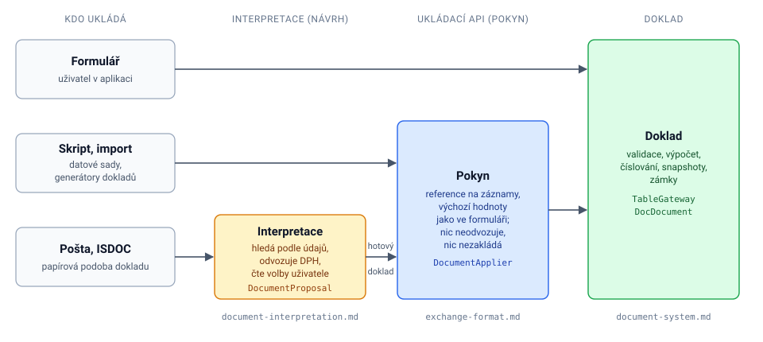

# Shipard — Interpretace dokladu (návrh)

Jak se z **papírové podoby** dokladu — PDF z pošty přečtené AI, ISDOC —
stane doklad, který jde uložit. Interpretace je vrstva **před** ukládacím
API: hledá záznamy podle údajů, odvozuje DPH a čte volby uživatele. Jejím
výstupem je **hotový doklad**, který uloží pokyn jako každý jiný.

Dokumentace ukládání dokladů je rozdělená po vrstvách (#166 D56):

| Vrstva | Dokument | Co tam je |
|---|---|---|
| doklad | [document-system.md](document-system.md) (výchozí hodnoty § 12c), [vat-calculation.md](vat-calculation.md) | pole, výchozí hodnoty, validace, výpočet, číslování |
| formát a ukládací API (pokyn) | [exchange-format.md](exchange-format.md) | pole formátu, reference, chybějící × `null`, importní mód, idempotence, REST, návod „Doklad skriptem“, kódy nálezů pokynu |
| interpretace (návrh) | tento dokument | hledání podle údajů, pravidla DPH přijatých dokladů, volby uživatele, zakládání, učení, heuristiky, kódy nálezů návrhu, `/interpret` |

Kdo píše skript nebo import, tento dokument nepotřebuje — posílá pokyn
a o čtení papírového dokladu nemusí vědět nic.

## 1. Místo v modelu



- **Formulář** ukládá doklad přímo (`TableGateway` → `DocDocument`).
- **Pokyn** (`DocumentApplier`) — skript, import, datové sady, generátory
  dokladů. Volající ví, co chce uložit; nic se neodvozuje a nic nezakládá.
- **Návrh** (`Interpret\DocumentProposal`) — pošta a ISDOC. Cesta je
  *interpretace → založení chybějících záznamů → pokyn → učení*.

Schéma je jedno (`shpd.docs.document.v1`, `docs/exchange-format.md` § 5);
liší se **vstupní třída**, ne parametr volání. `DocumentApplier` pravidla
interpretace nevolá a nezná (#166 D62) — **nové odvození patří jen do tříd
`Document\Interpret\`**, ne do applieru.

**Kdo interpretaci volá:**

| Volající | Vstup |
|---|---|
| pošta — náhled návrhu (`AnalysisController::previewMessage`) | `DocumentProposal::preview()` |
| pošta — použití návrhu (`MessageProposalApplier`, MCP `mail_draft_document`) | `DocumentProposal::apply()`; `applyOptions` skládá server, `interpret` z payloadu se nečte |
| ISDOC z přílohy zprávy | jako pošta — čtečka `IsdocReader` dá papírovou podobu se `source.kind: "isdoc"` (`docs/exchange-format.md` § 4 „Adaptéry“) |
| `dataset-verify` | použití návrhů sady (`Dataset/Verify/ProposalApplyStep`) |
| REST `/_exchange/docs/document/*` s `applyOptions.interpret: true` | návrh místo pokynu (§ 12) |
| REST `/_exchange/docs/document/interpret` | hotový doklad a zpráva bez uložení (§ 12) |

## 2. Vstup — papírová podoba a volby

Vstupem je payload téhož formátu jako pokyn, ale v **papírové podobě** —
tak, jak doklad přečetla AI nebo čtečka ISDOC:

- **strany a položky údaji** (název, IČO, DIČ, kód dodavatele, EAN) místo
  referencí — hledá je § 5. Uvedený `ref` má přednost a hledání se
  přeskočí; nenalezený `ref` je chyba i tady;
- **signály DPH** místo hotových hodnot — `vat.pct` řádku,
  `vat.reverseCharge`, `vat.supplyKind`, `vat.place` a `vat.mode`, jak je
  uvádí předloha (§ 6);
- **`vatRecap` a `totals` z předlohy** — rekapitulaci jde převzít (§ 6.8),
  `totals` jsou signál pro kontroly (§ 10), nikdy kontrolní součet;
- **volby uživatele** v bloku `_resolve` (`userAction`, § 7);
- **`applyOptions.autoCreateMode`** — co se smí založit bez rozhodnutí
  uživatele (§ 8);
- ostatní místa referencí (řada, pokladna, vlastní účet, dimenze,
  registrace DPH, původní doklad opravy, `partner` a `rows[].partner`) bere
  návrh **stejně jako pokyn** — `docs/exchange-format.md` § 5 „Reference na
  záznamy“.

`applyOptions.importNumber` je v návrhu chyba
`import_requires_instruction` — import přenáší hotový doklad a jde jen
pokynem (`docs/exchange-format.md` § 10 „Importní mód“).

**Papírová podoba má vlastní schéma (#166 D63–D65).** Výstup modelu při
analýze pošty se validuje proti **projekci** schématu dokladu, ne proti
plnému schématu. Projekci odvozuje kód (`Schema\PaperSchema`,
core.exchange) z jediného `shpd.docs.document.v1`: vynechá všechno, co
papírový doklad nenese — reference na záznamy, pole určená skriptům
a generátorům, volby uložení. Co to je, říká značka `x-paper` přímo ve
schématu (`docs/exchange-format.md` § 5 „Papírová podoba — značka
`x-paper`“); strana a položka řádku jsou v projekci jen objekt s údaji,
jednotka jen text a účet řádku holé číslo. Signály D39 (níže) v ní
zůstávají.

- Projekci nese `output_schema` profilu pošty (větev dokladu). Pole mimo
  ni ve výstupu modelu — `supplier.ref`, `numberSeries`, `applyOptions`,
  `_resolve` … — je `schema_error` celé analýzy (`OutputParser`); do
  interpretace, kde má reference přednost před hledáním (§ 5), se
  vymyšlená reference nedostane.
- Model schéma nedostává — řídí se ukázkou v promptu, která klíče mimo
  ukázku zakazuje. Projekce je brána na jeho výstupu.
- Projekcí se validuje **jen výstup modelu**. Uložený návrh (reference
  z obohacení řádků, `_resolve` s volbami uživatele), náhled, hotový doklad
  i ISDOC z přílohy jdou dál plným schématem.
- Pojistka zůstává: `source.ref` a `supplier.bankAccount.ref` server
  z návrhu z pošty zahazuje i tak (náhled zprávy přes REST, návrhy uložené
  před projekcí).
- Schéma profilu se na existující zdroje dat dostane jen s novou verzí
  promptu (`ds-upgrade` synchronizuje profil podle `prompt_version`) —
  změnu projekce bez nové verze nepustí `ProfileSchemaDriftTest` (D65).

**Dočasné signály návrhu (D39).** Uložené návrhy z pošty nesou tři pole
starým tvarem: `rows[].item.ourCode`, účet řádku holým číslem
(`"518100"`) a `vat.registrationCountry`. Ve schématu zůstávají jako
**signály platné jen v návrhu**; pokyn je odmítá chybou `signal_not_allowed`
s radou, které pole použít (tiché ignorování by uložilo jiný doklad, než
jaký odesílatel zamýšlel). Je to přechodný stav — po převodu uložených
návrhů pole zmizí. Obohacení řádků z historie už píše reference (`item.ref`,
účet `"@číslo"`), starý tvar čte dál.

## 3. Výstup — hotový doklad, zpráva, záznamy k založení

Kód, který „přemýšlí“ nad papírovou podobou dokladu — hledání podle údajů,
odvozování DPH, volby uživatele —, žije ve jmenném prostoru
`Document\Interpret\`. `DocumentApplier` ho nevolá a nezná (D62). Co čtou
obě strany, drží sdílená vrstva v `Document\` (`PayloadContext`,
`PayloadResolve`, `SourceRefLookup` — `docs/exchange-format.md` § 3).

| Třída | Co rozhoduje |
|---|---|
| `VatInterpretation` | kontext DPH návrhu: místo plnění z DIČ, druh plnění ze štítků, kód DPH řádku, doklad neplátce a mimo české DPH, režim ověřený proti číslům, ceny řádků s daní dodavatele, volby DPH z `_resolve` (§ 6) |
| `RecapInterpretation` | převzít, nebo přepočítat rekapitulaci |
| `RoundingInterpretation` | automatika a odhad módu zaokrouhlení |
| `RecordMatching` | strany a položky podle údajů, účet partnera, účet holým číslem, jednotka aliasem; rozhodnutí nad volbami uživatele a `autoCreateMode` |
| `PendingRecords`, `SupplierCodeLearning` | zakládání chybějících záznamů a učení dodavatelských kódů — **zapisují**, proto stojí mimo samotnou interpretaci |
| `ProposalDefaults` | pohyb řádku podle typu položky, výchozí způsob úhrady |
| `ProposalReport` | bloky náhledu návrhu navíc k resolve, `computed_total_mismatch` |
| `PaperChecks` | povinná pole předlohy a heuristiky nad čísly; `validate()` je prokládá kontrolami payloadu z `DocumentValidator` (pokladna vázaného typu, `applyOptions`, `source.ref`, dimenze, tvary hodnot) |
| `DocumentProposal` | **vstup návrhu** — skládá kroky a odpověď (níž) |

**`DocumentInterpreter::interpret(array $canonical): InterpretedDocument`**
čte databázi a nic nezapisuje. Z papírové podoby a voleb uživatele udělá:

- `document` — **hotový doklad**, payload platný jako pokyn;
- `report` — bloky `_resolve` návrhu (strany, řádky, DPH, oprava,
  `valueRepairs`, souhrn) a nálezy; cesty míří do původního payloadu;
- `pending` — osoby, položky a účet partnera, které je před uložením
  potřeba založit, s daty k založení a s cestou v hotovém dokladu, kam
  přijde reference (`InterpretedDocument::withCreated()` ji doplní);
- `rowMap` — index řádku hotového dokladu → index původního (vynechané
  řádky v hotovém dokladu nejsou);
- `learn` — dodavatelské kódy položek k naučení po uložení;
- `decisionError` — reference čeká na rozhodnutí (`unresolved_required`)
  nebo volba neplatí (`conflict`); doklad v této podobě uložit nejde.

**Hotový doklad je úplný** (D52) — výchozí hodnoty pokynu se na doklad
z papíru neuplatní, pokyn nad ním vrací prázdné `_resolve.defaults`:

- každý odkaz je reference číslem (id); strana nebo položka, která se
  teprve založí, zůstává objektem s daty bez `ref`. Účet partnera nese
  `supplier.bankAccount.ref` vždy — id (shoda, volba uživatele, po založení
  z `pending`), nebo výslovné `null` = bez vazby (D61);
- `vat.mode`, `vat.place`, `vat.registration` (i `null`), `vat.recapSource`
  a u převzaté rekapitulace `vatRecap` s kódy; přepočítaná se nepředává;
- řádky nesou výslovně `vat.code`, `operation`, `description`, `unitPrice`,
  `unit` (systémovým kódem; jednotka bez něj číslem = id, D60)
  a `quantity` — hodnotu, nebo `null`; ceny jsou
  už převedené (doklad neplátce a doklad mimo české DPH: `totalPrice`
  s daní dodavatele, `priceCalcMode: fromTotal`);
- `totals` nesou jen `totalRoundingAuto` a `totalRoundingMode` — **žádné
  částky**: pokyn by je bral jako kontrolní součet a doklad z papíru
  s haléřovým rozdílem odmítl;
- `payment.method`, `payment.ownBankAccount`, `currency`
  a `dates.issueDate` výslovně, i jako `null`;
- bez signálů návrhu (`item.ourCode`, účet holým číslem,
  `vat.registrationCountry`), bez `_resolve`, bez `applyOptions.interpret`
  a `autoCreateMode`; ostatní `applyOptions` a `source` beze změny.

Formát vyjádří vše, o čem interpretace rozhoduje — meze, které našla
část 1 (jednotka bez systémového kódu, zvolený účet partnera), zavřely
D60 a D61 (`docs/exchange-format.md` § 5 „Reference na záznamy“).

**Přijatá výjimka z „chování návrhu se nemění“** (D59, rozhodnuto
2026-11-23): návrh, který zůstane v režimu Bez DPH, aniž ho interpretace
považuje za doklad neplátce nebo doklad mimo české DPH (předloha říká
`none`, ale řádky nesou daň), dřív uložil řádky s kódem DPH a řádek
rekapitulace; pokyn doklad Bez DPH ukládá bez kódů (D20, #164), takže
vznikne bez kódů a bez rekapitulace. Ve veřejných sadách se nevyskytuje.

## 4. Kroky — vstup návrhu `DocumentProposal`

**Vstup návrhu `DocumentProposal`** (D53):

- `preview()` — `interpret()` + náhled pokynu nad hotovým dokladem. Odtud
  blok `computed` (částky, které skončí na dokladu); `ProposalReport::withComputed()`
  ho vrátí do zprávy s indexy řádků původního payloadu a porovná s částkou
  z papíru (`computed_total_mismatch`). Validaci dokladu pro cílový stav
  náhled návrhu nenese — review pracuje s konceptem a chybu uložení vrátí
  až apply.
- `apply()` — v **jedné transakci** (vlastní, nebo SAVEPOINT uvnitř cizí):
  založení záznamů z `pending` (`PendingRecords`) → `DocumentApplier::apply()`
  nad hotovým dokladem s jejich referencemi → učení dodavatelských kódů
  (`SupplierCodeLearning`) → vazba zprávy pošty na doklad. Chyba
  kteréhokoli kroku vrátí vše, i založené osoby. Před transakcí: doklad,
  na který zpráva už ukazuje, a doklad se stejným `source.ref` se vracejí
  beze změny; `unresolved_required` / `conflict` a chyby v nálezech
  interpretace uložení zastaví.
- `interpret()` — hotový doklad a zpráva bez uložení (`/interpret`, § 12).
- `validate()` — schéma a kontroly předlohy.

**Odpověď návrhu** má tvar, který čte review modal pošty: papírová podoba
po normalizaci hodnot + `_resolve` (zpráva interpretace, v náhledu
`computed`) + po uložení `savedDocId`. Cesty nálezů a indexy bloků řádků
míří do **původního** payloadu; nálezy pokynu nad hotovým dokladem (cíle
uložení — pokladna, řada, vlastní účet —, chyby validace dokladu) se
převádějí přes `rowMap` a co zpráva interpretace hlásí sama, se neopakuje.
`resolve_ignored`, `_resolve.defaults` ani varování úspěšně uloženého
dokladu odpověď návrhu nenese (ta ukazuje review).

**`DocumentProposal::apply()`** krok za krokem (pošta, ISDOC, REST
s `applyOptions.interpret: true`):

```
  ├─ 0. Idempotence — bez ukládání vrátí existující doklad:
  │      - source.message už ukazuje na doklad (návrh z pošty, exchange-format.md § 12;
  │        neplatí pro výslovné replaceConcept)
  │      - živý doklad se stejným source.kind + source.ref
  │
  ├─ 1. Schema validation
  │
  ├─ 2. Interpretace (DocumentInterpreter::interpret — čte, nezapisuje):
  │      hledání záznamů podle údajů, odvození DPH, volby uživatele
  │      z `_resolve`, `autoCreateMode` → hotový doklad, zpráva, pending
  │
  ├─ 3. Rozhodnutí chybí / neplatí → 422 unresolved_required / 409
  │      conflict; chyba v nálezech → 422 validation_failed
  │
  ├─ 4. Zámek podle source.ref (drží se přes commit celé transakce)
  │
  ├─ 5. NestedTransaction:
  │      5a. znovu dohledání podle source.ref
  │      5b. založení záznamů z pending (osoby, účet dodavatele, položky)
  │      5c. pokyn nad hotovým dokladem s jejich referencemi (kroky
  │          pokynu výš, uvnitř jako SAVEPOINT); neúspěch → rollback
  │          všeho včetně založených záznamů
  │      5d. učení dodavatelských kódů (economy_items_supplier_codes)
  │      5e. vazba zprávy na doklad (core_mail_incoming_messages.target_*);
  │          verdikt analýzy a stav zprávy píše MessageProposalApplier
  │
  └─ 6. Vrátí papírovou podobu s `_resolve` (zpráva interpretace,
        založené záznamy jako matched / `matchedBy: created`) a `savedDocId`
```

Kroky pokynu uvnitř 5c popisuje `docs/exchange-format.md` § 10.

### Návrh vedle pokynu

Co se s payloadem děje ve vstupu návrhu a co v pokynu. Návrh pokyn na
konci volá — sloupec „Návrh“ říká, co se stane **před ním** a navíc:

| Krok | Návrh | Pokyn |
|---|---|---|
| normalizace hodnot (před validací) | tvary + oprava IBAN ↔ číslo účtu | jen tvary |
| výchozí hodnoty | — (hotový doklad nese hodnoty výslovně, § 3 a § 9) | `InstructionDefaults` nad `DocHeadDefaults` / `DocRowDefaults`: co payload neuvádí, doplní se do **pracovní kopie** payloadu; zbytek pipeline běží nad ní, odpověď nese původní payload a `_resolve.defaults` (`docs/exchange-format.md` § 3) |
| kontroly payloadu | `PaperChecks::validate()`: povinná pole předlohy a heuristiky nad čísly, proložené kontrolami `DocumentValidator` | `DocumentValidator`: bez heuristik a bez povinných polí (jen `cashDesk` vázaného typu a `cashDirection`); `importNumber` povolené |
| resolve — strany, položky | `ref` má přednost, jinak hledání podle údajů (§ 5.1, § 5.2) | jen reference (`ReferenceResolver`); objekt bez `ref` s údaji = `reference_missing` (#166 D31) |
| resolve — účet řádku, jednotka | reference, nebo signál holým číslem (nenalezený = warning); jednotka i zkratkou a aliasem | jen reference (nenalezená = chyba); jednotka jen přesným systémovým kódem nebo id (`unit_not_found` = chyba) |
| resolve — účet partnera | `bankAccount.ref` má přednost, jinak hledání podle čísla mezi účty dodavatele; nenalezený jde k založení | `bankAccount.ref` (id; `null` = bez vazby), bez klíče přesná shoda čísla; nic se nezakládá |
| resolve — řada, pokladna, vlastní účet, dimenze, registrace DPH, původní doklad | reference | reference |
| resolve — kódy DPH | odvození, soulad se signály, volby uživatele (§ 6) | kód z payloadu se jen ověří |
| resolve — partner účetního a pokladního dokladu (`partner`, `rows[].partner`) | jen reference; bez pole volba `_resolve…partner` | jen reference |
| plán uložení | `RecordMatching::reconcile()` — čte `userAction` vč. vynechání řádků | `_resolve` se nečte vůbec (D32) — blok se zahodí před validací, info `resolve_ignored`; řádky se nevynechávají |
| zakládání záznamů | `PendingRecords` podle `autoCreateMode` / `userAction`, uvnitř transakce návrhu před pokynem; po uložení učení dodavatelských kódů | **žádné** — pokyn osoby, položky ani účty partnerů nezakládá; `autoCreateMode` nečte |
| hodnoty dokladu | místo, režim, registrace, rekapitulace a zaokrouhlení podle § 6, výchozí úhrada a pohyb řádku — zapsané **do hotového dokladu** (`FinishedDocument`) | `transform()`: hodnoty z payloadu (výchozí hodnoty už nese pracovní kopie); pole, které chybí i tam, je záměrně prázdné |
| po uložení (v transakci) | hotový doklad částky `totals` nenese — kontrolní součet se neuplatní | kontrolní součet `totals` proti uložené hlavičce; neshoda = rollback a `totals_check_failed` (`docs/exchange-format.md` § 5) |
| po uložení | odpověď použití návrhu varování uloženého dokladu nenese (ukazuje je review) | varování dokladu do `_resolve.issues`, `total_rounding_mode_ignored` |

## 5. Hledání záznamů podle údajů

Hledání podle údajů dělá **jen návrh** (`RecordMatching`, #166 D31, D33).
Pokyn hledá záznamy jen přes reference a nic nezakládá
(`docs/exchange-format.md` § 5 „Reference na záznamy“, § 8): stav
`canCreate` ani `ambiguous` v něm nevzniká, nenalezená reference je chyba.
I v návrhu má uvedený `ref` strany nebo položky přednost — hledání se
přeskočí a blok `_resolve` nese `matchedBy: "ref"`.

Resolver je sada nezávislých "lookuperů", které pro každou referenci v canonical
vrací jeden ze čtyř stavů:

| Status | Význam |
|--------|--------|
| `matched` | Jednoznačně napárováno, vrací konkrétní `id` |
| `ambiguous` | Víc kandidátů, vrací `candidates: [{id, name, …}]`, UI rozhoduje |
| `notFound` | Žádný match, není kandidát na vytvoření (např. neznámá `vatCode`) |
| `canCreate` | Žádný match, ale lze vytvořit z payloadu (Party, Item) |

Resolvery jsou idempotentní (čisté čtení DB). Zakládání záznamů probíhá až
při použití návrhu podle `_resolve.*.userAction` a `autoCreateMode` (§ 8).

### 5.1 Strany (`PartyResolver`)

Vstup: `Party` object + `country` hint.

Postup:

1. **`companyId` exact match** → je-li 1 výsledek, `matched`
   (`matchedBy: "companyId"`).
2. **`vatId` exact match** → analogicky (`matchedBy: "vatId"`).
3. **`taxId` exact match** → analogicky (`matchedBy: "taxId"`); `null`
   sondu přeskočí — zahraniční strana s `vatId` a bez `taxId` (#103 D115)
   se páruje přes `vatId`. Země se při párování identifikátorů nepoužívá.

   Identifikátory se před párováním **normalizují** pravidly
   `world.validations` podle země strany (`country`, jinak
   `address.country`; bez země jen obecná pravidla — ostatní pošta
   a registr tak párují beze změny) a IČO se hledá i **bez vedoucích
   nul** — data z doby před normalizací (#118 D16). V applieru je
   canonical už normalizovaný (`docs/exchange-format.md` § 10 → Normalizace
   a validace hodnot);
   resolver normalizuje znovu jako pojistku pro ostatní volající.

4. **`name` fuzzy s `country` filterem** — full-text + Levenshtein,
   `score >= threshold` → kandidáti seřazení podle score.
   - 1 kandidát se score `>= 0.95` → `matched`, `matchedBy: "name"`.
   - 1+ kandidátů 0.6 ≤ score < 0.95 → `ambiguous` se seznamem.
5. Žádný kandidát → `canCreate` s payloadem připraveným pro
   `PersonDocument::saveDocument()`.

**Self-party kratce:** `customer` (resp. `supplier`) při `selfParty == "customer"`
(`"supplier"`) → resolver vrátí `matched` s `personId` z `OwnCompanyResolver`,
`matchedBy: "selfParty"`. Pokud canonical přesto obsahuje identifikátory pro
self-party stranu, resolver porovná IČO/DIČ s vlastní firmou a vrátí warning,
když se liší — silný signál chybně extrahovaného dokladu.

### 5.2 Položky (`ItemResolver`)

Vstup: `Row.item` object + kontext (resolved `supplier.personId` pokud existuje,
pro per-partner mapování).

Postup (jen návrh; řádek s `item.ref` se nehledá — § 5):

1. **`ourCode` exact match** v `economy_items.code` → `matched`,
   `matchedBy: "ourCode"` (signál uložených návrhů, D39).
2. **`(supplier.personId, supplierCode)` lookup** v nové tabulce
   `economy_items_supplier_codes` → `matched`, `matchedBy: "supplierCode"`.
3. **`ean` exact match** v `economy_items.ean` (nový sloupec) → `matched`,
   `matchedBy: "ean"`.
4. **`sku` exact match** v `economy_items.sku` (nový sloupec) → `matched`,
   `matchedBy: "sku"`.
5. **`name` fuzzy** v `economy_items.name` + `description` → kandidáti.
6. Žádný kandidát → `canCreate` s payloadem připraveným pro vytvoření
   `economy_items` row (potřebuje uživatelské doplnění `item_kind`).

I `matched` výsledek nese `createPayload` — jen `name` a `description`
(#111 D5, U3): review modal z něj předvyplní „Vytvořit novou položku“
i u automaticky napárovaného řádku. Bez `code`, `sku` a `ean`, přes které
se řádek napároval (`ourCode` z historie je kód existující položky) — nová
položka by s nimi kolidovala. Applier ho u `matched` nečte.

Per-partner mapování v `economy_items_supplier_codes` se buduje jednak ručně,
jednak applierem: když uživatel rozhodne "tato extrahovaná položka odpovídá naší
`K-001`" pro `supplierCode: "KONZ-001"` od `personId: 42`, applier zaznamená
mapping. Příště se napaří automaticky. Výslovná volba položky v review
(`userAction: useExisting:<id>` u řádku se `supplierCode`) naučené
mapování **přepíše** (`ON DUPLICATE KEY UPDATE`, #111 D8) — oprava
špatného napárování se projeví u příští faktury; automatické napárování
a potvrzení z Konceptu (`SupplierCodeCaptureHandler`) zapisují jen
`INSERT IGNORE`.

### 5.3 Jednotky (`UnitResolver`)

Vstup: `unit` string.

Postup v **návrhu**:

1. **ISO kód** (e.g. `"h"`, `"kg"`, `"pcs"`, `"l"`) — mapování v
   `core.units.unitsSeed` na `core_units.code`. → `matched`.
2. **Lokalizovaná zkratka** (`"ks"` → pcs, `"hod"` → h, `"l"` → l) přes
   alias tabulku v PHP resolveru.
3. Žádný match → `notFound`. Návrh použije výchozí jednotku (`pcs`)
   a vyrobí warning `unit_not_found`.

Pokyn bere jen přesný systémový kód nebo id jednotky
(`docs/exchange-format.md` § 8 „Jednotka“); interpretace píše do hotového
dokladu systémový kód, jednotku bez něj číslem (#166 D60).

### 5.4 Bankovní účet partnera (`BankAccountResolver`)

Vstup: `Party.bankAccount` object + resolved `personId` (pokud existuje).
Shodu čísla s existujícím účtem osoby hledá návrh i pokyn týmž **klíčem
účtu** (`BankAccountKey`, `docs/exchange-format.md` § 8 „Účet partnera“);
reference `bankAccount.ref` má přednost — v návrhu prázdná reference nic
neříká a hledá se podle čísla. Jen návrh umí účet, který se nenašel,
**založit**:

1. Žádný match, ale partner existuje → `canCreate` (přidat účet
   partnerovi; payload nese normalizované a případně opravené hodnoty
   z canonicalu). Zakládá jen návrh; pokyn vazbu bez shody nevytvoří.
2. Partner ještě neexistuje (sám `canCreate`) → účet se založí až po
   osobě, v transakci návrhu (§ 4).

## 6. DPH přijatých dokladů

Pokyn hodnoty DPH neodvozuje: bere je z payloadu jako záměr a kód DPH jen
ověří v číselníku (`docs/exchange-format.md` § 3 „Hodnoty DPH jsou
v pokynu záměr“, § 8 „Kód DPH“). Vše v této kapitole dělá **jen
interpretace** (`VatInterpretation`, #166 D19): doklad neplátce, doklad
mimo české DPH, místo plnění z DIČ, odvození a náhrada kódu, volby
uživatele.

### 6.1 Země registrace a sazba řádku

Kód DPH řádku se hledá v číselníku země registrace k **datu sazby řádku**
(`VatRateDates::lineDate()` — `docs/exchange-format.md` § 5 „Datum sazby
DPH“, #159; ne DUZP). Sazbu návrh nese jako signál `vat.pct`; na doklad jde
vždy procento z číselníku podle kódu a data sazby.

**Země registrace:** u přijatého dokladu (`selfParty: "customer"`) na zdroji
s registrací DPH **platnou k datu dokladu** (`valid_from` / `valid_to`
proti DUZP, bez něj datu vystavení, bez obou dnešku) **vždy naše
registrace** — první aktivní podle země a id, stejné pořadí jako výchozí
hodnota formuláře dokladu (D2). `vat.registrationCountry` z AI i ISDOC se
ignoruje; při rozporu info issue `vat_registration_country_derived`.
Přijatý doklad, ke kterému žádná registrace neplatí, je doklad neplátce —
kódy DPH se u něj neresolvují vůbec (§ 6.2). U ostatních dokladů
(vystavené, účetní) kaskáda `vat.registrationCountry` → prefix kódu
(`cz-110` → `cz`) → země dodavatele.

### 6.2 Přijatý doklad neplátce DPH

`tasks/exchange-received-non-vat-payer.md` (#97). Zdroj dat, který k datu
dokladu není plátcem DPH, si daň dodavatele odečíst nemůže — je pro něj
**součástí ceny pořízení** a musí skončit v nákladech i v závazku vůči
dodavateli. Doklad proto vznikne **Bez DPH** (`vat_mode` 0) a jeho řádky
nesou ceny **včetně daně dodavatele**.

**Kdo je neplátce (D2):** přijatý doklad (`selfParty: "customer"`), mimo
import, a žádná aktivní registrace DPH platná k datu dokladu — DUZP, bez
něj datum vystavení, bez obou dnešek. Rozhoduje registrace k datu, ne
příznak `economy.vatAgenda` (`docs/ds-setup.md` D5): bývalý plátce má
doklady po `valid_to` jako neplátce, starší jako plátce.

**Cena řádku s daní (D4)** — pro každý položkový řádek (ne kontační)
první dostupné:

1. `rows[].computed.vatTotal` od dodavatele (ISDOC, případně AI),
2. řádky už v cenách s daní — režim dokladu deklarovaný nebo odvozený
   `VatModeDerivation` je `fromTotal` → cena řádku beze změny,
3. cena řádku × (1 + `vat.pct` / 100), zaokrouhleno na 2 místa; řádek bez
   sazby nebo s 0 % beze změny.

Cenou řádku se rozumí `totalPrice` (chybí-li, množství × jednotková cena)
**po slevě**; u řádku se slevou z ceny za jednotku se sleva odečítá od
množství × jednotkové ceny, protože `totalPrice` z dokladu dodavatele ji
zpravidla už obsahuje.

**Dorovnání na rekapitulaci dodavatele (D5):** je-li `vatRecap` úplný
(každý řádek má `base` i `total` — stejná podmínka jako u
`VatModeDerivation`), srovnají se řádky každé sazby na `vatRecap[].total`
té sazby. Rozdíl do tolerance zaokrouhlení (`max(0,02; 0,01 × počet řádků
sazby)`) jde na řádek s největší absolutní částkou; větší rozdíl se
nedorovnává a náhled ho ukáže jako `computed_total_mismatch`. Doklad tak
sedí na částku k úhradě i v haléřích.

**Co skončí na dokladu:** hlavička `vat_mode` 0, bez `vat_registration`
a bez rekapitulace (D8); řádky `total_price` = cena s daní,
`price_calc_mode` 1 (z celkové ceny, jednotkovou cenu dopočítá
`DocRowCalculator`), bez slev (cena je obsahuje) a bez `vat_code` /
`vat_pct` — kód z historie řádků ani sazba dodavatele se nepropisují.
Jednotková cena se dopočítá i u záporného množství (přijatý dobropis:
−10 ks za −12 500 = 1 250 za kus); jen množství 0 nebo prázdné dává 0 (#98).
`total_rounding_mode` se odvodí ze součtu převedených řádků. Účtování
žádnou změnu nepotřebuje: doklad Bez DPH zaúčtuje plnou částku řádku.

| Situace | `vat_mode` | Řádky | Issues |
|---|---|---|---|
| neplátce, dodavatel plátce, ceny bez daně (ISDOC, AI fromBase) | 0 | ceny s daní dle D4/D5 | info `vat_non_payer` |
| neplátce, ceny už s daní (účtenka, fromTotal) | 0 | ceny beze změny (+ D5) | info `vat_non_payer` |
| neplátce, dodavatel neplátce (doklad daň nenese) | 0 | jak přišly | — |
| neplátce, doklad nese přenesení daňové povinnosti (`vat.reverseCharge` nebo `rows[].vat.reverseChargeCode`) | 0 | dle D4 | + warning `non_payer_reverse_charge` |
| plátce (registrace platná k datu) | beze změny | beze změny | beze změny |
| bývalý plátce, doklad po `valid_to` | 0 | dle D4/D5 | info `vat_non_payer` |
| vystavený doklad, import | beze změny | beze změny | beze změny |

„Doklad nese daň dodavatele“ = některý položkový řádek má kladnou sazbu
nebo nenulovou daň, případně ji nese rekapitulace. Jen takový doklad se
převádí a hlásí `vat_non_payer`; doklad od neplátce zůstává, jak přišel.

U neplátce se **nehlásí** `vat_mode_derived`, `vat_mode_suspect` ani
`recap_source_computed_fallback` — režim i rekapitulace jsou dané a hlášky
by mátly. Volby DPH (`useValue:` / `useCode:`) se u něj ignorují s info
`vat_pin_ignored`; nabídka `_resolve.vatCodeOptions` chybí.

Mimo rozsah: samovyměření u neplátce, který je identifikovanou osobou
(jen warning `non_payer_reverse_charge`, daň se nevyměří).

### 6.3 Přijatý doklad mimo české DPH

`tasks/exchange-received-foreign-vat.md` (#89 task A). Dodavatel mimo
tuzemsko, který účtuje **vlastní (zahraniční) DPH**, nebo poskytuje službu
se **zvláštním místem plnění** (hotel, tankování, letenka, mýto v cizině):
daň se v ČR nepřiznává a zahraniční daň si plátce v přiznání neodečte.
Číselník na takové plnění kód nemá a nedostane ho (D1) — doklad vznikne
celý **Bez DPH** (`vat_mode` 0), řádky bez kódu DPH. Dřív návrh končil
chybou `vat_code_unknown`.

Rozhoduje se jednou na doklad ve `vatContext()` (`outOfScope`), jen ve
větvi derivace — přijatý doklad (`selfParty: "customer"`) na zdroji
s registrací DPH platnou k datu, mimo import — a až po konečném místě
plnění, tedy po volbě místa:

| Situace (efektivní místo ≠ tuzemsko) | `outOfScope` |
|---|---|
| volba režimu **Bez DPH** (`vat.mode.userAction = "useValue:none"`) | `user` (D4) |
| volba režimu s DPH (`fromBase` / `fromTotal`), nebo volba kódu (`useCode:`) na kterémkoli řádku | — (jako dřív) |
| některý řádek má ponechaný kód z canonicalu / historie řádků (platný a v souladu se signály) | — (jako dřív) |
| doklad nese daň dodavatele a `vat.reverseCharge` není `true` | `foreignVat` (D2) |
| doklad nese daň dodavatele a `vat.reverseCharge: true` (smíšený doklad) | — (jako dřív) |
| doklad daň nenese a **každý** položkový řádek je `special` — štítkem z bloku, nebo štítky své položky (viz *Zvláštní místo plnění ze štítků položky*) | `specialPlace` (D3, D20) |
| cokoli jiného (část řádků `special`, služba bez štítku, nejednoznačná položka, dovoz zboží, …) | — (jako dřív) |

„Doklad nese daň dodavatele“ je tentýž predikát jako u neplátce
(`SupplierVatPrices::carriesSupplierVat()`). Ponechaný kód potvrdil člověk
(historie řádků) — takový doklad dřív prošel se samovyměřením a projde
dál; režim mimo DPH nahrazuje jen dřívější chybu. Neplátce, vystavený
doklad a import se nemění; v tuzemsku je jediným druhem doklad od neplátce
(níže).

**Doklad od neplátce DPH v tuzemsku** (#164 D5a,
`tasks/vat-codebook-revision.md`). S efektivním místem plnění **v tuzemsku**
je doklad mimo české DPH jen tehdy, když ho vystavil neplátce — druh
`supplierNonPayer`. Dřív dostával kód „Bez daně“ a nulovou rekapitulaci;
kód zanikl a doklad vznikne celý Bez DPH s řádky bez kódu:

| Situace (efektivní místo = tuzemsko) | `outOfScope` |
|---|---|
| volba režimu s DPH (`fromBase` / `fromTotal`) | — |
| režim není Bez DPH — ani `vat.mode: "none"` na dokladu, ani volba `useValue:none` | — |
| doklad nese daň dodavatele, nebo některý řádek nenulovou sazbu | — (deklarované `none` u dokladu s daní se řeší jako dřív) |
| přenesení daňové povinnosti — `vat.reverseCharge: true`, předmět plnění na řádku, nebo kód řádku se samovyměřením | — (Bez DPH se dál tiše přepíná na `fromBase`, D11 z #87) |
| bez volby režimu: volba kódu (`useCode:`) na kterémkoli řádku, nebo řádek s ponechaným kódem | — (volbou kódu se uživatel vrací k dokladu s DPH) |
| cokoli jiného | `supplierNonPayer` |

Volba režimu Bez DPH má i tady přednost před volbou kódu řádku
(`vat_pin_ignored`). Ceny řádků se **nemění** — neplátce daň neúčtuje,
není co převádět.

**Ruční Bez DPH (D4):** volba režimu `none` v náhledu u dokladu
s efektivním místem mimo tuzemsko platí — doklad je mimo české DPH i tam,
kde by ho derivace vyřešila samovyměřením (služba z EU, kterou účetní
vědomě vede bez daně; smíšený doklad). Má přednost před vším, i před
volbou kódu řádku (ta se ohlásí info `vat_pin_ignored`). V tuzemsku
a u `none`, které jen deklarovala AI (bez volby), zůstává tiché přepnutí
na `fromBase` u řádků se samovyměřením (D11 z #87) — jinak by se ztratil
nárok i oddanění. `auto` v `_resolve.vat.mode` dál říká, co by vyšlo bez
volby (např. `fromBase`), takže volba *Automaticky* samovyměření vrátí.

**Co skončí na dokladu** — totéž jako u ručně založeného dokladu Bez DPH:
hlavička `vat_mode` 0, bez rekapitulace, `vat_place` = efektivní místo
plnění, `vat_registration` naše (formulář ji při přepnutí na Bez DPH také
ponechává); řádky bez `vat_code` / `vat_pct`. U `foreignVat` jsou ceny
řádků **včetně daně dodavatele** — tentýž převod jako u neplátce (D4 / D5
výše, `SupplierVatPrices`), v měně dokladu; u `specialPlace`
a `supplierNonPayer` ceny beze změny; u `user` podle toho, zda doklad daň
dodavatele nese. Účtování žádnou změnu nepotřebuje a doklad se nedostane do
přiznání ani do kontrolního hlášení.

**`_resolve`:** `vat.mode` = `{value: "none", source: "outOfScope", reason:
"foreignVat" | "specialPlace" | "user" | "supplierNonPayer", auto: …}`
(u `supplierNonPayer` z volby režimu říká `auto`, co by vyšlo bez ní);
řádky nesou blok `vatCode`
`{status: "matched", matchedBy: "outOfScope"}` bez kódu — náhled na něm
drží volbu kódu; `vatCodeOptions` zůstává. U `specialPlace` blok říká,
odkud `special` řádku je: `specialSource: "tag"` (štítek z bloku
`_resolve.contentTag`) nebo `"item"` (štítky položky pokrytého řádku, D19). Volbou kódu u řádku (nebo
režimu s DPH) se uživatel vrátí k dřívějšímu chování: řádky se rozhodují
derivací a nerozhodnuté hlásí `vat_code_unknown`. `_resolve.computed`
počítá výsledek stejnou cestou jako u neplátce.

**Issues:** info `vat_foreign_tax`, warning `vat_special_place`
(rozhodnutí stojí na štítku, proto varování s cestou zpět; když `special`
plyne ze štítků položky, zpráva položku jmenuje), warning
`vat_out_of_scope_user` (zvolené Bez DPH mimo tuzemsko), nebo info
`vat_supplier_non_payer` (doklad od neplátce v tuzemsku); apply neblokuje
žádná. Režim
`safe` doklad vystaví, ale k `vat_special_place` se jednoklikem z karty
nedojde: karta takového návrhu má strop pásma na *review*
(`docs/dashboard.md` § 5.1, #89 D17) a MCP `mail_draft_document` varování
vrací v odpovědi (`warnings`, D18). U dokladu mimo české DPH se **nehlásí** `vat_code_unknown`,
`vat_code_derived`, `supply_kind_derived`, `vat_mode_derived`,
`vat_mode_suspect` ani `recap_source_computed_fallback`.

Mimo rozsah (D5): smíšené doklady, vrácení daně z jiného členského státu.

### 6.4 Zvláštní místo plnění ze štítků položky

`tasks/exchange-special-place-covered-rows.md` (#89 D19–D21). Štítek
z bloku `_resolve.contentTag` vzniká jen u návrhu s nepokrytým položkovým
řádkem. U opakovaného dodavatele jsou řádky pokryté položkami z historie
(`rows[].item.ourCode`), blok chybí — a hotel v cizině by se beze slova
odvodil jako běžná služba se samovyměřením. Řádek **bez štítku z bloku**
(výjimka řádku ani štítek dokladu), který nese `item.ourCode`, se proto
klasifikuje podle `economy_items.content_tags` své položky. Počítají se
jen štítky, které mají v taxonomii `crossBorderSupply`:

| Štítky položky | Stav řádku |
|---|---|
| aspoň jeden s `crossBorderSupply` a všechny takové jsou `special` | `special` |
| mezi nimi je `special` i jiná hodnota (`goods` / `services`) | nejednoznačný |
| žádný `special`; položka bez štítků, neaktivní nebo neexistující | nic |

Štítek bez `crossBorderSupply` není „ne“ — položka *mýto + správní
poplatky* je `special`. Štítek z bloku má přednost vždy, i když sám místo
plnění neurčuje. Druh plnění (`goods` / `services`) se z položky
neodvozuje. Řádek, u kterého uživatel v náhledu zvolil položku
(`_resolve.rows[i].item.userAction`), se z položky neklasifikuje — na
dokladu skončí jiná položka, než nese canonical.

- **`special` z položky = štítek řádku (D20).** Platí pro něj totéž co
  pro `special` z bloku: veto v derivaci kódu, podmínka „každý položkový
  řádek je `special`“ pro doklad mimo české DPH (`vat_special_place`)
  i strop pásma karty návrhu. `_resolve.rows[].vatCode.specialSource` je
  `"item"`; u veta smíšeného dokladu zpráva `vat_code_unknown` položku
  jmenuje.
- **Nejednoznačná položka (D21).** Chování se nemění — řádek se odvodí
  jako dřív. Když je kód řádku **odvozený** (mimo tuzemsko je to vždy
  samovyměření), doklad nenese daň dodavatele a uživatel nezvolil režim,
  dostane řádek warning `vat_special_place_ambiguous`. Řádek s kódem
  ponechaným z canonicalu / historie (`matchedBy` vstupu) ani s volbou
  kódu varování nedostane. Karta návrhu má strop pásma *review*, když
  takový řádek v canonicalu nemá kód DPH (`docs/dashboard.md` § 5.1).

Pravidlo drží `SpecialPlaceSupply::classifyRow()` — čistá funkce nad
canonicalem, taxonomií a mapou kód položky → štítky; applier i strop pásma
ji sdílejí. Mapu čte `ItemContentTags::forCodes()` (jen živé položky,
klíč bez rozlišení velikosti písmen): applier jedním dotazem na doklad
a jen mimo tuzemsko — tuzemský doklad se na štítky položek neptá —, feed
jedním dotazem na sběr karet, detail zprávy jedním na zprávu. Ponechaný
kód z historie dál režim mimo DPH ruší (tabulka výše).

Mimo rozsah: štítek uložený na řádku dokladu a vracený z historie (přesné
i u sběrných položek, ale změna schématu), druh plnění z položky.

### 6.5 Místo plnění přijatého dokladu (`VatPlaceDerivation`)

Model čte pravidlo „intracom = dodavatel z jiného státu EU“ podle adresy;
dodavatel se sídlem mimo EU, který fakturuje pod DIČ jiného členského
státu (americký SaaS s irskou registrací), pak dostal `thirdCountry`
a kód `cz-417` (ř. 12 přiznání) místo `cz-217` (ř. 5). Pro ř. 5 rozhoduje
registrace k dani v jiném členském státě, tedy **prefix DIČ dodavatele**,
ne sídlo (`tasks/exchange-received-vat-place.md` D1/D2). Proto u přijatého
dokladu na zdroji s registrací DPH určuje místo plnění systém a teprve
z něj se odvozuje kód (níže).

Data: cfgItem `world.trade.unions` (`modules/world/trade`) — členství zemí
v uniích k datu, `taxPrefixes` s `country`, platností (`GB` do 2020-12-31)
a volitelným `supplyKinds` (`XI` jen zboží). Čtení `TradeUnionResolver`,
rozhodování `VatPlaceDerivation`:

1. DIČ dodavatele normalizovat (uppercase, jen `[A-Z0-9]`), prefix = první
   dva znaky, jen když jsou písmena;
2. DIČ dodavatele = DIČ odběratele → bez derivace (model dal naše DIČ
   k dodavateli);
3. unie, jejichž členem je země naší registrace k DUZP (fallback datum
   vystavení); z nich ta, jejíž `taxPrefixes` prefix zná — žádná / víc →
   bez derivace;
4. prefix k datu mimo platnost → `thirdCountry`;
5. `supplyKinds` na prefixu: kterýkoli položkový řádek mimo seznam →
   `thirdCountry`, kterýkoli bez `supplyKind` → bez derivace;
6. země prefixu = naše země → `domestic`, jinak `intracom`.

Efektivní místo drží `DocumentApplier::vatContext()` (`place`,
`placeSource: "vatId" | "ai" | null`, `placePrefix`) a čtou ho tři místa:
derivace a kontrola souladu kódu řádků, transform `vat_place` hlavičky
a hlavičkové issues. Canonical se nemění (vzor `VatModeDerivation`);
`supplier.country` zůstává, jak přišlo.

| `vat.place` z AI / ISDOC | derivace | výsledek |
|---|---|---|
| null (ISDOC) | místo | odvozené, bez issue |
| stejné | místo | beze změny |
| jiné (platné) | místo | odvozené + warning `vat_place_derived` |
| neznámá hodnota (`eu`) | místo | odvozené + `vat_place_derived` (bez `vat_place_unknown`) |
| cokoli | `null` | dnešní chování (`vat_place_unknown` u neznámé hodnoty) |

Bez derivace (`null`): doklad bez DIČ dodavatele, prefix, který unie nezná
(`US`, `CHE`, `EU…` z režimu OSS mimo Unii), prohozené strany, zdroj mimo
unii, chybějící datum. Mimo rozsah: ověření DIČ ve VIES (derivace věří
prefixu), stálá provozovna v ČR vedle zahraničního DIČ (bere se DIČ, které
přišlo), vystavené doklady.

### 6.6 Odvození kódu DPH u přijatých dokladů (`VatCodeDerivation`)

AI ani ISDOC neznají klíče číselníku (model vracel `reverse-charge`,
`eu-reverse`); kód proto určuje systém ze sémantických signálů — hlavička
`vat.place` (efektivní místo, viz výše), `vat.reverseCharge`, řádek `vat.pct`, `vat.supplyKind`
(`tasks/exchange-received-reverse-charge.md` D1/D4). Kandidáti = vstupní kódy číselníku naší registrace pro místo
plnění, bez `hidden`, bez `reducedDeduction` (krácený odpočet se nikdy
neodvozuje) a bez kódu „Mimo DPH“ (`cz-000`, kategorie `outOfScope` — #164
D5c: ze signálů se neodvozuje, volí ho uživatel v náhledu nebo přijde jako
`vat.code` v payloadu):

- **samovyměření** (`reverseCharge: true`, nebo místo ≠ tuzemsko): kódy
  s `reverseVatCode` kategorie `standard`; mimo tuzemsko rozhoduje
  `supplyKind` (EU zboží `cz-215`, služby `cz-217`; třetí země služby
  `cz-417` — dovoz zboží se neodvozuje, viz níže), v tuzemsku obecný
  vstupní kód přenesení základní sazby (`cz-115`, příznak `reverseCharge`
  kódu) — **předmět plnění kód nevybírá**, je to samostatný údaj řádku
  (viz „Předmět plnění“ níže); sníženou sazbu volí uživatel výběrem kódu
  v náhledu;
- **tuzemsko bez samovyměření:** kód bez `reverseVatCode`, jehož sazba
  k datu sazby řádku = `pct` řádku (`cz-110`, `cz-111`; 0 % = osvobozené
  plnění `cz-114`, #164 D5b; historicky `cz-301`). Doklad od neplátce
  (režim Bez DPH, řádky bez sazby) se k řádkům nedostane — vznikne celý
  Bez DPH, viz *Přijatý doklad mimo české DPH*.

Mimo tuzemsko se odvozují jen kódy samovyměření: vstupní „Osvobozeno“
(`cz-214`, `cz-414`) a třístranný obchod (`cz-220`) volí uživatel.

Kód vznikne jen z **právě jednoho** kandidáta. Odvozený kód dostane sazbu
z číselníku k datu sazby řádku — u samovyměření tedy 21, ne 0 z dokladu
dodavatele.

**Co se řídí datem sazby a co DUZP (#159 U3).** K datu sazby řádku:
odvození kódu a kontrola souladu, nabídka kódů pro validaci volby
uživatele, sazba v `createPayload.pct` (shodná s tím, co odvodí dokument),
platnost předmětu plnění; u řádku převzaté rekapitulace k datu řádku
rekapitulace. K DUZP (`dates.taxPointDate`, fallback datum vystavení):
místo plnění (`VatPlaceDerivation`), registrace DPH k datu a neplátce
(#97), rozhodnutí o samovyměření pro rekapitulaci a zařazení do období.

| vstupní `vat.code` | derivace | výsledek v `_resolve.rows[].vatCode` |
|---|---|---|
| prázdný | kód | `matched`, `matchedBy: "derived"`, bez issue |
| platný a v souladu se signály | cokoli | beze změny (`matchedBy: "cfgItem"`) |
| neznámý, nebo v rozporu se signály | kód | odvozený kód + warning `vat_code_derived` (původní hodnota ve zprávě) |
| neznámý / prázdný | `null` | `notFound` + error `vat_code_unknown` s důvodem a „doklad založ ručně“ (doklad mimo české DPH se k řádkům nedostane — viz výše) |
| prázdný, bez signálů | — | bez bloku `vatCode` (jako dřív) |
| `cz-000` „Mimo DPH“ (z payloadu nebo z historie řádků) | cokoli | beze změny — nemá místo, směr ani sazbu k porovnání, v rozporu se signály není nikdy (`VatCodeDerivation::conflict()`); řádek je mimo rekapitulaci a v částce dokladu |
| libovolný, **volba uživatele** `userAction: "useCode:<kód>"` (#87 task B) | cokoli | zvolený kód, `matchedBy: "user"`, sazba z číselníku k datu sazby řádku; kód mimo nabídku k datu sazby řádku (`_resolve.vatCodeOptions` je nabídka k datu sazby dokladu) → `notFound` + error `vat_code_pin_invalid`; v rozporu se signály warning `vat_code_pin_conflict` (volba platí, zpráva nese odvozený kód) |

**Předmět plnění u tuzemského přenesení** — pravidlo ověření předmětu
(`rows[].vat.reverseChargeCode`) je společné s pokynem:
`docs/exchange-format.md` § 8 „Kód DPH“. Návrh k němu přidává **volbu
uživatele**:

| efektivní kód řádku | `rows[].vat.reverseChargeCode` | výsledek |
|---|---|---|
| kód přenesení, **volba uživatele** `userAction: "useValue:<kód>"` (D12) | cokoli | zvolený předmět, `{value, source: "user", status: "matched"}`; mimo `_resolve.reverseChargeOptions` → `status: "notFound"` + error `reverse_charge_code_pin_invalid` (předmět z dokladu neplatnou volbu nenahradí) |

Volba předmětu jde stejnou mapou rozhodnutí jako kód DPH (#76, #87):
cesta `rows[i].reverseChargeCode`, akce `useValue:<kód>` — u řádku
i hromadně. `_resolve.reverseChargeOptions [{code, label}]` = předměty
platné k datu sazby dokladu, jednou na doklad a jen když má některý řádek
kód přenesení; volbu i předmět z dokladu validuje týž číselník k datu sazby
řádku (#159). Řádek se stavem `notFound` blokuje
jednoklikové použití (`reviewGate.js`).

„V souladu“ = místo kódu odpovídá `vat.place`; má `reverseVatCode` ⇔
`reverseCharge`; `supplyKind` sedí, když je na obou stranách; u tuzemska
bez samovyměření sedí sazba k datu. Null signál se nekontroluje. Kontrola
chrání i před kódem doplněným z historie řádků (`RowHistoryEnricher`),
který by jinak derivaci přebil. Kontrola dostává jen `supplyKind`
z canonicalu, ne fallback ze štítku — kód potvrzený člověkem štítek
nezpochybňuje.

**Volba uživatele** (`tasks/exchange-preview-vat-choices.md`, #87 task B):
náhled nabízí kódy z `_resolve.vatCodeOptions` — země naší registrace,
směr `input`, efektivní místo plnění, bez `hidden`, jen se sazbou platnou
k datu sazby dokladu, **včetně** kráceného odpočtu a dovozu zboží a vždy
s kódem „Mimo DPH“ jako posledním, pro každé místo plnění (položka má
`outOfScope: true` — náhled u ní nevypisuje procento, #164 U11)
(`VatCodeDerivation::options()`; táž funkce validuje volbu — u řádku
s vlastním datem sazby proti nabídce k datu řádku, #159). Volba kódu
(`rows[i].vatCode.userAction = "useCode:<kód>"`), místa plnění
(`_resolve.vat.place.userAction = "useValue:domestic|intracom|thirdCountry"`)
a režimu (`_resolve.vat.mode.userAction = "useValue:fromBase|fromTotal|none"`)
se uplatní ve stejném kontextu jako derivace: místo z volby přebije DIČ
i AI (`placeSource: "user"`, derivace místa se nespouští), kód z volby
přebije derivaci, canonical i historii, režim z volby přebije
`VatModeDerivation` (ochrana „Bez DPH“ + samovyměření → `fromBase` platí
v tuzemsku i proti volbě, tiše; mimo tuzemsko volba Bez DPH platí —
*Přijatý doklad mimo české DPH*, #89 D4). Rekapitulace (D3) i `_resolve.computed` volbu
následují. Volby platí jen ve větvi derivace (přijatý doklad na zdroji
s registrací DPH) — jinde se ignorují s info `vat_pin_ignored`; neplatná
hodnota nebo akce je error `vat_pin_invalid`. U zvolené hodnoty se nehlásí
`vat_place_derived`, `vat_mode_derived`, `vat_mode_suspect` ani
`vat_code_derived`.

**Druh plnění ze štítku řádku** (`tasks/exchange-received-supply-kind.md`
D2): přijatá faktura ze zahraničí, která DPH nezmiňuje (americký SaaS bez
DIČ, `vat.mode: none`), přijde z AI bez `supplyKind`. Když efektivní místo
≠ tuzemsko a řádek druh nemá, applier ho vezme ze štítku řádku
(`_resolve.contentTag`: výjimka `rowExceptions[]` pro index řádku, jinak
štítek dokumentu) podle atributu `crossBorderSupply` taxonomie
`core.exchange.contentTags` (`services` / `goods`; komentář v
`contentTags.jsonc`) a přidá warning `supply_kind_derived` na
`rows.N.vat.supplyKind`. Canonical se nemění — efektivní druh je jen
v kontextu a v `_resolve.rows[].vatCode.supplyKindSource: "tag"`. Bez
bloku `contentTag` (pokrytý doklad bez LLM běhu) nebo u štítku bez
atributu fallback není. Pořadí ve `vatContext()`: místo z DIČ s druhy
z canonicalu → fallback druhů → jediný doplňkový průchod derivace místa,
když fallback něco doplnil a první průchod selhal na prefixu (`XI` jen
zboží). Funguje i nad starou analýzou — `enrichFresh` blok persistuje.

Dvě pojistky proti tichému chybnému samovyměření, obě jen mimo tuzemsko:

- **dovoz zboží** (D3): třetí země + `goods` → `null` s důvodem „dovoz
  zboží — DPH se vyměřuje z celního dokladu, ne z faktury dodavatele“.
  Samovyměření dovozce (`cz-415` / `cz-405`, § 23 odst. 3) běžná firma
  nedělá, DPH platí celnímu úřadu a odpočet uplatní z JSD; `cz-415` jen
  ručně. Platí i pro `goods` ze štítku (issue `supply_kind_derived`
  i `vat_code_unknown`).
- **zvláštní místo plnění** (D4): štítek řádku s `crossBorderSupply:
  "special"` (ubytování, jízdné, stravování, nájem a služby k nemovitosti,
  mýto, parkování) → `null` s důvodem „místo plnění se řídí zvláštním
  pravidlem … — samovyměření se neodvozuje“. Veto jde před `supplyKind`
  z AI i před `reverseCharge: true` — samovyměření se neodvozuje tam, kde
  se daň v ČR nepřiznává. Kódu z historie řádků (`conflict()`) se veto
  netýká. Doklad, kde štítek nesou všechny řádky a daň na něm není,
  vznikne Bez DPH (*Přijatý doklad mimo české DPH*); chybou řádku zůstává
  veto jen u smíšeného dokladu. Stejné veto dává pokrytý řádek, jehož
  položka nese jen `special` štítky (*Zvláštní místo plnění ze štítků
  položky*, #89 D20).

Zahraniční DPH naúčtovaná dodavatelem z EU či třetí země (hotel, PHM
v cizině — `pct` > 0 bez `reverseCharge: true` není samovyměření) a veto
`special` vracejí `null` s druhem důvodu (`kind`: `foreignVat` /
`specialPlace`) — derivace o dokladu nerozhoduje, to dělá applier nad
celým dokladem (*Přijatý doklad mimo české DPH*).

Mimo rozsah (derivace vrací `null` → `vat_code_unknown`): snížená sazba
u samovyměření, PDP kódy mimo číselník, smíšené doklady, druh plnění
z textu řádku bez štítku. Vystavené a účetní doklady derivaci
nepoužívají.

### 6.7 Režim DPH ověřený proti číslům (`VatModeDerivation`)

Režim z předlohy (`vat.mode`) interpretace deterministicky ověřuje proti
číslům: sedí-li Σ `rows[].totalPrice` právě na Σ `vatRecap` total (fallback
`totals.totalAmount` − `totalRounding`), a ne na base, jsou řádky v cenách
s DPH → `vat_mode` dokladu se nastaví na 2 (`fromTotal`) bez ohledu na
deklarovaný režim; zrcadlově pro opačný směr. AI extraktory režim
u koncových cen (účtenky, PHM) vracejí špatně a daň by se počítala dvakrát.
Předloha zůstává nedotčená, korekce je v `_resolve.issues` jako warning
`vat_mode_derived`. Deklarované `none` u dokladu, jehož řádky mají kód se
samovyměřením, se změní na `fromBase` (doklad Bez DPH by rekapitulaci
nestavěl) — týž warning. Když řádky vypadají jako ceny s DPH při
deklarovaném `fromBase`, ale derivace nemá dost dat na korekci, zůstává jen
warning `vat_mode_suspect`. U přijatého dokladu neplátce DPH (§ 6.2) je
režim vždy `none` a `vat.mode` předlohy říká jen, v jakých cenách jsou
řádky.

### 6.8 Rekapitulace — převzít, nebo přepočítat (`RecapInterpretation`)

Co znamená `vat.recapSource` a jak doklad s převzatou rekapitulací počítá,
je v `docs/exchange-format.md` § 5 „Pole `vatRecap` a `totals`“. Pokyn bere
hodnotu z payloadu (chybí = `computed`); návrh ji bez uvedené hodnoty
odvozuje:

**Odvození, když `recapSource` chybí (`null`):** u dokladu, který přijímáme
(`selfParty: "customer"` — typicky AI extrakce faktury dodavatele), je
`declared` tehdy, když je rekapitulace neprázdná, každý řádek projde
aritmetickou kontrolou níže a u každého jde dohledat DPH kód. Jinak
`computed` + info issue **`recap_source_computed_fallback`** s důvodem —
bez něj by uživatel nepoznal, proč je na dokladu jiná rekapitulace než na
předloze. U vystavených dokladů je odvození vždy `computed`.

**Samovyměření (D3):** má-li kterýkoli položkový řádek — po odvození kódu
(§ 6.6) — kód s `reverseVatCode`, je rekapitulace přijatého dokladu vždy
`computed` + info issue, které místo šablony „nešlo převzít“ vysvětlí
situaci: dodavatel uvádí 0 % DPH, daň přiznává příjemce, rekapitulace se
sestaví z řádků (daň na výstupu a nárok na odpočet).
Rekapitulace dodavatele je z jeho pohledu (0 %, daň 0); naše nese nárok na
odpočet a oddaňovací pár. Explicitní `recapSource: "declared"` (import ze
starého Shipardu, s páry) zůstává beze změny.

**Vynechaný řádek (#111 D12):** když uživatel v náhledu řádek vynechá
(`_resolve.rows[i].item.userAction: "skip"`, nebo řádková `userAction`),
je rekapitulace vždy `computed` + info issue s důvodem „vynechaný řádek“
— i při explicitním `recapSource: "declared"`. Rekapitulace dodavatele je
za všechny řádky, doklad jich má míň; převzetím by součty dokladu zůstaly
za celou fakturu a náhled by vynechání neukázal. Platí pro `/preview`
i `/apply` stejně.

**DPH kód rekapitulace:** ISDOC ho v rekapitulaci nenese (`TaxSubTotal` má
jen sazbu a částky) a AI od promptu v4.6.0 také ne, takže ho applier
dohledá z položkových řádků — mapa sazba → kód (kód, který na řádku
skončí: odvozený má přednost před canonicalem), použije se jen pro sazbu
s jediným kódem. Bez kódu se rekapitulace převzít nedá (`vat_code` je NOT
NULL a bez kódu nejdou určit flagy sčítání) → `computed` + info issue.

**Neplátce DPH (#97 D8):** přijatý doklad na zdroji, který k datu dokladu
není plátcem, rekapitulaci na doklad nedostane nikdy — ani při explicitním
`declared`. Daň dodavatele je součástí cen řádků (§ 6.2), `vatRecap`
slouží jen k dorovnání řádků a zůstává v canonicalu analýzy. Import
(`applyOptions.importNumber`) se větve neplátce netýká.

### 6.9 Zaokrouhlení (`RoundingInterpretation`)

Mód zaokrouhlení celkové částky je ve formátu výslovný
(`totals.totalRoundingMode`, `docs/exchange-format.md` § 5). V návrhu má
uvedený mód přednost; bez něj ho interpretace odvodí porovnáním vypočtené
a deklarované částky — konzervativně jen pro rozdíl >= 0,01 a < 1,00, který
některý mód přesně reprodukuje (rozdíl o jediný haléř je platné
zaokrouhlení, 69,99 → 70,00; celé jednotky mají přednost před 0,05, protože
celá částka je násobek 0,05 taky). Kontrola `totals_mismatch` (§ 10) mlčí
přesně tam, kde interpretace mód přidělí. AI extrakce a ISDOC
(`PayableRoundingAmount`) mód neuvádějí.

**Automatické zaokrouhlení** (`totals.totalRoundingAuto`, #73): výslovné
`true` / `false` vyhrává. Bez něj je v návrhu zapnuto právě tehdy, když
předloha nemá `totals.totalAmount` — doklad s deklarovanou částkou (pošta,
ISDOC) má automatiku vypnutou a mód uvedený, jinak odvozený z čísel.

Obě hodnoty jdou do hotového dokladu výslovně (§ 3).

## 7. Volby uživatele a zpráva — `_resolve` návrhu

Blok `_resolve` vyrábí náhled návrhu (`ProposalReport`) a klient ho posílá
zpět s volbami (`userAction`) — žije ve stejném JSON dokumentu jako data,
klient drží jeden payload mezi náhledem a použitím. **Z payloadu ho čte jen
návrh**; pokyn blok zahodí celý a ohlásí info `resolve_ignored`
(`docs/exchange-format.md` § 9, kde je i tvar odpovědi pokynu). Záznam
určený referencí z payloadu má `status: "matched"`, `matchedBy: "ref"`;
reference, která se nenašla, `status: "notFound"` s příznakem
`referenceError: true` (chybu nese nález v `issues`). Řádek obohacený
z historie nese položku jako `item.ref`, takže i její blok má `matchedBy:
"ref"` — zdroj napárování říká `enrichment.matchedBy`.

```jsonc
{
  "summary": {
    "status":          "needsAttention",  // ok | needsAttention | hasErrors
    "matchedCount":    8,
    "unresolvedCount": 1,
    "ambiguousCount":  0,
    "errorCount":      0
  },

  // Per-reference resolve výsledky
  "supplier": {
    "status":     "matched",              // matched | ambiguous | notFound | canCreate
    "personId":   42,
    "matchedBy":  "companyId",
    "candidates": [],                     // pouze pro "ambiguous"
    "userAction": null                    // null | "useExisting:<id>"
                                          //   | "create" | "skip"
  },
  "customer": {
    "status":    "matched",
    "personId":  1,
    "matchedBy": "selfParty"
  },

  "supplierBank": {
    "status":     "canCreate",
    "candidates": [],
    "userAction": null                    // "create" attaches to resolved
                                          //   supplier.personId
  },

  "rows": [
    {
      "index": 0,
      "rowText": "Konzultace — Hodinová sazba senior konzultanta",
                                          // text řádku, jak ho zapíše applier
                                          //   (CanonicalRowText); u každého
                                          //   řádku, bez textu null
      "item": {
        "status": "matched", "matchedId": 18, "matchedBy": "ourCode",
        "createPayload": { "name": "Toner černý", "description": "" },
                                          // i u matched — předvyplnění
                                          //   „Vytvořit novou položku“ (#111)
        "display": { "id": 18, "code": "SPOTR-TON", "name": "Tonery a náplně",
                     "pinned": false },   // efektivní položka (jen /preview,
                                          //   #111 D3): volba useExisting
                                          //   > napárování; pinned = z volby
        "matchedDisplay": { "id": 18, "code": "SPOTR-TON",
                            "name": "Tonery a náplně" },
                                          // automatické napárování nezávisle
                                          //   na volbě (jen /preview, #111 D10)
        "userAction": null                // "useExisting:<id>" platí i nad
                                          //   matched — přebije napárování
      },
      // Účet, podle kterého se řádek zaúčtuje (jen /preview, #111 D7b);
      // null = sloupec Účet ukáže „—“. source: item (účetní položka) |
      // row (kontační řádek, nebo návrh účtu řádku bez efektivní
      // položky).
      "effectiveAccount": { "id": 412, "number": "501300",
                            "name": "Spotřeba materiálu", "source": "item" },
      "unit":     { "status": "matched", "unitId": 3, "matchedBy": "iso" },
      "vatCode":  { "status": "matched", "code": "cz-110",
                    "userAction": null }  // "useCode:<kód>" = volba uživatele
                                          //   (#87 B) → matchedBy "user";
                                          //   matchedBy "derived", když kód
                                          //   odvodila interpretace (§ 6.6);
                                          //   supplyKindSource "tag", když
                                          //   druh plnění doplnil ze štítku
                                          //   specialSource "tag" | "item" =
                                          //   odkud je zvláštní místo plnění
                                          //   řádku (§ 6.4, #89 D19)
                                          //   matchedBy "outOfScope" bez kódu
                                          //   = doklad mimo české DPH (§ 6.3)
    },
    {
      "index": 1,
      "item": {
        "status": "canCreate",
        "candidates": [],
        "userAction": null
      }
    }
  ],

  // Efektivní hlavička DPH (#87 B, D14) — náhled zobrazuje tohle, ne
  // canonical. source: ai | vatId | user | derived | default (canonical
  // hodnotu nenese, platí výchozí applieru) | nonPayer (jen mode: přijatý
  // doklad neplátce DPH, vždy "none" — § 6.2) | outOfScope (jen mode:
  // doklad mimo české DPH, vždy "none", navíc reason "foreignVat" |
  // "specialPlace" | "user" | "supplierNonPayer" — § 6.3). auto = hodnota bez volby
  // uživatele (select „Automaticky (…)“ ji ukazuje i po volbě). Volba:
  // userAction "useValue:<hodnota>" na vat.place / vat.mode (vstup; v
  // odpovědi není).
  "vat": {
    "place": { "value": "domestic", "source": "user",    "auto": "intracom" },
    "mode":  { "value": "fromBase", "source": "derived", "auto": "fromBase" }
  },

  // Nabídka kódů DPH pro ruční volbu řádků (#87 B, D13) — jen přijatý
  // doklad na zdroji s registrací DPH; kandidáti k efektivnímu místu
  // (po volbě) a DUZP. Mimo tuto větev blok chybí. Poslední je vždy
  // „Mimo DPH“ (outOfScope: true — bez procenta v náhledu, #164).
  "vatCodeOptions": [
    { "code": "cz-217", "label": "EU/Vstup/Služby/Základní", "pct": 21,
      "reverseCharge": true, "reducedDeduction": false, "supplyKind": "services", "outOfScope": false },
    { "code": "cz-218", "label": "EU/Vstup/Služby/Snížená",  "pct": 12,
      "reverseCharge": true, "reducedDeduction": false, "supplyKind": "services", "outOfScope": false },
    { "code": "cz-000", "label": "Mimo DPH", "pct": 0,
      "reverseCharge": false, "reducedDeduction": false, "supplyKind": null, "outOfScope": true }
  ],

  // Opravný doklad (#92 task B): výsledek dohledání původního dokladu
  // (exchange-format.md § 5 „Opravný daňový doklad“) — jen při bloku `correction` na typu
  // s příznakem. Vstup: userAction "useExisting:<id>" = odkaz přímo.
  "correction": {
    "status":       "matched",            // matched | notFound | ambiguous | none
    "matchedId":    77,
    "matchedBy":    "number",             // pin | number
    "docNumber":    "FV26-00123",
    "taxPointDate": "2026-03-15"
  },

  // Rekapitulace a součty, které skončí na dokladu — jen z /preview,
  // spočítané DocDocument::computeAmounts() nad transform() canonicalu
  // (stejný kód jako uložení; tasks/exchange-preview-vat-recompute.md).
  // V měně dokladu, domácí měna se nevrací. null = výpočet selhal
  // (info issue computed_unavailable), klient ukáže canonical.
  "computed": {
    "recapSource":   "declared",        // declared | computed — co doklad skutečně použil
    "recapFallback": null,              // důvod přepočtu (resolveRecapSource), jinak null
    "vatRecap": [
      { "vatCode": "cz-110", "vatPct": 21, "base": 10330.58, "tax": 2169.42,
        "total": 12500.00, "isReversePair": false }
    ],
    "totals": { "totalBase": 10330.58, "totalVat": 2169.42,
                "totalAmount": 12500.00, "totalRounding": 0.00 },
    // Ceny položkových řádků spočítané dokladem; index = index řádku
    // v canonicalu (ne pořadí na dokladu). U neplátce DPH včetně daně
    // dodavatele.
    "rows": [
      { "index": 0, "unitPrice": 1033.06, "totalPrice": 10330.60 }
    ]
  },

  // Validation & sanity findings — chyby i warningy
  "issues": [
    {
      "severity": "warning",            // "error" | "warning" | "info"
      "path":     "totals.totalAmount",
      "code":     "computed_total_mismatch",
      "message":  "Částka k úhradě na dokladu dodavatele 12500 se liší od částky, která skončí na dokladu (12499.5) — …",
      "declared": 12500.00,
      "computed": 12499.50
    },
    {
      "severity": "error",
      "path":     "dates.issueDate",
      "code":     "required",
      "message":  "Datum vystavení je povinné."
    }
  ]
}
```

### 7.1 Bloky navíc

`_resolve` má ve schématu `additionalProperties: true` — vrstvy návrhu si
do něj přidávají vlastní bloky bez změny schématu. Blok `rowText` a blok
`computed` nese i odpověď pokynu (`docs/exchange-format.md` § 9).

- `_resolve.rows[i].enrichment` — obohacení řádku z historie partnera
  nebo obsahové eskalace (viz `modules/core/mail/docs/ai-analysis.md`,
  sekce „Obohacení řádků z historie" a „Obsahová eskalace").
- `_resolve.rows[i].item.display` — efektivní položka řádku `{id, code,
  name, pinned}` (#111 D3), jen `/preview`: uložená volba `useExisting:<id>`
  (`pinned: true`) má přednost před automatickým napárováním (`status:
  matched`, `pinned: false`). U `skip`, nerozhodnutého nenapárovaného
  řádku a volby na neexistující položku klíč chybí.
  Review modal z něj kreslí druhý řádek buňky Položka.
- `_resolve.rows[i].item.matchedDisplay` — automaticky napárovaná položka
  `{id, code, name}` u každého bloku `status: matched`, nezávisle na volbě
  uživatele (#111 D10), jen `/preview`. Po ruční volbě z ní panel kreslí
  „Napárováno automaticky: …“ s názvem a zdrojem; `display` dál nese
  efektivní položku. Smazaná položka klíč nemá (klient ukáže `#id`).
- `_resolve.rows[i].effectiveAccount` — účet, podle kterého se řádek
  zaúčtuje, nebo návrh účtu řádku, `{id, number, name, source}` | `null`
  (#111 D7b), jen `/preview`, klíč na každém řádku. `skip` → `null`;
  kontační řádek (`accSide`) → účet řádku (`source: "row"`);
  efektivní položka → její `accounting_account`, jen u účetní položky
  (`item_type` 2; `source: "item"`), jinak `null` — služba a zásoba se
  účtují maskou kategorie a účet doplněný historií nebo štítkem se na
  řádek s ručně zvolenou položkou nezapíše; bez efektivní položky → účet
  řádku jako návrh (`source: "row"`) — účet z extrakce nebo kontace,
  obsahový štítek bez položky účet nenavrhuje (#36 D3). Bez extension
  `economy.accounting` je účet z položky vždy `null`.
- `_resolve.contentTag` — dokument-level obsahový štítek
  (`{tag, tagSource: "rule"|"llm", ruleId? | tagConfidence?,
  promptVersion?, rowExceptions?}`), persistuje se při `/result`,
  fresh re-check pravidla IČO ho může přepsat
  (`tasks/content-tag-enrichment.md`).
- `_resolve.vat` — efektivní místo plnění a režim DPH `{value, source,
  auto}` (#87 task B, D14; `/preview` i `/apply`). Náhled zobrazuje tyto
  hodnoty a jejich zdroj (z AI, z DIČ, odvozeno, zvoleno, výchozí);
  `auto` je hodnota bez volby uživatele pro položku „Automaticky (…)“;
  canonical `vat.*` zůstává vstupem.
- `_resolve.reverseChargeOptions` — nabídka předmětů plnění u tuzemského
  přenesení daňové povinnosti (#89 D12): `[{code, label}]`, předměty
  číselníku platné k datu sazby dokladu; jen když má některý řádek blok
  `reverseChargeCode`. `useValue:` u `rows[i].reverseChargeCode` validuje
  týž číselník k datu sazby řádku (`reverse_charge_code_pin_invalid`).
- `_resolve.vatCodeOptions` — nabídka kódů DPH pro ruční volbu řádků
  (#87 task B, D13), jen přijatý doklad na zdroji s registrací DPH.
  Kandidáti k efektivnímu místu a DUZP; stejná množina, proti které
  applier validuje `useCode:` (`vat_code_pin_invalid`).
- `_resolve.computed` — rekapitulace DPH, součty a ceny řádků, **které
  skončí na dokladu** (tvar v příkladu výše). Počítá ho náhled pokynu nad
  hotovým dokladem (`docs/exchange-format.md` § 9, blok `computed`)
  a `ProposalReport::withComputed()` ho vrátí do zprávy s indexy řádků
  **původního** payloadu; u přijatého dokladu neplátce DPH jsou ceny řádků
  včetně daně dodavatele. Náhled je zobrazuje místo cen z předlohy. Řádky
  vynechané volbou `skip` (řádková i `rows[i].item`) v `rows[]`,
  rekapitulaci ani součtech nejsou (#111 D9) a rekapitulace se přepočítá
  z řádků s důvodem „vynechaný řádek“ (D12, § 6.8). Náhled z něj zobrazuje
  rekapitulaci, součty a sazbu řádků
  (`_resolve.rows[i].vatCode.createPayload`); `vatRecap` / `totals`
  předlohy jen jako fallback a při `computed_total_mismatch` jako „na
  dokladu dodavatele“ (`tasks/exchange-preview-vat-recompute.md`).
- `_resolve.valueRepairs` — auditní blok oprav hodnot z redundance
  (#118 D4, D14): `[{path, from, to, basis}]`, `basis` `accountNumber`
  (IBAN dopočtený z čísla účtu) | `iban` (číslo účtu dopočtené z IBAN) —
  zdrojem je jen hodnota, která projde vším včetně mod 11; z podezřelého
  čísla (`account_number_checksum`, D30) se nic nedopočítává. Zapisuje
  ho normalizátor canonicalu
  (`Values\CanonicalValueNormalizer`) při `/result`, sběru ISDOC
  i v každém volání applieru — idempotentně: existující záznamy
  zachová, stejný nepřidá; `withResolve()` ho přenáší do čerstvého
  `_resolve`, takže přežije `/preview` i `/apply`. Validátor z něj dělá
  warning `bank_account_repaired` a strop pásma návrhu ho vidí jako
  nález (`docs/exchange-format.md` § 10 → Normalizace a validace hodnot).

### 7.2 Slovník `userAction`

| Hodnota | Význam |
|---------|--------|
| `null` | Default — applier použije resolved match. Pokud `status == "matched"`, OK; jinak chyba (`unresolved_required`). |
| `"useExisting:<id>"` | Použít konkrétní existující záznam — kandidáta z `candidates`, výsledek hledání, nebo jinou položku než napárovanou: u `rows[i].item` platí i nad `status == "matched"` a automatické napárování přebije (#111 D4). |
| `"create"` | Vytvořit novou entitu z payloadu (jen pro `canCreate`). |
| `"skip"` | Vynechat řádek — `rows[i].item` („Vynechat řádek“ v review) nebo řádková `rows[i].userAction`; řádek se na doklad nezapíše a v `/preview` chybí v `_resolve.computed` (#111 D9). Pro hlavičkové reference je default `null`. |
| `"useCode:<kód>"` | Jen `rows[i].vatCode` (#87 task B): zvolený kód DPH řádku z `_resolve.vatCodeOptions`. |
| `"useValue:<hodnota>"` | `_resolve.vat.place` (`domestic` / `intracom` / `thirdCountry`) a `_resolve.vat.mode` (`fromBase` / `fromTotal` / `none`) (#87 task B); `rows[i].reverseChargeCode` — předmět plnění řádku u tuzemského přenesení z `_resolve.reverseChargeOptions` (#89 D12). |

Klient vyplňuje `userAction` mezi `/preview` a `/apply`. `/apply` aktion
zvalidnuje a buď uloží, nebo vrátí chybu se seznamem nerozhodnutých referencí.

V návrhu volba `useExisting` přebíjí i položku, kterou řádku zapsalo
obohacení (`item.ref`); nenalezený `ref` z payloadu volbou přebít nejde.
Volby `_resolve.partner` a `_resolve.rows[i].partner` (`useExisting:<id>`)
určují partnera účetního a pokladního dokladu, když payload pole `partner`
/ `rows[].partner` nenese; uvedené pole má přednost. Volba na neexistující
nebo smazanou osobu je warning `pin_target_missing`. Původní doklad
opravného dokladu jde bez reference určit volbou
`_resolve.correction.userAction = "useExisting:<id>"`; neplatná je warning
`pin_target_missing` (path `_resolve.correction`) a doklad vznikne bez
odkazu (`docs/exchange-format.md` § 5 „Opravný daňový doklad“).

## 8. Zakládání záznamů a učení

Pokyn nic nezakládá. V návrhu zakládá chybějící osoby, položky a účet
partnera `PendingRecords` — uvnitř transakce návrhu, před pokynem (§ 4) —
podle voleb uživatele a `applyOptions.autoCreateMode`. Ten řídí, co se
stane s `canCreate` referencí, na které klient nedoplnil `userAction`:

| Mode | Chování |
|---|---|
| `strict` (default) | Bez explicit `userAction` → `422 unresolved_required`. Vhodné pro UI flow, kde uživatel rozhoduje. |
| `safe` | Autocreate, pokud `createPayload` splňuje per-tabulka guard (Party: `company_id`; Item: `name`; BankAccount: `iban` nebo `account_number`). Jinak `unresolved_required`. Vhodné pro AI flow (apply návrhu zprávy bez klientských userActions jede `safe`). |
| `liberal` | Autocreate vždy. Žádný safety guard. Pro budoucí B2B import / testovací cesty. |

`userAction` přebíjí mode — explicit `useExisting:<id>` nebo `create`
funguje stejně ve všech režimech.

Po uložení dokladu `SupplierCodeLearning` zapíše dodavatelské kódy položek
(`economy_items_supplier_codes`) — pravidla jsou v § 5.2. Učení pravidel
obsahových štítků patří poště (`modules/core/mail/docs/ai-analysis.md`).
Učí se jen při uložení návrhem; `/interpret` (§ 12) nic nezapisuje.

## 9. Pohyb řádku a výchozí úhrada (`ProposalDefaults`)

Výchozí hodnoty pokynu (`docs/document-system.md` § 12c) se na návrh
neuplatní — hotový doklad nese vše výslovně (§ 3). Návrh si drží vlastní
doplnění pohybu řádku:

Item řádek bez pohybu nesmí na docState 40 („Pohyb je povinný",
`DocRowOperationRules::validateRow`) — a AI pohyb správně nevrací
(interní účetní koncept, na předloze není). Applier proto v návrhu item řádkům
s `operation = null` pohyb doplní dvoustupňově podle cfgItem
**`docs.core.applyRowOperations`** (`modules/docs/core/config/`,
klíč = docType):

1. **`byItemType`** — mapa `economy.items.itemTypes` → kód operace;
   `item_type` se čte z DB přes finální ID položky řádku (matched
   i side-created jednotně, proto běží až po side-creates),
2. **`default`** — fallback docTypu, když řádek položku nemá nebo typ
   není v mapě (invni → `acc.entry`, invno → `sale.services`).

Explicitní canonical `operation` má přednost (passthrough); kontační
(`accSide`) a textové řádky se nedoplňují; docType bez záznamu v cfg →
dnešní chování (null). `cashreg` záznam má (`sale.goods` default);
`cash` záměrně ne — pohyby závisejí na směru a mapa osu směru nemá, import
(old_shipard runner) posílá `operation` explicitně a AI apply pokladní
doklady netvoří. Řádek s operací, která má v `rowOperations` vlajku
`rowSide` (kontační — FX, `payment.*`), applier přepne na `price_calc_mode`
fromTotal, aby `totalPrice` přežil přepočet. Doplnění je **tiché** — AI pohyb nikdy nevrací,
doplňuje se tedy rutinně na každém item řádku a hláška, která svítí
vždy, by učila uživatele Upozornění přeskakovat; transparentnost dává
sám výsledek ve sloupci Pohyb konceptu (na rozdíl od `vat_mode_derived`,
kde výsledek odchylku od výstupu AI sám nevysvětlí). Kód, který
v `docs.core.rowOperations` neexistuje nebo není pro docType povolený,
se nedoplní a přidá warning `row_operation_config_invalid`; paritu
konfigurace hlídá `ApplyRowOperationsParityTest`.

## 10. Kontroly předlohy a heuristiky (`PaperChecks`)

`PaperChecks::validate()` hlídá povinná pole předlohy (datum vystavení,
řádky, strana dokladu — nález `required`) a heuristiky nad čísly, proložené
kontrolami payloadu z `DocumentValidator`, které má i pokyn (pokladna
vázaného typu, `applyOptions`, `source.ref`, dimenze, tvary hodnot).

**V návrhu jsou `totals` signál** — kontrolní součet se nevyhodnocuje
(#166 D28), doklad se uloží s tím, co spočítal `DocDocument`, a rozdíl
proti předloze ukážou varování. K čemu tam `totals` a `vatRecap` slouží:

- **UI náhled** — chce je zobrazit (AI extrahovala součty z PDF, uživatel
  je kontroluje).
- **Validace** — validátor porovná deklarované totals s odhadem
  z canonicalu, pokud se liší, vyrobí warning `totals_mismatch`
  v `_resolve.issues`. Silný
  signál chybné extrakce řádků. Výjimka: deklarovaná **celá** částka
  v pásmu < 1,00 od vypočtené varianty projde bez warningu — jde
  o zaokrouhlení celkové částky faktury. Tohle je **heuristika** validátoru
  (odhad z canonicalu, bez DB). `/preview` navíc počítá částky **skutečným
  výpočtem dokladu** (`DocDocument::computeAmounts()`, blok
  `_resolve.computed`, § 7.1) a porovná částku k úhradě → warning
  `computed_total_mismatch` (tolerance 0,01; `computed` už nese
  zaokrouhlení podle `total_rounding_mode`). Když je výpočet k dispozici,
  náhled heuristický `totals_mismatch` z issues **vyřadí** — dvě hlášky
  o tomtéž by mátly. `/validate` a `/apply` heuristiku nechávají.
- **Integrita řádků vs. rekapitulace** — `totals_mismatch` nechytí
  neúplné řádky, když AI rekapitulaci opsala z dokladu (recap si na
  deklarovanou částku vždy sedne). Proto validátor navíc porovná součet
  položkových řádků proti rekapitulaci podle efektivního režimu DPH
  (fromBase → Σ `base`, fromTotal → Σ `total`; fallback `totals`,
  tolerance per-řádkového zaokrouhlení) → warning **`rows_recap_mismatch`**
  na `rows`. Rekapitulace z dokladu je autoritativní — mismatch znamená
  neúplné či chybně extrahované řádky. Párové řádky samovyměření
  (`isReversePair: true`, dump dokladu se samovyměřením) nesou tentýž
  základ podruhé a do součtu nepatří. Stejnou kontrolu dělá při uložení
  i `DocDocument` nad převzatou rekapitulací.
- **Vnitřní aritmetika rekapitulace** — pro každý řádek recapu musí
  platit `base + tax = total` (±0,02) a `tax = base × pct/100`
  (±max(0,05; |base| × 0,001) — kryje haléře i výpočet koeficientem);
  reverse-charge páry a 0% řádky se přeskakují. Primární řádek
  samovyměření (hned za ním jde jeho pár `isReversePair` v téže sazbě —
  tak ho skládá `DocDocument::buildVatRecapitulation` a vypisuje dump) má
  celkem = základ, daň se dodavateli neplatí; kontrola sazby platí dál.
  Porušení → warning **`vat_recap_inconsistent`** na `vatRecap[i]`. Chytá
  rekapitulaci, kterou model dopočítal pozpátku (typicky po chybně určeném
  režimu DPH) místo opsání z dokladu. **Pozor:** u explicitního `declared`
  je to jen warning, ne důvod k přepočtu.

**Oprava bankovního spojení z redundance** (#118 D4): normalizace hodnot
(`docs/exchange-format.md` § 10 „Normalizace a validace hodnot“) v návrhu
navíc opravuje IBAN ↔ číslo účtu. IBAN a tuzemské číslo účtu (cz, sk — země
z prefixu IBAN, jinak strany) nesou tentýž údaj; je-li jeden platný a druhý
ne, neplatný se dopočte z platného (dopočtená hodnota musí sama projít
validací), záznam jde do `_resolve.valueRepairs` (§ 7.1). Oba platné
a nesedí → jen nález; oba neplatné → beze změny. Pokyn normalizuje jen
tvary.

## 11. Kódy nálezů návrhu

Kódy v `_resolve.issues[]`, které vznikají **jen v návrhu**. Kódy společné
s pokynem (reference, tvary hodnot, kurz, opravný doklad, idempotence,
nálezy dokladu) jsou v `docs/exchange-format.md` § 9 „Kódy nálezů“. Chyba
(`error`) uložení návrhu zastaví, varování jen informuje.

| `code` | Severity | Význam |
|--------|----------|--------|
| `required` | error | Chybí povinné pole předlohy podle `docType` (datum vystavení, řádky, strana dokladu). V pokynu povinnost hlídá doklad pro cílový stav. |
| `totals_mismatch` | warning | Deklarovaná `totals.totalAmount` neodpovídá žádné vypočtené variantě (Σ řádků, Σ řádků s DPH, Σ recap). Heuristika validátoru; v `/preview` ji při dostupném `_resolve.computed` nahrazuje `computed_total_mismatch`. |
| `computed_total_mismatch` | warning | Jen `/preview` návrhu: částka k úhradě podle skutečného výpočtu dokladu (`_resolve.computed.totals.totalAmount`) se od `totals.totalAmount` liší o víc než 0,01. Nese `declared` a `computed`; zpráva příčinu nehádá, jen vyzve ke kontrole řádků a režimu DPH. U samovyměření se liší daň, k úhradě sedí — warning nepadne. |
| `rows_recap_mismatch` | warning | Součet položkových řádků neodpovídá rekapitulaci/totals dle efektivního režimu DPH — řádky nejspíš neúplné. |
| `vat_recap_inconsistent` | warning | Řádek rekapitulace vnitřně nesedí (`base + tax ≠ total` nebo `tax ≠ base × pct`) — recap dopočtený místo opsaného. |
| `vat_mode_derived` | warning | `DocumentApplier` koriguje `vat_mode` podle `VatModeDerivation` (Σ řádků sedí na total, ne na base — nebo zrcadlově); nebo deklarované `none` u dokladu, jehož řádky mají kód se samovyměřením → `fromBase` (Bez DPH by rekapitulaci nestavěl). |
| `recap_source_computed_fallback` | info | Rekapitulaci nešlo převzít (prázdná, nekonzistentní, bez dohledatelného DPH kódu, vynechaný řádek) — spočítá se z řádků; zpráva nese důvod. U samovyměření (D3) vlastní text: dodavatel uvádí 0 % DPH, daň přiznáváte vy, rekapitulace se sestaví z řádků (daň na výstupu a nárok na odpočet). |
| `vat_code_derived` | warning | Kód DPH řádku byl neznámý nebo v rozporu se signály dokladu — nahrazen odvozeným (`VatCodeDerivation`). Zpráva nese původní hodnotu. |
| `reverse_charge_code_pin_invalid` | error | Zvolený předmět plnění řádku (`useValue:`) není v `_resolve.reverseChargeOptions` k datu sazby — blokuje apply; vyber jiný (#89 D12). |
| `vat_code_pin_invalid` | error | Zvolený kód DPH řádku (`useCode:`) není v nabídce kódů k efektivnímu místu a **datu sazby řádku** (`_resolve.vatCodeOptions` je nabídka k datu sazby dokladu; u řádku s vlastním datem se ověřuje nabídka k jeho datu, #159) — blokuje apply; vyber jiný (#87 B). |
| `vat_code_pin_conflict` | warning | Zvolený kód DPH řádku odporuje signálům dokladu (`VatCodeDerivation::conflict()`); volba platí, zpráva nese důvod a odvozený kód (#87 B). |
| `vat_pin_invalid` | error | Neplatná hodnota nebo akce volby DPH (`useValue:` mimo enum, `useCode:` bez kódu, jiná akce — i u předmětu plnění řádku, kde se čeká `useValue:<kód>`); path dle volby (#87 B, #89 D12). |
| `vat_pin_ignored` | info | Volba DPH mimo větev derivace (vystavený doklad, přijatý doklad neplátce DPH) — ignorována; path dle volby (#87 B). Také volba kódu řádku u dokladu se zvoleným režimem Bez DPH mimo tuzemsko (#89 D4). Jen návrh — pokyn `_resolve` nečte a hlásí `resolve_ignored`. |
| `import_requires_instruction` | error | `applyOptions.importNumber` v režimu návrh (REST s `applyOptions.interpret: true`): import přenáší hotový doklad, jde jen pokynem (#166 D22). Path `applyOptions.importNumber`. |
| `supply_kind_derived` | warning | Řádek přijatého dokladu mimo tuzemsko bez `vat.supplyKind` — druh plnění doplněn ze štítku řádku (`crossBorderSupply` taxonomie, § 6.6). Zpráva nese název štítku a druh; path `rows.N.vat.supplyKind`. Hlásí se jen, když na doplněném druhu výsledek stojí (odvozený kód nebo `vat_code_unknown`). |
| `vat_registration_country_derived` | info | `vat.registrationCountry` přijatého dokladu neodpovídá naší registraci — nepoužije se (D2). |
| `vat_place_derived` | warning | Místo plnění přijatého dokladu odvozené z prefixu DIČ dodavatele (`VatPlaceDerivation`) se liší od neprázdné hodnoty `vat.place` z AI — použije se odvozené. Zpráva nese obě hodnoty a prefix. |
| `vat_mode_suspect` | warning | Řádky vypadají jako ceny s DPH při deklarovaném `fromBase`, ale derivace nemá dost dat na korekci. |
| `vat_non_payer` | info | Přijatý doklad, ke kterému neplatí žádná registrace DPH, a doklad nese daň dodavatele: vznikne Bez DPH s daní v cenách řádků (§ 6.2, #97). Path `vat.mode`. |
| `vat_foreign_tax` | info | Přijatý doklad od dodavatele mimo tuzemsko, který účtuje vlastní DPH: vznikne Bez DPH s daní dodavatele v cenách řádků (§ 6.3, #89 D2). Path `vat.mode`. |
| `vat_special_place` | warning | Přijatý doklad od dodavatele mimo tuzemsko bez daně, všechny řádky se zvláštním místem plnění — štítkem z bloku, nebo štítky položky pokrytého řádku (D19, D20; zpráva pak položku jmenuje): vznikne Bez DPH; volbou kódu DPH u řádku se vrátí samovyměření (§ 6.3, #89 D3). Path `vat.mode`. Apply neblokuje; karta návrhu ve feedu má kvůli němu strop pásma na *review* (`docs/dashboard.md` § 5.1, D17) a `mail_draft_document` ho vrací ve `warnings` (D18). |
| `vat_special_place_ambiguous` | warning | Řádek přijatého dokladu od dodavatele mimo tuzemsko bez daně dodavatele, pokrytý položkou, jejíž štítky místo plnění neurčují jednoznačně (`special` i jiná hodnota), s **odvozeným** kódem samovyměření (§ 6.4, #89 D21). Zpráva jmenuje položku a radí režim Bez DPH, pokud se daň v ČR nepřiznává. Path `rows.N.vat.code`. Apply neblokuje; řádek s ponechaným kódem ani s volbou uživatele (kód řádku, režim) ho nedostane. Karta návrhu má strop pásma *review*, když takový řádek nemá kód v canonicalu (`docs/dashboard.md` § 5.1). |
| `vat_out_of_scope_user` | warning | Uživatel zvolil režim Bez DPH u přijatého dokladu od dodavatele mimo tuzemsko: doklad vznikne bez DPH, daň se v ČR nepřizná (§ 6.3, #89 D4). Path `vat.mode`. Apply neblokuje. |
| `vat_supplier_non_payer` | info | Přijatý doklad od neplátce DPH v tuzemsku (režim Bez DPH z dokladu nebo z volby, bez daně a bez přenesení): vznikne Bez DPH, řádky bez kódu DPH, bez rekapitulace, ceny řádků beze změny (§ 6.3, #164 D5a). Path `vat.mode`. |
| `non_payer_reverse_charge` | warning | Přijatý doklad neplátce nese přenesení daňové povinnosti — daň se nevyměří; identifikovaná osoba ji musí přiznat mimo doklad (#97 D9). Path `vat.reverseCharge`. |
| `row_operation_config_invalid` | warning | Pohyb řádku nejde doplnit — chybná konfigurace rowOperations. |
| `account_not_found` | warning | Jen návrh: účet řádku holým číslem (signál) není v rozvrhu — řádek bude bez účtu. V pokynu je nenalezený účet `reference_not_found`. |
| `bank_account_repaired` | warning | Normalizátor dopočetl neplatný IBAN z čísla účtu nebo naopak (D4) — zdrojem je jen hodnota, která projde vším včetně mod 11 (D30, `Iban::isValidWithDomesticAccount()`); z `_resolve.valueRepairs`, zpráva nese původní i novou hodnotu. Návrh s tímto nálezem nikdy není `ready`. |
| `pin_target_missing` | warning | Volba `useExisting:<id>` (partner, partner řádku, původní doklad opravy) míří na neexistující nebo smazaný záznam — volba se nepoužije. Path podle volby. |

**Kódy společné s pokynem, které se v návrhu chovají jinak:**

| `code` | V návrhu |
|--------|----------|
| `vat_code_unknown` | error — kód DPH řádku není v číselníku země registrace **a nejde odvodit ze signálů** (§ 6.6). Zpráva nese důvod. U dokladu mimo české DPH (`vat_foreign_tax` / `vat_special_place` / `vat_out_of_scope_user`) se nehlásí. U zahraniční DPH a zvláštního místa plnění, které k dokladu mimo DPH nevedly (smíšený doklad, zvolený režim s DPH), zpráva radí kód u řádku nebo režim Bez DPH. |
| `unit_not_found` | warning — jednotku návrh nerozpoznal ani zkratkou a aliasem; doplní se výchozí (`pcs`). |
| `reference_missing` | warning — `partner` / `rows.N.partner` jen údaji bez `ref`: pole se nepoužije (podle údajů se partner nehledá v žádném režimu). Strany a položky bez `ref` návrh hledá podle údajů. |
| `partner_not_supported` | warning — pole `partner` na hlavičce typu, který ho nenese; ignoruje se. |
| `computed_unavailable` | info — výpočet `_resolve.computed` v náhledu selhal; náhled ukazuje údaje z předlohy. |

**Chyby použití návrhu** (`ApplyResult.errorCode`): `unresolved_required`
(422 — reference čeká na rozhodnutí, tělo nese `_resolve` se seznamem),
`conflict` (409 — volba neplatí: `useExisting:42`, ale záznam 42 už není),
`validation_failed` (422 — chyba v nálezech interpretace nebo pokynu nad
hotovým dokladem). Apply-level kódy pokynu (`number_series_not_found`,
`source_ref_busy`, …) platí i tady — `docs/exchange-format.md` § 9.

## 12. REST — `interpret: true` a `/interpret`

Dokladové endpointy `/_exchange/docs/document/{validate,preview,apply}`
běží jako pokyn (`docs/exchange-format.md` § 11). Interpretaci papírové
podoby si klient vyžádá výslovně:

```jsonc
{ "applyOptions": { "interpret": true } }   // vstup návrhu; s importNumber nejde
```

Payload pak jde cestou *interpretace → založení chybějících záznamů →
pokyn → učení* (`DocumentProposal`): `/preview` vrátí `_resolve` návrhu
(§ 7), `/apply` čte volby `_resolve.*.userAction` a zakládá chybějící
záznamy (§ 8). Chybové stavy navíc proti pokynu: `422 unresolved_required`
a `409 conflict` (§ 11).

### POST `/interpret`

Interpretace papírové podoby dokladu **bez uložení** (#166 D55). Jen čte —
je povolená i ve zdroji dat jen pro čtení, stejně jako `/preview`.

**Request body:** canonical JSON v papírové podobě (strany a položky
údaji, signály návrhu) s volitelným `_resolve` (volby uživatele)
a `applyOptions.autoCreateMode`. `applyOptions.interpret` se nečte —
endpoint interpretuje vždy.

**Response:**

```jsonc
{
  "document": { … },   // hotový doklad — payload platný jako pokyn (§ 3)
  "report": {
    "supplier": { "status": "matched", "matchedId": 42, … },   // bloky jako `_resolve` návrhu
    "rows":     [ … ], "vat": { … },
    "issues":   [ … ],          // nálezy; cesty do původního payloadu
    "summary":  { … },
    "pending":  [               // co je potřeba založit před uložením
      { "key": "supplier", "kind": "person", "table": "base_persons_persons",
        "payload": { … }, "ref": "supplier.ref" }
    ],
    "rowMap":   [0, 2]          // řádek hotového dokladu → řádek původního
  }
}
```

`document` jde poslat na `/apply` jako pokyn — dá stejný doklad jako
`/apply` s `interpret: true`. Má-li `report.pending` záznamy (zakládat se
smí podle `autoCreateMode` a `userAction: create`), nesou je strany
a položky v `document` jako objekt s daty **bez `ref`** a pokyn takový
doklad odmítne (`reference_missing`): volající je založí sám (API osob
a položek) a referenci doplní na cestu z `pending[].ref`, nebo použije
`/apply` s `interpret: true`, které zakládá samo. Reference, která čeká na
rozhodnutí (`unresolved_required`) nebo jejíž volba neplatí (`conflict`),
je nález ve zprávě, ne chyba endpointu. Dodavatelské kódy položek se učí
jen při uložení návrhem (`/apply` s `interpret: true`).

**Chybové stavy:** `400 schema_invalid` jako u `/preview`.
