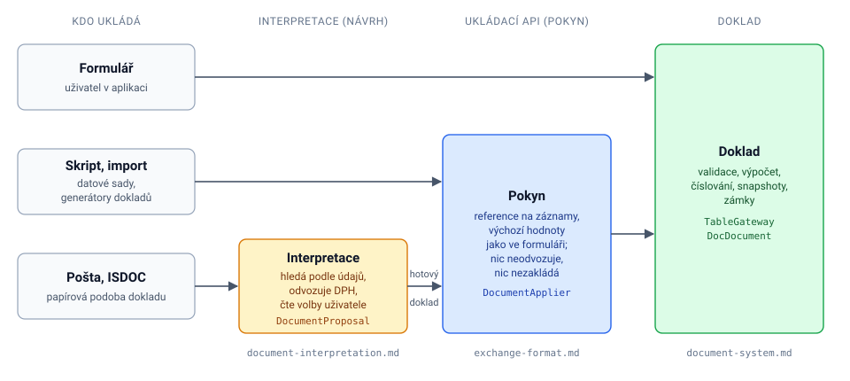

# Shipard — Výměnný formát dokumentů

## 1. Účel a kontext

**Výměnný formát** (exchange format) je kanonická JSON reprezentace doménové
entity (doklad, osoba, položka, …) navržená pro **přenos mezi systémy**.
Stojí jako střední vrstva mezi:

- **externí reprezentací** dokumentu (PDF zpracované AI, ISDOC, XML z účetního
  systému, výstup z partnerského API), kterou produkují různé zdroje v různých
  formátech,
- **vnitřní reprezentací** v Shipard DB (`docs_core_heads` row s FK na
  `base_persons_persons.id`, `economy_items.id`, …), která je optimalizovaná
  pro běh aplikace a referenční integritu.

Hlavní rozlišovací znak: **externí reprezentace nepoužívá interní ID**.
Místo `partner: 42` má `partner: { country: "cz", companyId: "12345678" }`.
Tím je formát samonosný — lze ho přenášet mezi DS, mezi firmami, do/z
e-fakturace, exportovat a archivovat. Mapování na lokální entity (proces
zvaný **resolve**) probíhá až při importu.

### K čemu nám to slouží

Mít jeden dobře navržený kanonický formát umožňuje stavět na něm několik věcí
najednou:

1. **Vizualizace** výsledku AI extrakce — uživatel vidí lidsky čitelný náhled
   dokladu (před uložením) se zvýrazněním nerozhodnutých referencí.
2. **Strojová validace** — kontrola chybějících údajů, nesouhlasných součtů,
   neexistujících referencí.
3. **Ukládání do DB** — applier transformuje canonical na interní `$data`
   pole a prožene přes existující `TableGateway::saveDocument()`. Veškerá
   business logika (`DocDocument::beforeSave`: snapshoty, recap, totals,
   přidělení čísla) zůstává ve stávajícím aparátu.
4. **API pro celé doklady** — `/api/v1/_exchange/docs/document/apply` jako
   atomický endpoint pro pořízení dokladu jedním requestem. Umožňuje Shipard
   používat jako automatizovaný fakturační systém.
5. **Importy z účetních / ERP systémů** — adaptér přečte jejich formát,
   transformuje na canonical, předá applieru. Stejná cesta pro Pohodu, Money,
   Flexibee, atd. — odlišuje se jen vstupní adaptér.
6. **Doklady, které Shipard generuje sám** — periodická fakturace zakázek
   (#110 Q1), později faktura ze zakázky, faktura ze zálohy apod. Vznikají
   **i se přegenerovávají výhradně přes výměnný formát a `DocumentApplier`**
   (`applyOptions.replaceConcept`, Q2) — generátor skládá kanonický payload
   z interních dat, žádné přímé skládání hlavičky a řádků mimo applier;
   odvození DPH, řada, zaokrouhlení i dimenze tak mají jedinou implementaci.
   Známé výjimky z doby před touto zásadou (#112): zaúčtování podaného
   přiznání DPH (`VatReturnAccountingService`) a účetní doklady majetku
   (`AssetPostingDocuments`) jdou přes `TableGateway`; sjednotí je
   samostatný task.
6. **Mezikrok pro elektronickou fakturaci** — ISDOC, Peppol UBL, e-Faktura
   se rozparsují na canonical, ten se uloží. Stejný flow pro AI extrakci
   i strukturovaná data. Příchozí ISDOC je implementován — viz `IsdocReader`
   v sekci Adaptéry (kapitola 4).
7. **Export pro elektronickou výměnu** — opačný směr: canonical dokladu
   (papírová projekce + `rows[].computed`) se serializuje do ISDOC
   (`IsdocWriter`, #119 fáze 1, `docs/einvoice.md`); ve fázi 2 ho tisk
   vloží do PDF faktury vydané a přiloží k e-mailu partnerovi, který má
   taky Shipard. Spolehlivější než AI extrakce z PDF na obou stranách.
8. **Datové sady** — přenosný obraz celého DS (`shpd-ds dataset-dump` /
   `dataset-seed`): exportery vyrobí canonical z DB, seed ho vrátí přes
   appliery. Demo sady, testovací fixtury, školicí DS. Viz
   `docs/datasets.md` (#40).

### Generalizace

Stejný pattern je vhodný i pro další entity. Tento dokument popisuje
**`shpd.docs.document.v1`** (doklady) jako první konkrétní formát. Další
plánované formáty (samostatné dokumenty / iterace) popisuje sekce 13.

## 2. Pojmosloví

| Termín | Význam |
|--------|--------|
| **Canonical / exchange format** | Kanonická JSON reprezentace doménové entity. Samonosná, bez interních ID. |
| **Schema** | Definice struktury konkrétního formátu (`shpd.docs.document.v1`). JSON Schema draft-2020-12 + PHP `DocumentValidator` pro logiku, kterou schema neumí (např. polymorfismus podle `docType`). |
| **Resolve** | Proces propojení referencí v canonical (Party, Item, Unit, VAT code, BankAccount) s entitami v lokální DB. |
| **Apply** | Proces uložení canonical dokumentu do DB — orchestruje resolve, transformuje na interní `$data`, deleguje na `TableGateway::saveDocument()`. |
| **Lineage** | Stopy, odkud doklad vznikl — `source.kind`, `source.ref` (identifikátor ve zdrojovém systému, klíč idempotence pokynu) + `source_message` v `docs_core_heads`, zpětně `target_*` na zdrojové zprávě. |

## 3. Architektura — tři vrstvy

Doklad se ukládá třemi cestami a všechny končí v `DocDocument`:



| Vrstva | Kdo jí mluví | Dokument |
|---|---|---|
| **doklad** — pole, výchozí hodnoty, validace, výpočet, číslování | formulář; pod ním každá další cesta | [document-system.md](document-system.md), [vat-calculation.md](vat-calculation.md) |
| **formát a ukládací API (pokyn)** — reference, chybějící × `null`, importní mód, idempotence, REST | skript, import, datové sady, generátory dokladů | tento dokument |
| **interpretace (návrh)** — hledání podle údajů, odvozování DPH, volby uživatele, zakládání, učení | pošta, ISDOC | [document-interpretation.md](document-interpretation.md) |

Vrstvy kódu výměnného formátu:

```
┌─────────────────────────────────────────────────────────────┐
│  REST API     /api/v1/_exchange/docs/document/{validate,    │
│                                    preview, apply,          │
│                                    interpret}               │
├─────────────────────────────────────────────────────────────┤
│  Vstup návrhu DocumentProposal (jen papírová podoba)        │
│    - interpretace → založení záznamů → pokyn → učení       │
├─────────────────────────────────────────────────────────────┤
│  Pokyn        DocumentApplier                               │
│    - orchestruje validate → resolve → transform → save     │
├─────────────────────────────────────────────────────────────┤
│  Reference    ReferenceResolver; UnitResolver, VatCodeResolver│
│               a BankAccountResolver jen přesnou shodou (§ 8) │
│    - reference z payloadu → DB id                           │
├─────────────────────────────────────────────────────────────┤
│  Schema       ExchangeFormat (PHP) + .json schema soubor    │
│    - definice struktury, statická validace                  │
├─────────────────────────────────────────────────────────────┤
│  Existing infra (nedotčeno)                                 │
│  Document, TableGateway, DocDocument::beforeSave,           │
│  VatRateResolver, ConfigRuntime, …                          │
└─────────────────────────────────────────────────────────────┘
```

**Klíčový design point:** Applier **nesestupuje** pod úroveň Document.
Veškerá business logika (přidělení čísla, snapshoty, recap, totals, rounding,
state transitions) zůstává v `DocDocument`. Exchange formát je pouze "lepší
vstup" — transformační vrstva nad existujícím dokumentovým systémem.

### Pokyn × návrh — dvě vstupní třídy, jedno uložení (#166 D18–D20, D53)

Doklad ve výměnném formátu přichází dvěma způsoby. Schéma je jedno
a totéž; liší se **vstupní třída**, ne parametr volání.

- **Pokyn** — `DocumentApplier` (`validate()` / `preview()` / `apply()`).
  Volající ví, co chce uložit. Applier dohledá reference, doplní výchozí
  hodnoty **týmž kódem jako formulář** („Výchozí hodnoty pokynu“ níž),
  nechá `DocDocument` validovat a počítat — a **nic neodvozuje ze signálů
  a nic nezakládá**. Co uloží formulář, uloží i pokyn („Invariant
  ukládání“, § 10). Režim ani větve odvozování applier nemá a na jmenném
  prostoru interpretace nezávisí (D62).
- **Návrh** — `Interpret\DocumentProposal` (`validate()` / `preview()` /
  `apply()` / `interpret()`), vstup pro **papírovou podobu** dokladu
  (pošta, ISDOC). Cesta je *interpretace → založení chybějících záznamů →
  pokyn → učení*: `DocumentInterpreter` udělá z předlohy a voleb uživatele
  (`_resolve`) **hotový doklad** a `DocumentApplier` ho uloží jako každý
  jiný pokyn („Návrh — interpretace před pokynem“ níž).

| Volající | Vstup |
|---|---|
| REST `/_exchange/docs/document/*` (API klient, import ze starého Shipardu) | pokyn; s `applyOptions.interpret: true` návrh; `/interpret` vrátí hotový doklad bez uložení (§ 11) |
| datové sady — sekce `docs/` (`DocumentSeeder`) | pokyn |
| generátory dokladů — periodická fakturace, opravný doklad | pokyn |
| pošta — náhled návrhu (`AnalysisController`) a jeho použití (`MessageProposalApplier`, MCP `mail_draft_document`), tedy i ISDOC z přílohy a `dataset-verify` | návrh (určuje kód; `interpret` z payloadu se nečte) |

**Pokyn nedělá** (D19) — je to práce interpretace: místo plnění z DIČ; odvození ani náhrada kódu
DPH; doklad neplátce a doklad mimo české DPH (ceny řádků s daní dodavatele,
zahozená rekapitulace); korekce režimu DPH ze součtů a kvůli samovyměření;
druh plnění ze štítků; odvození `recapSource` a dohledání kódu rekapitulace
z řádků; odhad módu zaokrouhlení (mód říká payload); vynechání řádků; heuristická varování
validátoru (`totals_mismatch`, `rows_recap_mismatch`, `vat_mode_suspect`,
`vat_recap_inconsistent`); oprava IBAN ↔ číslo účtu (normalizace tvaru
hodnot zůstává); učení dodavatelských kódů. Blok `_resolve` pokyn nečte
vůbec (#166 D32): payload, který ho nese, projde s jedním info nálezem
`resolve_ignored` — volby DPH, položek ani partnerů se neuplatní.

**Hodnoty DPH jsou v pokynu záměr** (D20):

| Pole | Hodnota v pokynu |
|---|---|
| `vat.place` | z payloadu; chybí = tuzemsko |
| `vat.mode` | z payloadu; chybí = výchozí hodnota jako ve formuláři (`fromBase`, u neplátce a účetního dokladu `none`). Doklad s `none` kódy řádků nenese (jako ve formuláři) a neověřují se |
| `rows[].vat.code` | z payloadu, ověřený proti číselníku země registrace k datu sazby řádku; neznámý = chyba `vat_code_unknown`. Chybí-li (i objekt `vat` bez klíče `code`), doplní se první kód nabídky jako ve formuláři; výslovné `"code": null` je „záměrně bez kódu“ a rozhodne `DocDocument` (`vat_code_missing`, `docs/vat-calculation.md` § 1.1). Importní mód kód nedoplňuje |
| `rows[].vat.pct` | nepoužije se — procento je vždy z kódu a data sazby |
| registrace DPH | reference `vat.registration` (`"@cz"`, #166 D36); chybí = výchozí registrace zdroje dat jako ve formuláři (první podle země a id, platná k datu dokladu), jen u dokladu s DPH; `null` = bez registrace. Signál `vat.registrationCountry` pokyn odmítá (`signal_not_allowed`). Mimo importní mód musí platit k datu dokladu |
| `vat.recapSource` | z payloadu; chybí = `computed`. `declared` vyžaduje `vatRecap` s kódem DPH na každém řádku — chybějící rekapitulace (`vat_recap_missing`), chybějící kód (`vat_recap_code_missing`) i neznámý kód (`vat_code_unknown`) je chyba, ne tichý přepočet z řádků |
| `totals.totalRoundingAuto` | z payloadu; chybí = zapnuto tam, kde automatika platí (prodejní typy, #73), jinak vypnuto; `null` = vypnuto. Na přítomnosti `totals.totalAmount` nezáleží (D26) |
| `totals.totalRoundingMode` | při vypnuté automatice z payloadu, chybí = `cent`; mód se neodhaduje. Při zapnuté automatice ho určí způsob úhrady — liší-li se uvedený, varování `total_rounding_mode_ignored` (§ 5) |
| `vat.roundingMode` | z payloadu; chybí = `cent` |
| `totals` — částky | **kontrolní součet** (D4, D27): každé uvedené pole se porovná s výpočtem dokladu, rozdíl nad 0,01 = `totals_check_failed` a doklad se neuloží (§ 5) |

Importní mód (`applyOptions.importNumber`) je vždy pokyn a nese jen
historii — § 10 „Importní mód“.

### Návrh — interpretace před pokynem (#166 D51–D53)

Papírová podoba dokladu (pošta, ISDOC) nejde applieru přímo. Vstup návrhu
`Interpret\DocumentProposal` z ní a z voleb uživatele udělá **hotový
doklad** — úplný pokyn s referencemi číslem a hodnotami uvedenými výslovně
— a `DocumentApplier` ho uloží jako každý jiný. Kód interpretace žije ve
jmenném prostoru `Document\Interpret\`; applier ho nevolá a nezná (D62).
Co čtou obě strany, drží sdílená vrstva v `Document\`: `PayloadContext`
(typ dokladu, registrace DPH z reference, datum sazby, původní doklad
opravy, kurz, kontext DPH pokynu), `PayloadResolve` (reference, dimenze,
ověření kódu DPH a předmětu plnění z payloadu, řádek převzaté rekapitulace,
**plán uložení** — `basePlan()` / `plan()` — z nalezených referencí)
a `SourceRefLookup` (dohledání dokladu podle `source.ref`).

Vše o interpretaci — vstup, hotový doklad, kroky, hledání podle údajů,
pravidla DPH přijatých dokladů, volby uživatele, zakládání a učení — je
v [document-interpretation.md](document-interpretation.md).

### Výchozí hodnoty pokynu — jedno místo s formulářem (#166 D40–D50)

**Co formulář předvyplní novému dokladu a řádku, to doplní i pokyn, když
to payload neuvádí** — jedním kódem v `docs.core`
(`Defaults\DocHeadDefaults`, `Defaults\DocRowDefaults`;
`docs/document-system.md` § 12c). Minimální pokyn — typ dokladu, partner
a položka — tak dá stejný doklad, jaký vznikne ve formuláři bez zásahu
uživatele (§ 11 „Doklad skriptem“). Hodnota z payloadu vždy vyhrává; návrh
(pošta, ISDOC) výchozí hodnoty nedostává a nemění se.

**Pravidla jsou na jednom místě — `docs/document-system.md` § 12c**
(kdy se která hodnota doplní a čím). Tady jen, kterých polí formátu se
týkají:

| Pole formátu | Sloupec dokladu |
|---|---|
| `currency` | `doc_currency` |
| `payment.method` | `payment_method` |
| `vat.mode` | `vat_mode` |
| `dates.issueDate` | `issue_date` |
| `vat.registration` | `vat_registration` |
| `payment.ownBankAccount` | `bank_account` |
| `totals.totalRoundingAuto` | `total_rounding_auto` |
| `rows[].operation` | `operation` |
| `rows[].description`, `rows[].unitPrice`, `rows[].unit` | `description`, `unit_price`, `unit` |
| `rows[].quantity` | `quantity` |
| `rows[].vat.code` | `vat_code` |

Účetní datum, DUZP, DPPD, splatnost a autora doplňuje `DocDocument` jako
dosud a ve výčtu doplněných polí nejsou.

**Chybějící klíč × `null`** (D50): chybějící klíč (a prázdný text) = doplní
se výchozí hodnota; klíč s hodnotou **`null` = „záměrně prázdné“** — pole
zůstane prázdné. Objekt `vat` řádku bez klíče `code` je „chybí“;
`"vat": {"code": null}` je záměrně bez kódu. U polí, která prázdná být
nemohou (`currency`, `payment.method`, `vat.mode`,
`totals.totalRoundingAuto`), `null` znamená „bez výchozí hodnoty pokynu“
a platí výchozí hodnota sloupce. Export (`DocumentExporter`) proto píše
`null` výslovně u pole s výchozí hodnotou, které je na dokladu prázdné —
doklad uložený bez vlastního účtu, řádek konceptu bez kódu DPH —, jinak by
round-trip doklad změnil. Stejně to dělají generátory datových sad
a opravný doklad (kopie řádků původního dokladu).

**Importní mód** výchozí hodnoty omezuje — datum vystavení a obsah řádku
se nedoplňují (§ 10 „Importní mód“).

**Odpověď říká, co pokyn doplnil sám** (D44): `_resolve.defaults` je seznam
`{path, value}` — cesta pole ve formátu a doplněná hodnota (název režimu
a úhrady, kód DPH, kód pohybu, systémový kód jednotky, u reference id
záznamu) — v `/preview` i po `/apply`, i když apply skončí chybou. Payload
v odpovědi zůstává, jak přišel. Výchozí kód DPH mění částky: skript, který
kód neposílá, dostane základní sazbu, a `defaults` s `_resolve.computed`
jsou místo, kde to uvidí.

```jsonc
"_resolve": {
  "defaults": [
    { "path": "currency",               "value": "CZK" },
    { "path": "payment.method",         "value": "bankTransfer" },
    { "path": "vat.mode",               "value": "fromBase" },
    { "path": "dates.issueDate",        "value": "2026-11-23" },
    { "path": "vat.registration",       "value": 1 },
    { "path": "payment.ownBankAccount", "value": 1 },
    { "path": "rows.0.operation",       "value": "sale.services" },
    { "path": "rows.0.description",     "value": "Správa IT — měsíční paušál" },
    { "path": "rows.0.unitPrice",       "value": 6500 },
    { "path": "rows.0.unit",            "value": "mnth" },
    { "path": "rows.0.quantity",        "value": 1 },
    { "path": "rows.0.vat.code",        "value": "cz-120" }
  ]
}
```

**Povinná pole** (D1, D45): schéma vyžaduje obálku a `docType`. Všechno
ostatní má výchozí hodnotu, nebo ho hlídá `DocDocument::validate()` **pro
cílový stav** jako u formuláře — pokyn bez partnera nebo bez řádků jde
uložit jako koncept, potvrzení ho zastaví. Vlastní kontroly povinnosti
`DocumentValidator` v pokynu nemá a nález je na pole jeden (chybějící datum
vystavení v importu nehlásí zároveň odvozené účetní datum). Dvě pole
výchozí hodnotu mít nemohou a validátor je vyžaduje dál: **pokladnu**
dokladu vázaného na pokladnu (`cashDesk` — řada se nikdy nevybírá potichu)
a **směr** pokladního dokladu (`cashDirection`).

## 4. Životní cyklus

```
Vstup (PDF, ISDOC, ruční zadání, ...)
  │
  ▼
[Adaptér / AI analýza pošty / parser]
  │
  ▼
Canonical JSON  ──────►  /validate     → vrátí jen issues (no DB writes)
  │                       /preview     → vrátí canonical + _resolve (no DB writes)
  │                       /apply       → resolve → save → vrátí enriched canonical
  ▼
DB záznam v docs_core_heads + rows + vatRecap + případně nové persons/items
```

`validate` a `preview` jsou idempotentní a bez vedlejších efektů. Hotový
doklad z importu, datové sady nebo generátoru jde **pokynem** a nic se při
něm nezakládá; canonical z adaptéru nebo AI analýzy jde **návrhem** (§ 3),
který smí chybějící osoby a položky založit podle voleb uživatele
(`docs/document-interpretation.md` § 8).

### Adaptéry

První implementovaný vstupní adaptér je **ISDOC** (český standard
e-fakturace): `Shipard\Module\Core\Exchange\Isdoc\IsdocReader` konvertuje
ISDOC 6.x XML (i `.isdocx` ZIP obal) na canonical se `source.kind='isdoc'`
a confidence 1.0. Mapuje se jen to, co v ISDOC opravdu je (chybějící pole
se vynechávají); podporované `DocumentType`: 1 → `invoiceReceived`,
2 → `creditNote`. Řádky nesou i `computed` (základ, daň a cenu s daní, jak
je spočítal dodavatel) — cenu s daní z nich bere interpretace u přijatého
dokladu neplátce DPH (`docs/document-interpretation.md` § 6.2). Čtečka čte i tuzemské přenesení daňové
povinnosti (`vat.reverseCharge`, `rows[].vat.reverseChargeCode`), režim
DPH (`vat.mode`, doklad bez DPH jako doklad neplátce), slevu, poznámku
a způsob úhrady (#119 krok 3). Kompletní mapovací tabulka v obou směrech:
[docs/einvoice.md](einvoice.md) § 4–5. Použití
v příjmu pošty (deterministický import místo AI analýzy):
`modules/core/mail/docs/ai-analysis.md`, sekce „Deterministický ISDOC
import".

Výstupní adaptér je **`IsdocWriter`** (#119 fáze 1): canonical pro
e-fakturu (papírová projekce + `rows[].computed`) → ISDOC 6.0.1, čistá
funkce bez databáze, nad rozhraním formátu `EInvoice\EInvoiceWriter`
(registr `EInvoiceFormats`). Chybějící povinná hodnota je
`EInvoiceInputException` s cestami, ne prázdný element; výstup musí projít
XSD 6.0.1 i 6.0.2. Round-trip generátor → čtečka hlídá
`IsdocCorpusRoundTripTest` nad korpusem. Vše v [docs/einvoice.md](einvoice.md).
Ostatní adaptéry (Peppol UBL, Pohoda, Flexibee, …) zůstávají future work.

## 5. Specifikace `shpd.docs.document.v1`

Top-level struktura:

```jsonc
{
  // ── Format meta ──────────────────────────────────────────────────────────
  "format": "shpd.docs.document",
  "formatVersion": "1.0",

  // ── Source (audit / lineage) ─────────────────────────────────────────────
  "source": {
    "kind": "aiExtraction",      // aiExtraction | isdoc | peppolUbl | manual
                                  //   | api | import.oldShipard
                                  //   | import.flexibee | import.pohoda | …
    "ref": "ORD-2026-0042",       // string|null, do 60 znaků — identifikátor
                                  //   dokladu ve zdrojovém systému; s `kind`
                                  //   klíč idempotence pokynu (viz „Idempotence
                                  //   pokynu“ níže, #166 D46)
    "extractedAt": "2026-05-14T10:30:00Z",
    "confidence": 0.92,           // jen pro aiExtraction (overall_confidence)
    "message": 12345,             // int|null — FK na core_mail_incoming_messages.
                                  //   Injektuje ho SERVER při apply návrhu
                                  //   z pošty (nikdy se nevěří klientovi);
                                  //   applier ho propíše do
                                  //   docs_core_heads.source_message
    "promptVersion": "v1.1.0",    // pro AI lineage
    "raw": { /* opaque source-specific payload, optional */ }
  },

  // ── Document identity ────────────────────────────────────────────────────
  "docType": "invoiceReceived",  // key z docs.core.docTypes
  "docNumber": "2026000123",     // číslo dokladu vystavované strany (na
                                  //   přijaté faktuře = supplier's invoice #)
                                  //   Naše interní číslo přiděluje series
                                  //   až při Confirm — toto pole se ukládá
                                  //   do partner_doc_number (viz Apply).
  "docText": "Konzultace 04/2026",
  "selfParty": "customer",       // "supplier" | "customer" | null
                                  //   která strana jsme my
  "fiscalPeriodType": null,      // "opening" | "closing" | null — doklad
                                  //   otevíracího / uzávěrkového období
                                  //   (docs_core_heads.fiscal_period_type,
                                  //   #69 D20): zařadí se do jednodenního
                                  //   měsíce Otevření / Uzavření roku podle
                                  //   účetního data, ne do běžného měsíce;
                                  //   saldokonto uzávěrkové řádky nebere.
                                  //   Jen import mód (applyOptions
                                  //   .importNumber) — jinak applier pole
                                  //   ignoruje. Exportér ho vypisuje vždy.

  // ── Řada a pokladna — reference (viz „Reference na záznamy“ níže) ────────
  "numberSeries": "@invni",      // číselná řada dokladu; chybí = výchozí
                                  //   řada typu, u pokladních typů ji určuje
                                  //   pokladna
  "cashDesk": null,              // pokladna ("@POK") — povinná u pokladního
                                  //   dokladu a prodejky (§ „Polymorfismus“)

  // ── Parties ──────────────────────────────────────────────────────────────
  "supplier":  { /* Party — viz sekce 6 */ },   // reference na osobu, nebo
  "customer":  { /* Party — viz sekce 6 */ },   //   objekt s `ref` a daty
  "balanceParty": null,            // Party — ruční plátce (osoba pro
                                  //   saldokonto, #72); null = odvodí se
  "partner": null,                 // Party — partner hlavičky účetního
                                  //   dokladu a dokladu vázaného na pokladnu
                                  //   (#166 D30); u faktur je partnerem
                                  //   strana a pole je chyba

  // ── Dates ────────────────────────────────────────────────────────────────
  "dates": {
    "issueDate":         "2026-04-15",
    "dueDate":           "2026-04-29",
    "accountingDate":    "2026-04-15",
    "taxPointDate":      "2026-04-15",  // DUZP
    "vatObligationDate": "2026-04-15",  // DPPD
    "vatRateDate":       null,          // vlastní datum sazby DPH dokladu —
                                        //   jen při vat.rateSource "document"
                                        //   (#159, viz „Datum sazby DPH“ níže)
    "periodFrom":        null,
    "periodTo":          null
  },

  // ── Currency & VAT ───────────────────────────────────────────────────────
  "currency":     "CZK",          // ISO 4217 uppercase v canonical;
                                   //   applier lowercases pro cfgItem
  "exchangeRate": null,           // kurz za jednotku; null u cizí měny → applier
                                   //   ho mimo import mód doplní z kurzovního
                                   //   lístku k účetnímu datu: accountingDate, jinak
                                   //   u invoiceReceived taxPointDate, jinak issueDate
                                   //   (AccountingDateRule, #103 D78),
                                   //   kurz na dokladu vždy vyhrává; nenalezeno =
                                   //   warning exchange_rate_missing a V pořádku
                                   //   zastaví validace (#121 D6, U5,
                                   //   docs/exchange-rates.md §5.2)

  "vat": {                        // celý objekt nullable — nelze-li určit,
                                   //   vynechat nebo null (ne prázdný objekt)
    "mode":  "fromBase",          // fromBase | fromTotal | none | null
                                   //   (key z docs.core.vatModes; enum ve
                                   //   schématu — neznámá hodnota mimo schema
                                   //   validaci → warning `vat_mode_unknown`).
                                   //   V pokynu záměr (§ 3). Návrh režim
                                   //   z předlohy ověřuje proti číslům
                                   //   a u dokladu neplátce ho přebíjí —
                                   //   docs/document-interpretation.md § 6.7.
    "place": "domestic",          // domestic | intracom | thirdCountry | null
                                   //   Canonical názvy — číselník world.vat má
                                   //   pro thirdCountry `foreign`. Enum ve
                                   //   schématu; neznámá hodnota mimo schema
                                   //   validaci → warning `vat_place_unknown`.
                                   //   V pokynu záměr (chybí = tuzemsko).
                                   //   Návrh u přijatého dokladu místo
                                   //   odvozuje z prefixu DIČ dodavatele —
                                   //   docs/document-interpretation.md § 6.5.
    "registration": "@cz",        // naše registrace DPH — reference (#166
                                   //   D36), nepovinná: bez ní pokyn doplní
                                   //   výchozí registraci zdroje dat, dokladu
                                   //   Bez DPH žádnou. Mimo importní mód musí
                                   //   k datu dokladu platit, jinak chyba
                                   //   `vat_registration_not_valid`.
    "registrationCountry": null,  // DOČASNÉ (D39) — signál jen pro návrh:
                                   //   ISO země naší registrace, jak ji
                                   //   přečetla AI (docs/document-
                                   //   interpretation.md § 6.1). Pokyn pole
                                   //   odmítá (`signal_not_allowed`).
    "reverseCharge": false,       // bool | null — daň přiznává příjemce
                                   //   („reverse charge“, přenesení daňové
                                   //   povinnosti, čl. 196 směrnice, § 92a);
                                   //   signál návrhu pro odvození kódu DPH
                                   //   řádků, i když je na dokladu DPH 0
                                   //   (docs/document-interpretation.md § 6.6).
    "recapSource": "declared",    // computed | declared | null
                                   //   Autorita rekapitulace (viz níže).
                                   //   declared = vatRecap je fakt z dokladu
                                   //   a DocDocument ho nepřepočítá.
                                   //   null → pokyn `computed`, návrh
                                   //   rozhodne sám (viz níže).
    "calcSource": "header",       // header | rows | null
                                   //   Metoda výpočtu PŘEPOČÍTANÉ
                                   //   rekapitulace (docs.core.vatCalcSources):
                                   //   header = daň jednou ze součtu cen
                                   //   ve sazbě (norma), rows = součet
                                   //   řádkových daní. null → header.
    "controlStatementMode": "auto" // auto | detail | aggregate | exclude | null
                                   //   Ruční zařazení do kontrolního hlášení
                                   //   (docs_core_heads.cs_mode, cfgItem
                                   //   economy.vat.controlStatementModes, #77):
                                   //   auto = podle limitu 10 000 Kč, detail =
                                   //   vždy A4/B2, aggregate = vždy A5/B3,
                                   //   exclude = mimo hlášení (v přiznání
                                   //   zůstává). 1:1 se starým vatCS 0–3;
                                   //   null → auto. Applier auto do payloadu
                                   //   nedává (default sloupce), exporter
                                   //   hodnotu vypisuje vždy (round-trip).
    "rateSource": "auto"          // auto | document | rows | null
                                   //   Přepínač „Sazby DPH podle“
                                   //   (docs_core_heads.vat_rate_source, cfgItem
                                   //   docs.core.vatRateSources, #159 D11):
                                   //   k jakému datu se hledá sazba kódů DPH.
                                   //   auto = DPPD → DUZP → datum vystavení
                                   //   (opravný doklad: původní plnění),
                                   //   document = dates.vatRateDate,
                                   //   rows = rows[].vat.rateDate
                                   //   a vatRecap[].rateDate. null → auto.
                                   //   Exporter vypisuje jen document / rows.
                                   //   Viz „Datum sazby DPH“ níže.
  },

  // ── Payment ──────────────────────────────────────────────────────────────
  "payment": {
    "method":          "bankTransfer",  // cash | bankTransfer | card | cashOnDelivery
                                        //   | setOff | paymentGateway (docs.core.paymentMethods)
    "ownBankAccount":  "@BU1",          // náš bankovní účet dokladu — reference
                                        //   (#166 D30); vydaná faktura ho ve
                                        //   stavu V pořádku vyžaduje
    "paymentReference": "2026000123",
    "specificSymbol":  null,
    "constantSymbol":  null
  },

  // ── Notes ────────────────────────────────────────────────────────────────
  "notes": {
    "internal":   null,           // → docs_core_heads.notice
    "onDocument": "Děkujeme."     // → docs_core_heads.doc_notice
  },

  // ── Dimenze deníku (#110 D20, T2) ────────────────────────────────────────
  "dimensions": {                 // klíč = id dimenze (journalDimensions
    "costCenter": "@S01"          //   v economy.accounting), hodnota =
  },                              //   reference na záznam cílové tabulky
                                  //   (#166 D30; přirozený klíč = `exchangeKey`
                                  //   tabulky: středisko kód, zakázka číslo,
                                  //   majetek inventární číslo).
                                  //   Hlavička = výchozí hodnota pro
                                  //   řádky bez vlastní (→ docs_core_heads
                                  //   .cost_center). Neznámé id / dimenze,
                                  //   jejíž tabulka klíč nemá → dimension_unknown,
                                  //   hodnota bez záznamu → reference_not_found
                                  //   (obě blokují apply). Chybějící objekt
                                  //   = sloupce zůstanou prázdné.

  // ── Opravný daňový doklad (#92 D10, task B) ──────────────────────────────
  "correction": {                 // objekt = opravný doklad (docs_core_heads
    "originalDoc":          "@FV26-00123",  //   .corrective = 1), null / chybí
    "originalDocNumber":    "FV26-00123",   //   = běžný doklad. Jen u typu
    "originalTaxPointDate": "2026-03-15",   //   s příznakem docTypes[]
    "reason":               "Sleva za vadu" //   .corrective (faktura vydaná);
  },                              //   jinde warning correction_not_supported.
                                  //   Původní doklad = reference `originalDoc`
                                  //   (#166 D30); `originalDocNumber` je jen
                                  //   text, nic se podle něj nedohledává
                                  //   (§ 5 „Opravný daňový doklad“). Objekt
                                  //   se samými null = jen příznak (import ze
                                  //   starého Shipardu).

  // ── Rows ─────────────────────────────────────────────────────────────────
  "rows": [
    { /* DocumentRow — viz sekce 7 */ }
  ],

  // ── Computed (applier recomputes; `totals` v pokynu = kontrolní součet) ──
  "vatRecap": [
    {
      "vatCode": "cz-110", "vatPct": 21,
      "base": 10330.58, "tax": 2169.42, "total": 12500.00,
      "isReversePair": false
    }
  ],
  "totals": {
    "totalBase":     10330.58,
    "totalVat":      2169.42,
    "totalAmount":   12500.00,
    "totalRounding": 0.00,
    "totalRoundingAuto": false,    // nepovinné; automatika podle způsobu úhrady
    "totalRoundingMode": null      // nepovinné; cent | unit | unitUp | unitDown | fiveCent
  },

  // ── Attachments ──────────────────────────────────────────────────────────
  "attachments": [
    {
      "filename":  "faktura-001.pdf",
      "mimeType":  "application/pdf",
      "size":      123456,
      "sha256":    "…",           // optional, pro dedup
      "kind":      "original",    // original | scan | supplement | preview
                                   //   | structured (strojově čitelný formát
                                   //   — ISDOC, UBL, XML export)
      "ref":       "att:42",      // existující core_attachments_files.id, NEBO
      "inline":    null           // "data:application/pdf;base64,…"
                                   //   (mutually exclusive s ref)
    }
  ],

  // ── Resolve state (populated by /preview, used by /apply) ────────────────
  "_resolve": { /* viz sekce 9 */ }
}
```

### Idempotence pokynu — `source.ref` (#166 D46)

Skript nebo import, který pošle tentýž doklad podruhé (opakovaný běh,
výpadek spojení po odeslání), nesmí založit duplicitu. Doklad proto nese
**identifikátor ze zdrojového systému** `source.ref` vedle `source.kind`;
obojí se uloží na hlavičku (`source_kind`, `source_ref`).

```jsonc
"source": { "kind": "api", "ref": "ORD-2026-0042" }
```

- **Opakovaný pokyn se stejnou dvojicí vrátí existující doklad beze
  změny**: 200, `savedDocId` existujícího dokladu,
  `_resolve.summary.status = "alreadyApplied"` a info nález
  `already_applied` s `docId` a `docNumber`. **Obsah se neporovnává** —
  druhý pokyn s jiným obsahem doklad nezmění (aktualizace dokladu pokynem
  neexistuje, #166 D7) a jeho obsah se ani neposuzuje: dohledání běží před
  validací, takže opakování po výpadku projde i poté, co se ve zdroji dat
  něco změnilo.
- **Živé doklady**: doklad v koši nový pokyn neblokuje — vznikne nový.
  Žije-li dokladů se stejnou dvojicí víc (doklad obnovený z koše vedle
  novějšího), vrací se nejnovější.
- **Shoda je přesná**: velikost písmen i diakritika rozhodují (`INV-1`
  a `inv-1` jsou dva doklady). Identifikátor je text do 60 znaků bez mezer
  na krajích; prázdný řetězec schéma odmítne, `null` = bez klíče.
- **`ref` bez `kind`** je chyba validace `source_kind_missing` — dvojice
  se hledá celá, identifikátor sám nic neurčuje. Pro skript nebo jiný
  systém přes REST je druh `api`; import si volí vlastní.
- **Jiný typ dokladu**: existující doklad jiného typu, než je `docType`
  payloadu, je chyba `source_ref_conflict` (422) — stejný identifikátor
  pro jiný doklad je chyba volajícího.
- **Oba režimy** (pokyn i návrh přes `applyOptions.interpret`) se chovají
  stejně, importní mód také: opakovaný běh importu vrátí existující doklad.
  **Návrh z pošty klíč nenese** — papírová podoba schématu pole nemá
  (výstup modelu s ním analýza odmítne) a server `source.ref` ze zdroje
  zprávy pro jistotu zahazuje (vyplněné číslem faktury by druhé zprávě
  vrátilo doklad té první). Opakovaný apply návrhu
  hlídá vazba zprávy na doklad (§ 12).
- **`/preview`** existující doklad hlásí nálezem `already_applied` (jiný
  typ chybou `source_ref_conflict`); zbytek náhledu běží jako obvykle.
- **Přegenerování** (`applyOptions.replaceConcept`): cílový koncept se
  z dohledání vylučuje a `source_ref` přebírá z payloadu (§ 10).
- **Export** píše `source.ref`, je-li vyplněný — sady nesou původ. Apply
  takové sady nad zdrojem dat, kde doklad s touž dvojicí žije, vrátí ten
  existující.

Souběh a zámek popisuje § 10 „Idempotence a souběh“.

### Reference na záznamy — jedno pole na odkaz (#166 D30–D39)

Každý odkaz na záznam je **jedno pole s referencí** podle gramatiky z § 8:
`42` (id záznamu), `"@klíč"` (přirozený klíč cílové tabulky) nebo
`"@sloupec:hodnota"` (jmenovaný sloupec, který tabulka pro hledání
deklaruje). Hledá jediný `ReferenceResolver`: přesně jeden živý záznam,
nenalezeno i nejednoznačné je chyba — nikdy první nalezený.

| pole | cílová tabulka | přirozený klíč | příklad |
|---|---|---|---|
| `supplier`, `customer`, `balanceParty` — reference, nebo objekt s `ref` (§ 6) | osoby | číslo osoby; jmenovitě i IČO a DIČ (D35) | `"@F00042"`, `"@company_id:12345678"`, `"@vat_id:CZ12345678"` |
| `rows[].item` — reference, nebo objekt s `ref` (§ 7) | položky | kód; jmenovitě i EAN a SKU | `"@KONZ"`, `"@ean:8590000000017"` |
| `numberSeries` | řady dokladů | kód řady (D17) | `"@invno"` |
| `payment.ownBankAccount` | vlastní bankovní účty | kód | `"@BU1"` |
| `cashDesk` | pokladny | kód | `"@POK"` |
| `dimensions.<id>`, `rows[].dimensions.<id>` | cílová tabulka dimenze | podle tabulky | `"@S01"` |
| `rows[].account` | účty osnovy | číslo účtu | `"@518100"` |
| `vat.registration` | registrace DPH | kód registrace (D17) | `"@cz"` |
| `correction.originalDoc` | doklady | číslo dokladu | `"@FV26-00123"` |
| `partner` — hlavička účetního dokladu a dokladu vázaného na pokladnu; `rows[].partner` — reference, nebo objekt s `ref` | osoby | jako strana | `"@F00042"`, `42` |

- **Pokyn** hledá jen přes referenci a **nic nezakládá** (D31) — osoby,
  položky ani účty partnerů. Reference, která se nenajde, je nález
  `severity: error` s kódem resolveru (`reference_not_found`,
  `reference_ambiguous`, `reference_invalid`, …) a cestou pole; odpověď
  422 `validation_failed`, nic se neuloží. Strana nebo položka jako objekt
  **bez `ref`** s identifikujícími údaji (název, IČO, kód) je chyba
  `reference_missing` — ne tiché „bez partnera“ / „bez položky“.
- **Návrh** (pošta, ISDOC) hledá strany a položky podle údajů
  (`docs/document-interpretation.md` § 5); uvedený `ref` má přednost a hledání se přeskočí (nenalezený `ref`
  je chyba i tady). Ostatní místa z tabulky bere návrh stejně jako pokyn.
- **Jednotka** (`rows[].unit`, D37, D60): **text** = holý systémový kód
  jednotky (`"hr"`, `"pcs"`), **kladné celé číslo** = id jednotky — tak se
  zapíše jednotka založená uživatelem, která systémový kód nemá. Pokyn bere
  jen přesnou shodu, neznámá jednotka je chyba `unit_not_found`; zkratky
  a aliasy zná jen návrh. Export píše systémový kód; jednotku bez
  něj s varováním vynechá.
- **Účet partnera** (`supplier.bankAccount.ref`, D61): reference na záznam
  účtu osoby — jen **id** (přirozený klíč účet nemá, `"@…"` je
  `reference_invalid`). S referencí pokyn doklad naváže na ten účet; účet
  jiné osoby, než je dodavatel dokladu, je chyba
  `bank_account_person_mismatch`. **Chybí-li klíč**, vznikne vazba jen
  přesnou shodou čísla s existujícím účtem osoby (jako dřív); **výslovné
  `null`** = účet se k záznamu neváže. Údaje účtu (`accountNumber`, `iban`,
  `bic`) jdou do sloupců hlavičky vždy. Export `ref` nepíše (data stačí);
  interpretace ho do hotového dokladu píše vždy. Návrh z pošty referenci
  z předlohy zahazuje stejně jako `source.ref` — papírová podoba schématu
  ji nenese.
- **Autor** zůstává id v `applyOptions.author` (D38). Strana vlastní firmy
  (`selfParty`) referenci nenese.
- **Partner účetního a pokladního dokladu** (`partner`, `rows[].partner`,
  `tasks/doc-format-partner-fields.md`) má tvar strany, ale hledá se **jen
  přes `ref`**, v obou režimech — pole je nové, žádný uložený návrh ho
  nenese. Objekt s názvem / IČO / DIČ bez `ref` je v pokynu chyba
  `reference_missing`, v návrhu varování a pole se nepoužije.
  - `partner` na hlavičce nese jen `accountingDocument`, `cashDocument`
    a `cashRegisterDocument`. U faktur je partnerem strana: pole je
    v pokynu chyba `partner_not_supported`, návrh ho s varováním ignoruje.
  - U pokladního dokladu a prodejky nese partnera hlavičky i strana podle
    směru (tak ho píše export). Pole `partner` má přednost; určí-li pole
    a strana **různé osoby**, pokyn doklad odmítne (`partner_conflict`).
    V importním módu bere dobový snapshot data z pole.
  - Účetní doklad snapshot partnera nemá (nemá směr obchodu) — data vedle
    `ref` se u něj nepoužijí.
- `_resolve` pokyn **nečte vůbec** (D32): blok se zahodí před zpracováním
  a payload dostane jeden info nález `resolve_ignored` (path `_resolve`).
  V návrhu volby `_resolve.partner` a `_resolve.rows[].partner` fungují
  dál; uvedené pole má přednost.
- Exportér (`DocumentExporter`, datové sady) píše každý odkaz přirozeným
  klíčem; generátory dokladů (periodická fakturace, opravný doklad) id.
  Číslo dokladu nemá unikátní index a čísla různých typů se mohou shodovat —
  `correction.originalDoc` klíčem pak může být nejednoznačný (chyba).

**Dočasné signály návrhu (D39).** `rows[].item.ourCode`, účet řádku holým
číslem (`"518100"`) a `vat.registrationCountry` zůstávají ve schématu jen
pro uložené návrhy z pošty (`docs/document-interpretation.md` § 2). Pokyn
je odmítá chybou `signal_not_allowed` s radou, které pole použít — tiché
ignorování by uložilo jiný doklad, než jaký odesílatel zamýšlel.

Tvar referencí formátu drží `Document\CanonicalReferences` (strana a položka
jen referencí se uvnitř applieru rozbalí na objekt s `ref`; odpověď vrací
rozbalený tvar).

### Papírová podoba — značka `x-paper` (#166 D63–D65)

Schéma dokladu je jedno. Co z něj **papírový doklad nenese** — reference na
záznamy, pole určená skriptům a generátorům, volby uložení — je v něm
označené klíčovým slovem `x-paper` u vlastnosti (v `.jsonc` i v `.json`):

| Zápis | Význam v papírové podobě |
|-------|--------------------------|
| `"x-paper": false` | vlastnost tam není |
| `"x-paper": { … }` | vlastnost má uvedené schéma místo svého (`rows[].unit` jen text, `rows[].account` jen řetězec číslic — signál D39) |

Papírovou podobu z toho mechanicky odvodí `Schema\PaperSchema`
(core.exchange): značené vlastnosti vynechá nebo nahradí, uzel typu „objekt,
nebo reference“ (strana, položka řádku) nechá jen objektem, definice, na
které pak nic neodkazuje (`Reference`), odstraní a značky ve výsledku
nejsou. Vynechat povinnou vlastnost nebo zapsat značku jinam než
k vlastnosti je chyba.

Označené je dnes: `source.ref`, `source.message`, `source.raw`, `cashDesk`,
`numberSeries`, `fiscalPeriodType`, `balanceParty`, `partner`, `dimensions`,
`dates.vatRateDate`, `vat.registration`, `vat.recapSource`, `vat.calcSource`,
`vat.controlStatementMode`, `vat.rateSource`, `vat.roundingMode`,
`payment.ownBankAccount`, `correction.originalDoc`,
`totals.totalRoundingAuto`, `totals.totalRoundingMode`, `_resolve`,
`applyOptions`, `savedDocId`, `ref` strany, položky a účtu partnera,
`rows[].operation`, `rows[].partner`, `rows[].dimensions`,
`rows[].vat.rateDate` a `vatRecap[].rateDate`. Zdroj pravdy je značka ve
schématu, ne tento výčet.

- **Validace formátu značku ignoruje** — pokyn, náhled, export i uložené
  návrhy se validují plným schématem beze změny.
- Papírovou podobou se validuje **jen výstup modelu** při analýze pošty:
  nese ji `output_schema` profilu (`docs/document-interpretation.md` § 2).
  Blok v profilu přepíše `php scripts/profile-paper-schema.php`, shodu hlídá
  `ProfileSchemaDriftTest`.
- **Nové pole formátu**: nese-li ho papír, značku nedostane a přibude
  i v profilu pošty; jinak dostane `"x-paper": false`. V obou případech,
  kdy se tím změní schéma profilu, je potřeba **nová verze promptu** —
  synchronizace profilu při `ds-upgrade` se řídí verzí a bez ní se schéma
  na existující zdroje dat nedostane (D65; test otisk schématu u verze
  hlídá).

### Pole `vatRecap` a `totals` — vstup vs. autorita

**`vatRecap` je autorita, když doklad říká `vat.recapSource: "declared"`.**
Applier ho pak uloží tak, jak přišel, a `DocDocument::beforeSave()` ho
nepřepočítá — dopočte z něj jen domácí měnu, součty hlavičky a flagy
sčítání z definice kódu (`docs/vat-calculation.md` § 5). To je cesta pro
import ze starého Shipardu a pro doklad dodavatele: nárok na odpočet je
částka **z faktury**, i když je haléřově „špatně".

U `"computed"` (a u vystavených dokladů vždy) je `vatRecap` **informativní**
a v DB je autoritativní hodnota vypočtená z řádků.

**`vatRecap[].reverseChargeCode`** (nepovinné, #89 D10) — předmět plnění
skupiny u tuzemského přenesení daňové povinnosti; klíč skupiny rekapitulace
je (kód DPH, sazba, předmět). U převzaté rekapitulace ho řádek s kódem
přenesení **musí** nést (jinak error `reverse_charge_code_missing` /
`reverse_charge_code_unknown`, path `vatRecap.N.reverseChargeCode`),
oddaňovací pár nese předmět své skupiny, u jiného kódu se ignoruje.
Exporter ho vyváží; AI extrakce ho nevyplňuje (rekapitulace dodavatele se
u přenesení nepřebírá).

**`vatRecap[].rateDate`** (nepovinné, #159 D11) — vlastní datum sazby DPH
řádku rekapitulace při `vat.rateSource: "rows"`; prázdné = automatické datum
dokladu. Kód a předmět plnění řádku převzaté rekapitulace applier ověřuje
k tomuto datu, takže doklad smí nést dvě skupiny téhož kódu s různou sazbou
(vyúčtování záloh zdaněných starou sazbou). Procento skupiny na dokladu je
vždy sazba z číselníku k datu sazby (`docs/vat-calculation.md` § 5.2);
`vatPct` ze vstupu slouží dohledání kódu a kontrole konzistence.

**Když `recapSource` chybí** (`null`), bere pokyn `computed`. Návrh
(pošta, ISDOC) rozhoduje sám, zda rekapitulaci dodavatele převzít —
odvození, samovyměření, vynechaný řádek, dohledání kódu rekapitulace
a doklad neplátce popisuje `docs/document-interpretation.md` § 6.8.

**`totals` nejsou autorita nikdy** — součty hlavičky vždy počítá
`DocDocument`. Co s nimi applier udělá, říká režim (§ 3; #166 D4, D27, D28).

**V pokynu jsou `totals` kontrolní součet.** Payload je nést nemusí; když
je nese, každé uvedené číselné pole se porovná se sloupcem hlavičky, který
`DocDocument` spočítal a uložil (v měně dokladu):

| pole | sloupec hlavičky |
|---|---|
| `totals.totalBase` | `total_base` |
| `totals.totalVat` | `total_vat` |
| `totals.totalAmount` | `total_amount` |
| `totals.totalRounding` | `total_rounding` |

Rozdíl větší než 0,01 (porovnává se v celých haléřích) je chyba
**`totals_check_failed`**: `/apply` vrátí 422 a nic se neuloží — kontrola
běží v transakci hned po uložení dokladu, neshoda ji vrátí i se založenými
entitami. `_resolve.issues` nese nález za každé pole, které nesedí:

```json
{
  "severity": "error",
  "path":     "totals.totalAmount",
  "code":     "totals_check_failed",
  "message":  "Kontrolní součet nesedí: totals.totalAmount uvádí 1211.00, výpočet dokladu dává 1210.00.",
  "declared": 1211.0,
  "computed": 1210.0
}
```

`/preview` pokynu hlásí týž nález předem nad `_resolve.computed.totals`
(místo varování `computed_total_mismatch`, které patří návrhu). Jedno
porovnání pro obě cesty: `TotalsCheck` (core.exchange). Platí i v importním
módu a pro každý cílový stav včetně Konceptu. Co kontrola znamená v praxi:

- Pole, které payload neuvádí (nebo je `null`), se nekontroluje. Kdo chce
  jen pojistku částky k úhradě, pošle samotné `totalAmount`.
- Nic se nepočítá znovu: u převzaté rekapitulace jdou součty z rekapitulace
  a z řádků „Mimo DPH“ (`docs/vat-calculation.md` § 5.1) — porovnává se
  s tím, co doklad opravdu uložil.
- `totalVat` je daň, kterou hlavička sčítá; daň samovyměření do ní nepatří
  (`sum_tax` kódu). Export ji píše stejně, zdroj mimo Shipard se tomu musí
  přizpůsobit.
- `totalRounding` u dokladu s automatickým zaokrouhlením plyne ze způsobu
  úhrady — neshoda tak odhalí i špatně uvedený způsob úhrady. To je záměr.
- Generátory, které částky nepočítají (periodická fakturace, opravný
  doklad), `totals` neposílají a kontrola se jich netýká.

**V návrhu jsou `totals` signál**, ne kontrolní součet (D28): doklad se
uloží s tím, co spočítal `DocDocument`, a rozdíl proti předloze ukážou
varování — `docs/document-interpretation.md` § 10.

**Mód zaokrouhlení — `totals.totalRoundingMode` a `vat.roundingMode`**
(#166 D25, D26). Obě pole jsou nepovinná a jsou **záměr**; názvy ↔ kódy
`RoundingModes` drží `RoundingModeNames` (core.exchange) pro applier
i exporter:

| `totals.totalRoundingMode` | `total_rounding_mode` | význam |
|---|---|---|
| `cent` | 0 | na haléře (výchozí) |
| `unit` | 1 | matematicky na celé jednotky |
| `unitUp` | 3 | na celé jednotky nahoru |
| `unitDown` | 4 | na celé jednotky dolů |
| `fiveCent` | 5 | matematicky na 0,05 (hotovost SK a část eurozóny) |

`vat.roundingMode` (`vat_rounding_mode`, zaokrouhlení daně ve skupině
rekapitulace): `cent` (0, výchozí) nebo `unit` (1). Platí z payloadu v obou
režimech, odhad neexistuje.

Mód celkové částky se uplatní **při vypnuté automatice**
(`totals.totalRoundingAuto`, níže):

- **pokyn** — mód z payloadu, chybí = `cent`. Nic se neodhaduje: doklad
  zaokrouhlený na koruny bez `totalRoundingMode` vyjde na haléře a s `totals`
  neprojde kontrolním součtem;
- **návrh** — uvedený mód má přednost; bez něj ho interpretace odhadne
  z čísel předlohy (`docs/document-interpretation.md` § 6.9).

Při **zapnuté automatice** mód určuje způsob úhrady a applier
`total_rounding_mode` neposílá. Uvádí-li pokyn jiný mód, než jaký
automatika dopočítala, platí automatika a `_resolve.issues` dostane varování
**`total_rounding_mode_ignored`** (v `/preview` i po `/apply`); pro vlastní
mód je potřeba `totalRoundingAuto: false`.

`totals.totalRounding` nese rozdíl ze zaokrouhlení se znaménkem
(zaokrouhleno dolů = záporné, např. `-0.05`). Applier z něj mód **nečte**:
v pokynu je to pole kontrolního součtu, v návrhu signál. Výslednou částku
a `total_rounding` dopočte `DocDocument` sám.

**Důsledek pro zdroje dat:** `totalAmount` musí být částka **po** zaokrouhlení
(placená) — starý Shipard drží `sumTotal` bez zaokrouhlení a runner musí
poslat `sumTotal + rounding` (reimport 2026-09-07: 211/311/321 o haléře
jinak, saldo nespáruje 70,00 proti 69,99). V pokynu k tomu patří
`totalRoundingAuto: false` a `totalRoundingMode` podle nastavení zdrojového
dokladu — jinak doklad vyjde na haléře a kontrolní součet ho odmítne. AI
extrakce a ISDOC (`PayableRoundingAmount`) jdou návrhem a mód neuvádějí.

**Automatické zaokrouhlení podle způsobu úhrady** (#73 D8, sloupec
`total_rounding_auto`): u prodejního dokladu (`invoiceIssued`,
`proformaIssued`, `cashRegisterDocument`, příjmový `cashDocument`) applier
nastaví příznak podle `totals.totalRoundingAuto`. Explicitní `true` /
`false` vyhrává. Bez něj (nebo `null`):

- **pokyn** — zapnuto všude, kde automatika platí; na `totals` nezáleží
  (#166 D26);
- **návrh** — podle toho, zda předloha nese částku k úhradě
  (`docs/document-interpretation.md` § 6.9).

Při zapnuté automatice mód určí `DocDocument::computeAmounts()` ze způsobu
úhrady, měny dokladu a země zdroje dat (`TotalRoundingAuto`,
`docs/vat-calculation.md` § 6) a náhled ho ukáže
v `_resolve.computed.totals.totalRoundingMode`. Přijatý doklad automatiku
nemá nikdy. `DocumentExporter` příznak vyváží vždy, mód celkové částky jen
při vypnuté automatice a jen mimo `cent`, `vat.roundingMode` jen mimo `cent`
— dump dokladů, kterých se zaokrouhlení netýká, se nemění a dump → seed
zachová stav dokladu.

### Polymorfismus podle `docType`

`docType` určuje, která pole jsou relevantní:

- **`invoiceReceived`** — strana, kterou _my_ pozici je `customer`,
  `supplier.bankAccount` se má vyplnit (kam platíme),
  `payment.paymentReference` typicky odvozeno od `docNumber`.
- **`invoiceIssued`** — strana, kterou my pozici je `supplier`,
  `supplier.bankAccount` (= náš účet) se vyplní z dokladu, customer
  z partnera.
- **`proformaIssued`** (`invpo`, zálohová faktura vydaná, #79 D1) — strany
  jako `invoiceIssued` (my `supplier`, partner `customer`, povinný).
  **Není daňový doklad** (`docTypes[].tax_document: false`):
  `dates.taxPointDate` / `dates.vatObligationDate` applier ignoruje
  a doklad nenese období DPH (`vat_period` / `cs_period` / `rs_period`
  zůstávají NULL, do tvrzení nevstupuje). Rekapitulace DPH a sazby řádků
  se zpracují jako u faktury. Řádky jen `sale.services` / `sale.goods`.
- **`proformaReceived`** (`invpi`, zálohová faktura přijatá, #106 D1) —
  strany jako `invoiceReceived` (my `customer`, partner `supplier`,
  povinný; `supplier.bankAccount` = kam platit; `docNumber` = číslo výzvy
  od dodavatele, chybějící hlásí warning `partner_doc_number_missing`
  jako u přijaté faktury). **Není daňový doklad**: `dates.taxPointDate` /
  `dates.vatObligationDate` applier ignoruje a doklad nenese období DPH.
  Řádky jen `purchase.goods` / `purchase.services` / `purchase.other`.
  Applier z AI analýzy (`applyRowOperations`) zatím typ nezná — přijde
  s poštou (#106 D4).
- **`accountingDocument`** (`cmnbkp`) — bez stran, kontační řádky
  (`accSide`, `account`); nepovinný partner hlavičky polem `partner`,
  partner řádku polem `rows[].partner` (reference na osobu, #166 D30).
- **`cashDocument`** (`cash`, pokladní doklad, #59 D12) — povinný **`cashDesk`**
  (reference na pokladnu, `"@POK"` = `economy_codebooks_cash_desks.code`)
  a **`cashDirection`** (1 příjem / 2 výdej). Řadu applier dohledá podle
  (typ, pokladna) — řady jsou vázané na pokladnu; uvedená jiná řada
  (`numberSeries`) je chyba `number_series_conflict` (422, #166 U3).
  Chybí-li řada, applier ji založí sám (`BoundNumberSeriesProvisioner`,
  idempotentní — pokladna založená generickým CRUD importu nespustí
  `afterSave` handler); pokladna, která se nenajde, je nález
  `reference_not_found` (422 `validation_failed`), pokladna mimo stav 40 =
  apply-level chyba `cash_desk_not_found` (422). Archivovanou pokladnu (70)
  přijme jen import mód (`applyOptions.importNumber`) — řady vzniknou ve
  stavu 70 (#59 Task E). `cash_desk` hlavičky se denormalizuje z řady.
  Strany `supplier`/`customer` nepovinné (anonymní doklad); je-li strana
  uvedená, je partnerem hlavičky podle směru (příjem → odběratel, výdej →
  dodavatel; `selfParty` má přednost) a v import módu z ní vzniká dobový
  snapshot. Partnera hlavičky jde určit i polem `partner` — má přednost
  před stranou, jiná osoba než strana je v pokynu `partner_conflict`
  (§ 5 „Reference na záznamy“). `payment.method` default `cash` (jinak jen
  `card`). Úhrady faktur hotově/kartou = řádky `operation:
  payment.receivable` / `payment.payable` s `totalPrice`,
  `paymentReference` (VS) a partnerem v poli `rows[].partner` (viz §7).
  Převody peněz (#59 Task D)
  = řádky `operation: transfer.in` (jen `cashDirection: 1`) /
  `transfer.out` (jen 2) s `totalPrice` a volitelným `paymentReference`
  (staré `symbol1`/`symbol2`), bez partnera; `operation` je passthrough,
  směr vůči `cashDirection` hlídá validace dokladu. Zálohy (#59 Task E):
  `advance.received` (jen příjem) / `advance.given` (jen výdej) s
  `totalPrice`, povinným partnerem v poli `rows[].partner` a
  volitelným `paymentReference`, bez DPH; záporná částka = vrácení. Odpočet
  `sale.advanceDeduction` / `purchase.advanceDeduction` je na `cashDocument`
  položkový řádek s DPH jako na faktuře (záporný základ). Stejné klíče platí i pro
  `operation` bankovní transakce (`shpd.bank.statement.v1`).
- **`cashRegisterDocument`** (`cashreg`, prodejka) — povinný `cashDesk`,
  bez `cashDirection` (pevně výstup); vratka = záporné řádky. `dataset-dump`
  oba pokladní typy vypisuje včetně `cashDesk` / `cashDirection`
  (`DocumentExporter`, #131 krok 0a); `numberSeries` u nich nevyváží —
  řadu určuje pokladna.
- **`invoiceIssued` / `proformaIssued` / `invoiceReceived` / `proformaReceived` + `cashDesk`** —
  volitelná reference na pokladnu platí jen s `payment.method: "cash"` (faktura placená hotově →
  `cash_desk` hlavičky, účtuje se na pokladnu místo 311/321); s jinou
  platbou se ignoruje s warningem `cash_desk_ignored`. Platba hotově **bez**
  `cashDesk` (návrh z AI pokladnu nezná) dostane výchozí pokladnu zdroje
  dat (`economy_codebooks_cash_desks.is_default`, info `cash_desk_defaulted`,
  #103 F3); bez výchozí pokladny zůstává prázdná a účtování ohlásí
  `cash_desk_account_missing` (deník s maskou `211???`).
- **`creditNote*`** — bude rozšířeno o `relatedDocNumber` (originál).
- **`order*`, `deliveryNote*`, `bankStatement*`** — budoucí rozšíření,
  držíme stejnou top-level kostru.

Pole, která nedávají smysl pro daný `docType`, mají být `null` nebo
vynechána. Validace polymorfismu je v PHP
(`DocumentValidator::checkPerDocType()`), JSON Schema definuje jen společnou
strukturu.

### Datum sazby DPH — `vat.rateSource` a vlastní data (#159 D11)

Procento DPH se na dokladu nezadává: řádek i řádek rekapitulace dostane
sazbu z číselníku podle kódu a **data sazby** (`docs/vat-calculation.md`
§ 5.2). Výměnný formát nese přepínač a vlastní data 1:1 se sloupci dokladu:

| canonical | sloupec | význam |
|---|---|---|
| `vat.rateSource` | `docs_core_heads.vat_rate_source` | `auto` (0, i `null`) — opravný doklad k datu původního plnění, jinak DPPD (`dates.vatObligationDate`), bez něj DUZP, bez něj datum vystavení; `document` (1) — vlastní datum dokladu; `rows` (2) — vlastní datum na řádcích |
| `dates.vatRateDate` | `docs_core_heads.vat_rate_date` | datum sazby všech řádků i řádků rekapitulace při `document` |
| `rows[].vat.rateDate` | `docs_core_rows.vat_rate_date` | datum sazby řádku při `rows`; prázdné = automatika |
| `vatRecap[].rateDate` | `docs_core_vat_recap.vat_rate_date` | datum sazby řádku převzaté rekapitulace při `rows`; prázdné = automatika |

Applier datum sazby nepočítá vlastním kódem: z canonicalu složí hlavičku
(`DocumentApplier::vatRateHead()`) a volá `VatRateDates::headDate()` /
`lineDate()` — totéž pravidlo jako dokument. **K datu sazby řádku** hledá
kód DPH (v návrhu i jeho odvození, kontrola souladu a volba uživatele),
sazbu a platnost předmětu plnění, u řádku převzaté rekapitulace k datu
řádku rekapitulace (§ 8 „Kód DPH“). Místo plnění, registrace DPH k datu, neplátce a zařazení do období
dál čtou `dates.taxPointDate`.

Hodnoty se na doklad jen předají; mazání dat mimo režim a zdroj `auto`
u nedaňového dokladu a dokladu bez DPH dělá dokument při uložení. Vlastní
datum mimo svůj režim (`dates.vatRateDate` při `rateSource` ≠ `document`,
`rows[].vat.rateDate` / `vatRecap[].rateDate` při `rateSource` ≠ `rows`)
applier ignoruje a hlásí jednou na doklad info **`vat_rate_date_ignored`**.

`vat.pct` řádku zůstává **signálem** pro odvození kódu a kontrolu souladu —
teď k datu sazby řádku. Přijatá faktura z ledna 2013 s plněním dodavatele
31. 12. 2012 (`vatObligationDate`) a řádkem `cz-110` 20 % tak kód ponechá;
dřív končila `vat_code_unknown`. Importní mód nemá výjimku: kód, který
k datu sazby řádku sazbu nemá, applier nenahrazuje a doklad odmítne
validace dokumentu
(`vat_rate_missing`).

Exporter (datové sady) vypisuje `vat.rateSource` jen pro `document` / `rows`
a data jen vyplněná — doklad v automatice se exportuje beze změny. AI
extrakce pole nevyplňuje (#159 D12), ISDOC je nenese.

### Opravný daňový doklad — blok `correction`

Opravný doklad (#92, `tasks/corrective-doc-core.md` D1–D5,
`tasks/corrective-doc-exchange.md` D10, U1–U5) je faktura vydaná s příznakem
na hlavičce; ve výměnném formátu ho nese volitelný blok `correction`
(`originalDoc` reference | null; `originalDocNumber` string | null, max 40;
`originalTaxPointDate` date | null; `reason` string | null). Objekt = opravný doklad, `null` nebo chybějící
klíč = běžný doklad; objekt se samými `null` je platný (starý Shipard posílá
jen příznak).

**Typ dokladu.** Applier blok bere jen u typu s příznakem
`docTypes[].corrective` (`DocTypes::isCorrective()`, dnes `invoiceIssued`);
u jiného typu ho ignoruje a přidá warning `correction_not_supported` —
doklad vznikne jako běžný. Mapování: `corrective` = 1, `corrected_doc`
(odkaz), `corrected_doc_number`, `corrected_doc_date`, `correction_reason`.
Bez bloku se do hlavičky nic nezapisuje (příznak zůstává 0);
`applyOptions.replaceConcept` bez bloku sloupce opravy vynuluje.

**Odkaz na původní doklad** (`DocumentApplier::correctionDecision()`,
jednou per canonical — čtou ho datum sazby, kurz, `transform()` i náhled;
#166 D30):

1. Reference `correction.originalDoc` — id (posílá služba Vystavit opravný
   doklad), nebo `"@číslo dokladu"` (datové sady). Doklad musí existovat
   a mít typ s příznakem; nenalezená nebo nejednoznačná reference je chyba
   s kódem resolveru, doklad jiného typu chyba
   `correction_original_not_supported` (path `correction.originalDoc`,
   422 `validation_failed`). Číslo dokladu nemá unikátní index — shodné
   číslo u dvou dokladů je `reference_ambiguous`. Stav původního dokladu
   applier nehlídá — při potvrzení ho zkontroluje
   `DocDocument::validateCorrective` (V pořádku, stejný partner).
2. Jen v **návrhu** a bez reference: volba
   `_resolve.correction.userAction = "useExisting:<id>"`; neplatná = warning
   `pin_target_missing` (path `_resolve.correction`) a doklad vznikne bez
   odkazu. Pokyn volby `_resolve` nečte.

Podle `originalDocNumber` se **nic nedohledává** — je to jen text
(souhrnný opravný doklad, číslo na tisku); bez odkazu zůstane číslo i datum
plnění z bloku.

S odkazem applier přepíše `corrected_doc_number` a `corrected_doc_date`
(DUZP původního dokladu, bez něj datum vystavení) už v `transform()` —
dokument je z odkazu dosazuje znovu v `beforeSave()`, ale `validate()`
i odvození sazeb DPH běží dřív a čtou je z dat
(`VatRateDates`). Náhled vrací výsledek dohledání
v `_resolve.correction` (`status` matched | notFound | none,
`matchedId`, `matchedBy` ref | pin, `docNumber`, `taxPointDate`).

**Datum sazby DPH** (D4): automatické datum sazby opravného dokladu je
datum plnění původního dokladu (z odkazu, jinak `originalTaxPointDate`; bez
obojího běžná automatika DPPD → DUZP → datum vystavení) — jedna větev
pravidla `VatRateDates::automaticDate()`, viz „Datum sazby DPH“ výše.
Vlastní datum (`vat.rateSource` `document` / `rows`) má přednost i tady.
Místo plnění, registrace k datu, období DPH a KH dál čtou `taxPointDate` /
DUZP opravného dokladu.

**Kurz** (D4): u opravného dokladu v cizí měně applier kurz z lístku
nedoplňuje. S odkazem a shodnou měnou převezme kurz původního dokladu (info
`exchange_rate_from_original`); bez odkazu zůstane prázdný (info
`exchange_rate_corrective_manual`) a potvrzení zastaví validace dokladu.
`exchangeRate` z canonicalu vždy vyhrává; import mód nedohledává nic
(`docs/exchange-rates.md` § 5.2).

**Import mód** (`applyOptions.importNumber`): blok platí stejně — příznak,
odkaz referencí i datum sazby — a doklad se uloží v cílovém stavu. Datové
sady na tom stojí: dump vyváží blok ze sloupců s odkazem
`originalDoc: "@<číslo původního dokladu>"` (jen když odkaz existuje)
a seed ho podle něj obnoví — proto exportér řadí opravné doklady až za
běžné doklady téhož typu (`DocumentExporter::orderSql()`,
`docs/datasets.md` § 4).

## 6. Party object

Strana je **reference na osobu** — sama (`"supplier": 42`,
`"customer": "@F00042"`, `"@company_id:12345678"`), nebo objekt s `ref`
a daty (#166 D30, D34, D35):

```jsonc
{
  "ref":      "@F00042",           // reference na osobu: id, "@číslo osoby",
                                    //   "@company_id:IČO", "@vat_id:DIČ".
                                    //   Pokyn hledá jen podle ní; návrh ji
                                    //   bere přednostně, jinak hledá podle
                                    //   údajů (docs/document-interpretation.md
                                    //   § 5.1). AI ji nevyplňuje.
  "name":     "Dodavatel s.r.o.",
  "country":  "cz",                // ISO 3166-1 alpha-2, lowercase v canonical
                                    //   ("cz", "sk", "de", ...)

  // Identifiers — alespoň jeden silně doporučený, resolver je zkouší v pořadí
  "companyId": "12345678",         // IČO (CZ), Reg.č. (SK), USt-IdNr base (DE), …
  "taxId":     "CZ12345678",       // národní daňové číslo: v CZ DIČ = vatId; u zahraniční
                                   // strany jen číslo z dokladu (Steuernummer), jinak null (#103 D115)
  "vatId":     "CZ12345678",       // VAT ID (DIČ k DPH)


  "courtRegistration":
    "Obchodní rejstřík vedený MS v Praze, oddíl C, vložka 123456",

  "address": {
    "street":       "Hlavní",
    "houseNumber":  "1",
    "city":         "Praha",
    "cityPart":     "Nové Město",
    "zip":          "11000",
    "country":      "cz",
    "registryCode": null,          // RÚIAN address code, CZ-specific
    "displayLine":  "Hlavní 1, 110 00 Praha 1"
  },

  "contact": {                     // kontakt k dokladu: osoba + její kanály
    "name":  "Jan Novák",          // kontaktní osoba strany („Vyřizuje“, Attn,
                                    //   ISDOC Contact/Name) — jen náhled návrhu
    "email": "fakturace@example.cz",
    "phone": "+420 123 456 789",
    "web":   "https://example.cz"
  },

  "bankAccount": {                 // pro invoiceReceived: supplier's account
                                    //   (kam my platíme)
                                    // pro invoiceIssued: náš účet
                                    //   (kam customer platí)
    "ref":           null,               // reference na účet osoby (id, #166 D61):
                                         //   id = ten účet, null = bez vazby,
                                         //   klíč chybí = přesná shoda čísla;
                                         //   čte se u dodavatele (§ 5)
    "accountNumber": "1234567890/0100",  // CZ/SK domestic form s bank kódem
    "iban":          "CZ6508000000001234567890",
    "bic":           "GIBACZPX",
    "currency":      "CZK"
  },

  "paymentTermDays": 14            // default splatnost pro due date
}
```

**Reference a data vedle ní.** V pokynu určuje osobu jen `ref`; objekt bez
`ref` s názvem, IČO nebo DIČ je chyba `reference_missing`, prázdný objekt
(anonymní pokladní doklad) strana bez osoby. Data vedle `ref` jsou
**dobový snapshot**: v importním módu (`applyOptions.importNumber`) z nich
vzniká snapshot partnera na dokladu (dobové DIČ pro kontrolní hlášení); mimo
něj se snapshot staví z adresáře a data z payloadu se nepoužijí. Strana jen
referencí v importním módu dostane snapshot z adresáře. Dvě osoby se stejným
IČO nebo DIČ jsou u `"@company_id:…"` / `"@vat_id:…"` chyba
`reference_ambiguous`. `DocumentExporter` píše stranu jako objekt s
`ref: "@<číslo osoby>"` a daty z adresáře.

**`contact` u dokladu vs. u Osoby.** V dokladu je `contact` *kontakt
k dokladu*: kontaktní osoba strany (`name` — „Vyřizuje“, „Kontaktní osoba“,
„Attn“, jméno uvedené nad názvem firmy; ISDOC `Contact/Name`) a její kanály.
Formát Osob (`shpd.persons.person.v1`) má naproti tomu `contact` jako
hlavičkový kanál firmy a jména osob vede v `contacts[]`. Hodnota
`contact.name` zůstává v návrhu (`canonical_json`) a zobrazuje ji náhled
návrhu (`DocumentExchangePreview`); **nepropisuje se** do Osoby
(`PartyResolver`, `PersonApplier`) ani do snapshotů dokladu
(`DocDocument::buildSnapshots()`, import-mód
`DocumentApplier::buildImportPartnerSnapshot()`) a `DocumentExporter` ji
nevydává (stranu skládá z Osoby). Jméno fyzické osoby bez názvu firmy
(účtenka, OSVČ) patří do `name` strany, ne do `contact.name`. Zadání:
`tasks/exchange-contact-name.md`.

### Self-party flow

Pokud `selfParty == "customer"`, applier ví, že druhá strana (`customer`) je
naše vlastní firma. Resolve pro customer:

1. Pokud `customer` je v payloadu vyplněn a obsahuje identifikátory →
   normální resolve (užitečné pro audit / kontrolu, že to skutečně jsme my).
2. Pokud `customer` je `null` / vynechán → applier ho doplní přes
   `OwnCompanyResolver::getOwnPersonId()`.

Symetricky pro `selfParty == "supplier"`.

**`balanceParty` — ruční plátce (#72 D2).** Volitelná třetí strana bez
vazby na `selfParty`: osoba pro saldokonto, za kterou vzniká saldokontní
řádek dokladu (`docs_core_heads.partner_balance`). Applier ji hledá
stejně jako `supplier`/`customer` (pokyn referencí, návrh i podle údajů —
`_resolve.balanceParty`, `userAction`, auto-create) a zapíše ji s `partner_balance_manual = 1` — odvození při
uložení (terminál / dopravce / partner) ji pak nepřepíše, v import módu
ani terminál. Vynechaná / `null` = plátce se odvodí při uložení. Exportér
ji vydává jen u dokladu s ručním plátcem; odvozeného si cílový DS odvodí
sám. Terminál a způsob dopravy kanonický formát zatím nenese (navazující
importní task).

`selfParty == null` znamená "nevíme / nezáleží" — typicky externí export
nebo import mezi dvěma cizími subjekty.

## 7. Row object

```jsonc
{
  "rowKind":  "item",              // key z docs.core.rowKinds
                                    //   item | text | section | discount | …
  "operation": null,               // key z docs.core.rowOperations (pohyb
                                    //   řádku). AI extraktory nevyplňují —
                                    //   interní účetní koncept, na předloze
                                    //   není; návrh ho při apply doplní
                                    //   podle typu položky / docTypu
                                    //   (docs/document-interpretation.md § 9).
                                    //   V pokynu:
                                    //   chybějící klíč = výchozí pohyb jako
                                    //   ve formuláři, null = záměrně bez
                                    //   pohybu (§ 3 „Výchozí hodnoty pokynu“).
  "orderPos": 1,

  // Položka: reference sama ("item": "@K-001", "item": 18), nebo objekt
  // s `ref` a texty (#166 D30). Pokyn hledá jen přes referenci; návrh hledá
  // i podle kódů a názvu, viz sekce 8.
  "item": {
    "ref":          "@K-001",      // reference na položku: id, "@kód",
                                    //   "@ean:…", "@sku:…". AI ji nevyplňuje;
                                    //   obohacení z historie ano.
    "ourCode":      null,          // DOČASNÉ (D39) — economy_items.code jako
                                    //   signál jen pro návrh (uložené návrhy
                                    //   z pošty); pokyn ho odmítá
                                    //   (signal_not_allowed) — patří tam `ref`
    "supplierCode": "KONZ-001",    // dodavatelský kód
                                    //   (per-partner mapování přes
                                    //    economy_items_supplier_codes)
    "sku":          "K-001-EN",    // optional
    "ean":          "8590123456789",
    "name":         "Konzultace",
    "description":  "Hodinová sazba senior konzultanta"
  },

  // Quantity & price
  "unit":          "hr",           // systémový kód jednotky (core_units
                                    //   .system_code) — holý kód, ne reference
                                    //   (D37); číslo = id jednotky (jednotka
                                    //   bez systémového kódu, D60). Pokyn bere
                                    //   jen přesnou shodu (jinak chyba
                                    //   unit_not_found); návrh zná i zkratky
                                    //   a aliasy ("h", "ks")
  "quantity":      10,
  "unitPrice":     1033.06,
  "totalPrice":    10330.58,       // informative; applier recomputes z
                                    //   quantity * unitPrice (s discountem)
  "priceCalcMode": "fromUnitPrice", // key z docs.core.priceCalcModes

  // Discount (pct OR amount, ne obojí)
  "discountPct":    null,
  "discountAmount": null,

  // VAT
  "vat": {
    "code": "cz-110",              // klíč z per-country VAT codes; u přijatého
                                   //   dokladu smí být v návrhu null — kód
                                   //   odvodí interpretace ze signálů
                                   //   (docs/document-interpretation.md § 6.6)
    "pct":  21,                    // optional; signál pro odvození kódu
                                   //   a kontrolu souladu — na doklad jde
                                   //   vždy sazba z číselníku k datu sazby
                                   //   řádku (#159 D1)
    "supplyKind": null,            // goods | services | null — druh plnění,
                                   //   rozhoduje jen mimo tuzemsko; u přijatého
                                   //   dokladu bez hodnoty ho návrh doplní
                                   //   ze štítku řádku (warning
                                   //   `supply_kind_derived`)
    "reverseChargeCode": null,     // kód předmětu plnění u tuzemského
                                   //   přenesení daňové povinnosti ("4"
                                   //   stavební práce, "4a", "5" příloha 5,
                                   //   "14" mobilní telefony … — číselník
                                   //   world.vat reverseChargeSubjects);
                                   //   ukládá se na řádek dokladu (§ 8
                                   //   „Kód DPH“)
    "rateDate": null               // vlastní datum sazby DPH řádku — jen při
                                   //   vat.rateSource "rows" (řádek odpočtu
                                   //   zálohy ve staré sazbě); prázdné =
                                   //   automatické datum dokladu (#159, § 5
                                   //   „Datum sazby DPH“)
  },

  // Computed (informative)
  "computed": {
    "vatBase":   10330.58,
    "vatAmount": 2169.42,
    "vatTotal":  12500.00
  },

  // Text řádku na řádkové úrovni (docs_core_rows.description): účetní
  // doklad bez item fragmentu, export. AI extrakce ho nevyplňuje — text
  // se skládá z item.name + item.description, viz „Text řádku" níže.
  "description":      null,

  // Kontace / saldo identita (účetní doklad, úhrady payment.* na pokladním
  // dokladu): částka přímo v totalPrice, strana a účet u kontace, VS / SS /
  // KS / splatnost úhrady. Partner řádku je pole `partner` — reference na
  // osobu (42, "@F00042", "@company_id:…"), nebo objekt s `ref` (#166 D30).
  "partner":          null,
  "accSide":          null,          // "debit" | "credit" (jen kontace)
  "account":          null,          // účet řádku — reference na účet osnovy
                                     //   ("@518100", id). DOČASNÉ (D39): holé
                                     //   číslo ("518100") je signál jen pro
                                     //   návrh, pokyn ho odmítá
  "paymentReference": "2026000042",  // VS hrazeného dokladu
  "specificSymbol":   null,
  "constantSymbol":   null,
  "dueDate":          null,

  // Dimenze deníku řádku (#110 T2): stejný tvar jako na hlavičce (sekce 5),
  // → docs_core_rows.cost_center. Řádek bez hodnoty dědí hlavičku (engine).
  "dimensions":       { "costCenter": "@V01" }
}
```

### Text řádku

Text, který skončí v `docs_core_rows.description`, skládá **jediný**
helper `Shipard\Module\Core\Exchange\Document\CanonicalRowText::compose($row)`
([tasks/exchange-row-text.md](../tasks/exchange-row-text.md) D1/D2, #84):

1. neprázdný top-level `description` má přednost (účetní doklad, export,
   dataset round-trip, položka zadaná jen referencí — ta žádný text nenese
   a řádek bez `description` zůstane bez textu);
2. jinak `item.name`; za oddělovač ` — ` se připojí `item.description`,
   pokud je po trimu neprázdný a není v názvu obsažený (case-insensitive) —
   AI extrakce do popisu dává někdy užitečný detail (fakturované období,
   číslo služby), někdy šum (jednotka, záhlaví sloupců);
3. chybí-li název, samotný popis; nic → `null`.

Výsledek je oříznutý na 500 znaků. Tentýž helper používá applier
(`transformRows`), náhled (`_resolve.rows[i].rowText`, §9), poziční guard
`SupplierCodeCaptureHandler`, `ContentTagClassifier` i
`RowHistoryEnricher` (první kandidát matchování) — skládat text řádku
jinde znamená, že si vrstvy přestanou odpovídat (guard tiše přeskakuje,
historie nenapáruje exact matchem). Frontend skladbu nezrcadlí, jen
zobrazuje `rowText`.

## 8. Reference a hledání záznamů

Pokyn hledá záznamy **jen přes reference** a nic nezakládá; hodnoty, které
odkazem na záznam nejsou (jednotka, kód DPH), jen ověří. Hledání podle
údajů — strany podle IČO a jména, položky podle kódu dodavatele, jednotky
zkratkou, odvozování kódu DPH — dělá jen interpretace návrhu.

> **Dřívější oddíly 8.1–8.5** (hledání stran, položek, jednotek a účtů
> podle údajů; 8.4 s pravidly DPH přijatých dokladů) jsou
> v [document-interpretation.md](document-interpretation.md) § 5 a § 6.
> Dřívější oddíl 8.6 je první pododdíl tady.

### Reference přirozeným klíčem (`ReferenceResolver`)

Obecné hledání záznamu podle přirozeného klíče (#166 D8–D10, D15). Který
sloupec je klíč, říká **definice cílové tabulky** (`exchangeKey`,
`exchangeLookupColumns` — `docs/table-definitions.md` § 4); resolver ho jen
najde. Třídy `ReferenceValue` (rozbor hodnoty, bez databáze),
`ReferenceResolver` a `ReferenceException` v `modules/core/exchange/src/Resolve/`.

> **Formát dokladu tuto gramatiku používá pro každý odkaz na záznam**
> (#166 D11–D14, D30–D39, `tasks/doc-format-references.md`) — seznam míst
> je v § 5 „Reference na záznamy“. Datové sady (`SetupReferences`) v sekci
> setup dál píšou holou hodnotu klíče bez `@`; dimenze dokladů
> (`DimensionResolver`) berou referenci.

**Číselná řada dokladů a registrace DPH mají vlastní kód** (#166 D16, D17;
`tasks/number-series-vat-registration-codes.md`): sloupec `code`
s unikátním indexem je jejich `exchangeKey`, takže se odkazují stejnou
gramatikou jako ostatní číselníky — řada `"@invno"`, `"@cash-POK"`,
registrace `"@cz"`. Kód je nezávislý na `doc_number_code` řady (ten se
propisuje do čísla dokladu jako `%C`). Tvar kódu hlídá
`Shipard\Core\Database\RecordCode`: písmena bez diakritiky, číslice, tečka,
podtržítko a pomlčka, první znak písmeno nebo číslice — **bez mezer, `@`
a dvojtečky**, aby kód šel zapsat do reference a nekolidoval s pravidlem
dvojtečky. Ve formátu dokladu je nesou pole `numberSeries`
a `vat.registration` (§ 5).

**Gramatika hodnoty reference** (D9):

| Hodnota v JSON | Význam |
|---|---|
| `42` (celé číslo > 0) | primární klíč záznamu |
| `"@K00042"` | přirozený klíč cílové tabulky (`exchangeKey`) |
| `"@company_id:12345678"` | jmenovaný sloupec — jen `exchangeKey` nebo sloupec z `exchangeLookupColumns` |
| cokoli jiného | chyba `reference_invalid`: `"42"`, `"K00042"`, `0`, `1.5`, `true`, `null`, pole, `"@"` |

**Pravidlo dvojtečky** (D15): část před **první** dvojtečkou je sloupec jen
tehdy, když jde o `exchangeKey` nebo deklarovaný sloupec pro hledání; jinak
je celý text za `@` hodnota přirozeného klíče. `"@A:1"` tedy hledá klíč
`A:1`, `"@vat_id:CZ:1"` hledá ve sloupci `vat_id` hodnotu `CZ:1`. Prázdná
hodnota za deklarovaným sloupcem (`"@company_id:"`) je chyba.

**Hledání** (D10):

- přesná shoda v collation sloupce; hodnota se **neořezává** a nemění se
  velikost písmen — `"0123"` a `"123"` jsou různé klíče;
- právě jeden živý záznam. Žádný = `reference_not_found`, víc než jeden =
  `reference_ambiguous` (zpráva nese počet a id záznamů) — nikdy první
  nalezený;
- záznam v koši (`docState` 90, jen u tabulky s `docStates`) se nepočítá,
  ani při hledání primárním klíčem; archivovaný ano;
- tabulka i sloupec jdou do SQL jen z definice tabulky, hodnota parametrem.

**Rozhraní** `ReferenceResolver(Connection, definice aktivních tabulek)`:

| Metoda | Použití |
|---|---|
| `resolve(tabulka, hodnota)` | hodnota podle gramatiky výše |
| `resolveByKey(tabulka, hodnota)` | holá hodnota přirozeného klíče (datové sady, dimenze) |
| `resolveByColumn(tabulka, sloupec, hodnota)` | deklarovaný sloupec pro hledání |
| `keyOf(tabulka, id)` | přirozený klíč záznamu pro export; `null` = záznam není nebo má klíč prázdný (koš se nefiltruje) |
| `hasKey(tabulka)` / `keyColumn(tabulka)` | má tabulka přirozený klíč a který sloupec to je |

**Chyby** — `ReferenceException` s kódem (`errorCode`), tabulkou, sloupcem,
hodnotou a u nejednoznačnosti seznamem id; volající si z nich skládá vlastní
znění (datové sady `DatasetException`). Formát dokladu kód výjimky přebírá
jako kód nálezu s cestou pole (`DocumentApplier::referenceIssue()`):

| Kód | Kdy |
|---|---|
| `reference_invalid` | hodnota nemá tvar reference, nebo je prázdná |
| `reference_table_unknown` | tabulka na zdroji dat není aktivní |
| `reference_no_key` | tabulka nemá `exchangeKey` — záznam jde odkázat jen `id` |
| `reference_column_not_allowed` | sloupec tabulka pro hledání nedeklaruje |
| `reference_not_found` | žádný živý záznam |
| `reference_ambiguous` | víc živých záznamů se stejnou hodnotou |

### Jednotka

`rows[].unit` není reference na záznam. Platí jen přesná shoda (#166 D37):
**text** je systémový kód jednotky (`core_units.system_code`, např. `"hr"`,
`"pcs"`, `"mnth"`) — bez aliasů, zkratek a úprav hodnoty; neznámá jednotka
je **chyba** `unit_not_found`. Jednotku bez systémového kódu nese formát
**číslem** — id aktivní jednotky (`UnitResolver::resolveId()`, #166 D60);
tak ji píše interpretace do hotového dokladu. Exportér jednotku bez kódu
dál s varováním vynechá (id není přenosné mezi zdroji dat). Zkratky
a aliasy zná jen návrh (`docs/document-interpretation.md` § 5.3).

### Kód DPH

`rows[].vat.code` a `vatRecap[].vatCode` se v pokynu **jen ověří** — nic
se neodvozuje, `vat.pct` z payloadu se nepoužije a chybějící kód zůstává
„nevyplněno“ (§ 3). Odvození a náhradu kódu, doklad neplátce a doklad mimo
české DPH dělá jen návrh (`docs/document-interpretation.md` § 6).

Vstup: `vat.code` + země registrace + **datum sazby řádku**
(`VatRateDates::lineDate()` — § 5 „Datum sazby DPH“, #159; ne DUZP).

1. `VatRateResolver::getVatCodes($country, ...)` (modul `world.vat`) dá
   číselník země.
2. Kód v číselníku → `matched` s definicí kódu (`reverseVatCode`,
   `noPayTax`, …); procento dává číselník k datu sazby.
3. Kód v číselníku není → `notFound` + error `vat_code_unknown`.

**Země registrace:** kódy se hledají v zemi registrace dokladu — reference
`vat.registration`, bez ní výchozí registrace zdroje dat (§ 3). Doklad bez
registrace jde kaskádou prefix kódu (`cz-110` → `cz`) → země dodavatele.

**Předmět plnění u tuzemského přenesení** (#89 D10, D11,
`tasks/vat-reverse-charge-subjects.md`). U každého položkového řádku, na
kterém **skončí** kód DPH s příznakem `reverseCharge` (odvozený, z canonicalu,
z historie řádků i zvolený; přijaté i vystavené doklady, i importní mód),
applier vezme `rows[].vat.reverseChargeCode`, ověří ho proti číselníku
`reverseChargeSubjects` k datu sazby (`VatCodeDerivation::reverseChargeSubject()`)
a uloží na řádek dokladu (`reverse_charge_code`); rekapitulace se pak skládá
per (kód, sazba, předmět). **Nic se tiše nedoplňuje** — ani v importním módu:

| efektivní kód řádku | `rows[].vat.reverseChargeCode` | výsledek |
|---|---|---|
| kód přenesení | platný k datu sazby | `_resolve.rows[].reverseChargeCode {value, source: "document", status: "matched"}`, bez issue |
| kód přenesení | chybí | `{value: null, source: null, status: "notFound"}` + error `reverse_charge_code_missing` |
| kód přenesení | mimo číselník / neplatný k datu | `{value: "<hodnota>", source: "document", status: "notFound"}` + error `reverse_charge_code_unknown` s hodnotou ve zprávě |
| jiný kód, bez kódu, doklad Bez DPH | cokoli | bez bloku, předmět se ignoruje (i z volby) |

Na doklad se propíše jen ověřený předmět. Blok `reverseChargeCode` se počítá
do `_resolve.summary` jako ostatní reference řádku. Volbu předmětu
uživatelem má jen návrh (`docs/document-interpretation.md` § 6.6).

### Účet partnera

**Reference `supplier.bankAccount.ref`** (#166 D61):
`PayloadResolve::partnerBankReference()` ji dohledá `ReferenceResolver`em
(jen id) a ověří, že účet patří dodavateli dokladu
(`BankAccountResolver::partnerAccountBelongsTo()`); doklad bez osoby
dodavatele nemá s čím porovnat a referenci přijme. Výslovné `null` hledání
vypíná.

**Bez reference** (klíč chybí) vznikne vazba jen přesnou shodou
s existujícím účtem osoby (#118 D16): aktivní účty osoby
(`base_persons_bank_accounts` podle `person`) se porovnají v PHP přes
**klíč účtu** (`World\Validations\BankAccountKey::of()`) z **obou** sloupců
— u starých dat nese `account_number` často IBAN. Klíč: IBAN státu
s tuzemským tvarem účtu (cz, sk) i tuzemské číslo `[předčíslí-]číslo/kód`
→ `bban:<20 číslic>` (BBAN je u cz i sk stejný, země není potřeba); jiný
IBAN → `iban:<IBAN>`; jinak `raw:<hodnota>`. Nezávisí na platnosti
kontrolních součtů. IBAN z dokladu má přednost (`matchedBy: iban`), pak
číslo účtu (`accountNumber`).

Účet, který se nenajde, pokyn **nezakládá** — údaje účtu jdou jen do
sloupců hlavičky. Založení účtu partnera umí jen návrh
(`docs/document-interpretation.md` § 5.4).

Postup pro **vlastní účet** (`resolveOwnBank`, dnes bez produkčního
volajícího — applier bere vlastní účet referencí `payment.ownBankAccount`):

1. Načíst aktivní účty z `economy_codebooks_bank_accounts` a porovnat
   stejným klíčem.
2. Žádný match → `notFound` (vlastní účet musí být v codebooks, applier
   ho nevytváří automaticky).

## 9. Odpověď pokynu — `_resolve`

`/preview` a `/apply` vracejí payload, **jak přišel**, s blokem `_resolve`:
co pokyn našel, co doplnil sám a co mu vadí. **Z payloadu pokyn blok
nečte** (#166 D32) — payload, který ho nese, projde a dostane jeden info
nález `resolve_ignored`. Volby uživatele (`userAction`) čte jen návrh;
tvar `_resolve` návrhu, slovník `userAction` a bloky náhledu pošty jsou
v `docs/document-interpretation.md` § 7.

```jsonc
"_resolve": {
  "summary": {
    "status":          "ok",          // ok | needsAttention; po uložení
                                      //   "applied", při opakovaném pokynu
                                      //   "alreadyApplied" (§ 5)
    "matchedCount":    3,
    "unresolvedCount": 0,
    "ambiguousCount":  0,
    "errorCount":      0
  },

  // Reference z payloadu: supplier, customer, balanceParty, partner,
  // supplierBank — jen ty, které payload nese. Strana vlastní firmy
  // (selfParty) má matchedBy "selfParty".
  "customer": { "status": "matched", "matchedId": 42, "matchedBy": "ref" },

  "rows": [
    {
      "index":   0,
      "rowText": "Správa IT — měsíční paušál",   // text řádku, jak skončí
                                                 //   na dokladu (§ 7)
      "item":    { "status": "matched", "matchedId": 18, "matchedBy": "ref" },
      "unit":    { "status": "matched", "matchedId": 3, "matchedBy": "systemCode" },
      "vatCode": { "status": "matched", "matchedBy": "cfgItem",
                   "createPayload": { "code": "cz-120", "pct": 21,
                                      "reverseVatCode": null, "noPayTax": false } }
      // podle obsahu řádku i: account, partner, dimensions, reverseChargeCode
    }
  ],

  // Místo plnění a režim, které skončí na dokladu; source "default" =
  // payload hodnotu nenese.
  "vat": {
    "place": { "value": "domestic", "source": "default", "auto": "domestic" },
    "mode":  { "value": "fromBase", "source": "default", "auto": "fromBase" }
  },

  // Co pokyn doplnil výchozí hodnotou (§ 3) — /preview i /apply.
  "defaults": [
    { "path": "currency",         "value": "CZK" },
    { "path": "rows.0.vat.code",  "value": "cz-120" }
  ],

  // Rekapitulace a součty, které skončí na dokladu — jen /preview.
  "computed": {
    "recapSource":   "computed",        // declared | computed — co doklad skutečně použil
    "recapFallback": null,
    "vatRecap": [
      { "vatCode": "cz-120", "vatPct": 21, "base": 6500.00, "tax": 1365.00,
        "total": 7865.00, "isReversePair": false }
    ],
    "totals": { "totalBase": 6500.00, "totalVat": 1365.00,
                "totalAmount": 7865.00, "totalRounding": 0.00 },
    "rows": [
      { "index": 0, "unitPrice": 6500.00, "totalPrice": 6500.00 }
    ]
  },

  // Nálezy — chyby i varování
  "issues": [
    {
      "severity": "error",            // "error" | "warning" | "info"
      "path":     "rows.0.item",
      "code":     "reference_not_found",
      "message":  "…"
    }
  ]
}
```

**Bloky referencí.** Záznam určený referencí má `status: "matched"`,
`matchedBy: "ref"` a `matchedId`. Reference, která se nenašla, má
`status: "notFound"` s příznakem `referenceError: true`; chybu nese nález
v `issues` (kódy resolveru, § 8). Stav `canCreate` ani `ambiguous`
s kandidáty v pokynu nevzniká — to jsou stavy návrhu. Opravný doklad nese
blok `correction` s výsledkem dohledání původního dokladu (§ 5), doklad
s kódem tuzemského přenesení navíc `reverseChargeOptions` (předměty plnění
platné k datu sazby dokladu).

**`defaults`** (#166 D44): seznam `{path, value}` polí, která applier
doplnil výchozí hodnotou, protože je payload neuváděl (§ 3 „Výchozí
hodnoty pokynu“) — v `/preview` i po `/apply`, i když apply skončí chybou.

**Blok `computed`** — rekapitulace DPH, součty a ceny řádků, **které
skončí na dokladu** (`{recapSource, recapFallback, vatRecap[], totals,
rows[]}`), v měně dokladu; domácí měna se nevrací. `rows[]` =
`{index, unitPrice, totalPrice}` položkových řádků podle **indexu řádku
payloadu** (#97) — cena za jednotku a cena řádku po slevě, jak je spočítal
doklad. Jen `/preview`: `transform()` s náhledovým plánem (kódy DPH
a jednotky z čerstvého resolve, bez řady) →
`TableGateway::createDocument()` → `DocDocument::computeAmounts()` — stejný
kód jako `beforeSave()` při apply, včetně přetížení podtříd (účetní doklad
sčítá z řádků, `vatRecap` prázdné; `tasks/exchange-preview-vat-recompute.md`).
Při výjimce je blok `null` a nálezy nesou info `computed_unavailable`.
Uvádí-li payload `totals`, porovná je náhled s tímto blokem
(`totals_check_failed`, § 5).

**`rowText`** — text řádku složený serverem (`CanonicalRowText`, § 7 „Text
řádku“); informativní, `/preview` i `/apply` ho počítají znovu.

### Kódy nálezů

Kódy v `_resolve.issues[]` (`DocumentValidator`, `DocumentApplier`,
sdílená vrstva `PayloadContext` / `PayloadResolve`). Chyba (`error`)
blokuje `/apply`, varování jen informuje. Kódy, které vznikají **jen
v návrhu** — odvozování DPH, volby uživatele, heuristiky nad čísly
předlohy —, jsou v `docs/document-interpretation.md` § 11; kde se společný
kód chová v návrhu jinak, říká to tam.

**Nálezy dokladu** (#166 D21): chyby a varování `DocDocument::validate()`
nesou kód dokladu (`vat_code_missing`, `vat_rate_missing`,
`correction_reason_required`, `required`, `no_rows`, `no_own_company`, …
— `docs/vat-calculation.md`, `docs/document-system.md`) a `path` přeložený
ze sloupce na pole formátu tam, kde je vazba jednoznačná
(`DocumentIssuePaths`: `rows.2.vat_code` → `rows.2.vat.code`, `issue_date`
→ `dates.issueDate`, `partner` → `supplier` / `customer`,
`correction_reason` → `correction.reason`, …); jinak zůstává sloupec
(`number_series`, `_form`). Index řádku je index řádku payloadu. Do nálezů
se dostanou z odmítnutého `/apply`, z úspěšného `/apply` (varování)
a z `/preview`.

| `code` | Severity | Význam |
|--------|----------|--------|
| `required` | error | Validátor pokynu vyžaduje jen `cashDesk` dokladu vázaného na pokladnu (§ 3 „Výchozí hodnoty pokynu“). Ostatní povinnost hlídá doklad pro cílový stav (#166 D45) — nález dokladu se stejným kódem (výš). |
| `author_not_found` | error | `applyOptions.author` není id existujícího uživatele (#93 D9). `null` a chybějící klíč se nekontrolují. |
| `totals_check_failed` | error | Jen pokyn (#166 D27): uvedené pole `totals` (`totalBase`, `totalVat`, `totalAmount`, `totalRounding`) se od hodnoty spočtené dokladem liší o víc než 0,01. Jeden nález za pole, `path` = `totals.<pole>`, nese `declared` a `computed`. `/apply` končí 422 `totals_check_failed` a nic se neuloží; `/preview` hlásí totéž nad `_resolve.computed`. § 5 „Pole `vatRecap` a `totals`“. |
| `total_rounding_mode_ignored` | warning | Jen pokyn (#166 D26): doklad má zapnuté automatické zaokrouhlení a `totals.totalRoundingMode` uvádí jiný mód, než jaký dal způsob úhrady. Platí automatika; pro vlastní mód `totalRoundingAuto: false`. `path` = `totals.totalRoundingMode`. |
| `computed_unavailable` | info | Jen `/preview`: výpočet `_resolve.computed` selhal výjimkou (zalogováno) — blok je `null`. |
| `vat_code_unknown` | error | Kód DPH řádku (`rows.N.vat.code`) nebo řádku převzaté rekapitulace (`vatRecap.N.vatCode`) není v číselníku země registrace (§ 8 „Kód DPH“). Pokyn kód neodvozuje — neznámý kód je chyba vždy; blokuje apply. |
| `reverse_charge_code_missing` | error | Řádek (path `rows.N.vat.reverseChargeCode`) nebo řádek převzaté rekapitulace (`vatRecap.N.reverseChargeCode`) s kódem tuzemského přenesení daňové povinnosti nemá předmět plnění. Blokuje apply i v importním módu — výchozí hodnota neexistuje (#89 D10). |
| `reverse_charge_code_unknown` | error | Předmět plnění není v číselníku `reverseChargeSubjects` nebo k datu sazby dokladu neplatí; zpráva nese hodnotu. Blokuje apply i v importním módu (#89 D10). |
| `already_applied` | info | Živý doklad se stejným `source.kind` + `source.ref` už existuje (#166 D46). Path `source.ref`, nese `docId` a `docNumber` (koncept číslo nemá → `null`). V odpovědi `/apply` provází `_resolve.summary.status = "alreadyApplied"`, v `/preview` říká, že apply doklad vrátí beze změny. § 5 „Idempotence pokynu“. |
| `source_ref_conflict` | error | Doklad se stejným `source.kind` + `source.ref` existuje, ale je jiného typu než `docType` payloadu (#166 D46). Path `source.ref`, nese `docId` a `docNumber`. `/apply` končí 422 `source_ref_conflict`, `/preview` hlásí totéž. |
| `source_kind_missing` | error | `source.ref` bez `source.kind` — klíč idempotence je dvojice (#166 D46). Path `source.ref`. |
| `resolve_ignored` | info | Jen pokyn: payload nese blok `_resolve` — pokyn ho celý ignoruje (volby DPH, položek, partnerů i vynechání řádků; #166 D32). Jeden nález na payload, path `_resolve`. |
| `vat_recap_missing` | error | Jen pokyn: `vat.recapSource: "declared"` bez řádků `vatRecap` (#166 D20). Path `vatRecap`. |
| `vat_recap_code_missing` | error | Jen pokyn: řádek převzaté rekapitulace nemá kód DPH — kód se z řádků nedohledává (#166 D20). Path `vatRecap.N.vatCode`. |
| `document_validation_unavailable` | info | Jen `/preview` pokynu: validaci dokladu pro cílový stav nešlo spustit (výjimka, zalogováno) — nálezy dokladu ukáže až uložení. |
| `vat_rate_date_ignored` | info | Vlastní datum sazby DPH mimo svůj režim (#159 D11): `dates.vatRateDate` při `vat.rateSource` ≠ `document`, `rows[].vat.rateDate` nebo `vatRecap[].rateDate` při `rateSource` ≠ `rows`. Jedno na doklad, `path` = první výskyt. Applier s datem nepočítá, dokument ho při uložení smaže. |
| `vat_place_unknown` / `vat_mode_unknown` | warning | Neznámá hodnota `vat.place` / `vat.mode` — fallback tuzemsko / fromBase. Schéma má obě pole jako enum, takže jen mimo schema validaci. |
| `partner_doc_number_missing` | warning | Přijatá faktura cílí na stav ≥ 20 bez čísla dokladu dodavatele. |
| `invalid_value` | error | `cashDirection` pokladního dokladu není 1 ani 2. |
| `dimension_unknown` | error | Klíč objektu `dimensions` není id deklarované dimenze deníku, nebo cílová tabulka dimenze nemá `exchangeKey` (#110 T2, #166 D8). Path `dimensions.<id>` / `rows.N.dimensions.<id>`. Kontroluje `DocumentValidator` se znalostí sady dimenzí (apply, /validate); preflight sady bez DS ho nehlásí. |
| `reference_not_found` / `reference_ambiguous` / `reference_invalid` / `reference_no_key` / `reference_column_not_allowed` / `reference_table_unknown` | error | Reference formátu dokladu (#166 D30, § 5 „Reference na záznamy“) se nenašla, není jednoznačná, nemá tvar reference, nebo cílová tabulka hledání neumí — kód resolveru (§ 8), path = pole s referencí (`supplier`, `rows.N.item`, `numberSeries`, `payment.ownBankAccount`, `cashDesk`, `dimensions.<id>`, `rows.N.account`, `vat.registration`, `correction.originalDoc`). Pokyn i návrh; odpověď 422 `validation_failed`, nic se neuloží. U dimenze nese zpráva její název. |
| `reference_missing` | error | Strana, položka nebo partner (`partner`, `rows.N.partner`) jako objekt bez `ref`, ale s názvem / IČO / DIČ / kódem — pokyn podle údajů nehledá a nic nezakládá (#166 D31). Path `supplier` / `customer` / `balanceParty` / `rows.N.item` / `partner` / `rows.N.partner`. |
| `partner_not_supported` | error | Pole `partner` na hlavičce typu, který ho nenese (faktury — partnerem je strana; #166 D30). Path `partner`. |
| `partner_conflict` | error | Jen pokyn: u pokladního dokladu / prodejky určují pole `partner` a strana podle směru různé osoby. Path `partner`. |
| `signal_not_allowed` | error | Jen pokyn: dočasný signál návrhu (#166 D39) — `rows.N.item.ourCode`, účet řádku holým číslem (`rows.N.account`), `vat.registrationCountry`. Zpráva radí, které pole použít. |
| `unit_not_found` | error | Jednotka řádku není přesným systémovým kódem jednotky, nebo jednotka s uvedeným id není (#166 D37, D60). Path `rows.N.unit`. |
| `bank_account_person_mismatch` | error | Reference `supplier.bankAccount.ref` (#166 D61) ukazuje na účet jiné osoby, než je dodavatel dokladu. Path `supplier.bankAccount.ref`. Reference textem (`"@…"`) je `reference_invalid` — účet partnera přirozený klíč nemá. |
| `vat_registration_not_valid` | error | Reference `vat.registration` míří na registraci, která k datu dokladu neplatí (mimo importní mód). Path `vat.registration`. |
| `correction_original_not_supported` | error | `correction.originalDoc` míří na doklad typu, ke kterému nejde vystavit opravný doklad. |
| `cash_desk_ignored` | warning | `cashDesk` na faktuře bez `payment.method: "cash"` — pokladna se nepropíše. |
| `cash_desk_defaulted` | info | Platba hotově bez `cashDesk` — doklad dostal výchozí pokladnu zdroje dat (`is_default`, #103 F3). |
| `replace_concept_requires_draft` | error | `applyOptions.replaceConcept` s `targetDocState` jiným než 10 — přegenerování ukládá vždy Koncept (#110 Q2). |
| `replace_concept_with_import` | error | `applyOptions.replaceConcept` spolu s `importNumber` — koncept číslo nemá. |
| `replace_author_ignored` | warning | `applyOptions.author` při přegenerování — autor původního konceptu zůstává, klíč se ignoruje. |
| `company_id_invalid` | warning | IČO strany (cz, sk) nemá osm číslic nebo platný kontrolní součet (#118 D13, `Values\CanonicalValueValidator`). Path `supplier.companyId` apod. |
| `vat_id_invalid` | warning | DIČ / VAT ID nemá tvar prefix státu + 2–13 znaků, nebo neodpovídá pravidlu státu podle prefixu (cz 8–10 číslic, sk 10, de kontrolní číslice). |
| `vat_id_company_id_mismatch` | warning | Osmimístné české DIČ není `CZ` + IČO strany (9–10místné DIČ fyzické osoby vazbu nemá). Path `*.vatId`. |
| `zip_invalid` | warning | PSČ cz / sk nemá pět číslic (podle země adresy, jinak strany). |
| `account_number_invalid` | warning | Jistá chyba tvaru tuzemského čísla účtu `[předčíslí-]číslo/kód`, nebo strana cz / sk má účet jiného tvaru — důvod podle příčiny (#118 D27): nepovolené znaky, chybějící kód banky, jiný tvar, číslo ze samých nul. Mod 11 sem nepatří (D30). |
| `account_number_checksum` | warning | **Podezření** (#118 D30): tuzemské číslo účtu má správný tvar, ale předčíslí nebo číslo neprojde mod 11 — pravidlo pro vytvoření čísla, zveřejněné účty ho někdy nesplňují. Jednou na účet: path `*.bankAccount.accountNumber`; jen s IBAN (nebo IBAN jiného účtu) `*.bankAccount.iban` s textem „číslo účtu uvnitř … neprojde kontrolou mod 11 — ověřte ho“. Nikdy nenese návrh opravy; z podezřelého čísla se nic nedopočítává. V adresáři varování i u vlastní firmy a vlastních účtů. |
| `iban_invalid` | warning | IBAN nemá tvar, platnou kontrolní číslici (ISO 7064 MOD 97-10), nebo chybnou délku státu — důvod podle příčiny (#118 D27). Číslo účtu uvnitř (cz / sk) IBAN neznehodnotí (D30, `account_number_checksum`). |
| `bic_invalid` | warning | BIC nemá tvar 8 nebo 11 znaků. |
| `iban_account_mismatch` | warning | IBAN je platný a číslo účtu má tuzemský tvar, ale nenesou týž účet (BBAN se liší) — mod 11 nerozhoduje (D30), dva různé účty jsou jistá chyba. Path `*.bankAccount.iban`. |
| `exchange_rate_from_list` | info | Doklad v cizí měně bez `exchangeRate` mimo import mód: kurz doplněn z kurzovního lístku k účetnímu datu (#121 D6, `docs/exchange-rates.md` § 5.2). Path `exchangeRate`. |
| `exchange_rate_missing` | warning | Kurz k účetnímu datu není v lístku — doklad se uloží bez kurzu, potvrzení zastaví validace dokladu. |
| `correction_not_supported` | warning | Blok `correction` na typu dokladu bez příznaku `docTypes[].corrective` (přijatá, zálohová, pokladní) — ignorován, doklad vznikne jako běžný (#92 task B U2). Path `correction`. |
| `exchange_rate_from_original` | info | Opravný doklad v cizí měně bez `exchangeRate`: kurz převzat z původního dokladu (odkaz, shodná měna) místo lístku (#92 D4). Path `exchangeRate`. |
| `exchange_rate_corrective_manual` | info | Opravný doklad v cizí měně bez odkazu a bez `exchangeRate`: lístek se nečte, kurz zůstane prázdný a potvrzení zastaví validace dokladu. |

Apply-level kódy (`ApplyResult.errorCode`, 422): **`validation_failed`**
(error v issues před uložením, nebo doklad neprošel validací `DocDocument`
při uložení — #166 D21; nálezy jsou v `_resolve.issues`, nic se neuložilo),
`number_series_not_found` (řada z reference `numberSeries` není aktivní
nebo není typu dokladu),
`number_series_conflict` (u typu vázaného na pokladnu uvádí `numberSeries`
jinou řadu, než jakou určuje pokladna),
`replace_target_not_found` / `replace_target_type_mismatch` (422)
a `replace_target_not_concept` (409) u `replaceConcept`,
`source_ref_conflict` (422 — identifikátor ve zdroji už nese doklad jiného
typu) a `source_ref_busy` (409 — jiný pokyn se stejným `source.ref` se
právě ukládá a do 10 s nedoběhl; opakování je bezpečné),
**`cash_desk_not_found`** (pokladna mimo stav V pořádku (40), takže jí nelze
založit řadu typu `cash`/`cashreg`; pokladně ve stavu 40 applier chybějící
řadu založí sám). Pokladna, řada ani vlastní účet, které se podle reference
**nenajdou**, apply-level kód nemají — jsou nálezem `reference_not_found`
pod `validation_failed`.

## 10. Apply pipeline

**Pokyn** — `DocumentApplier::apply()`:

```
POST /api/v1/_exchange/docs/document/apply
  │
  ├─ 0. Idempotence — bez ukládání vrátí existující doklad: živý doklad
  │      se stejným source.kind + source.ref (#166 D46; jiný typ → 422
  │      source_ref_conflict)
  │
  ├─ 1. Schema validation (statická struktura)
  │
  ├─ 2. Tvary hodnot, výchozí hodnoty pokynu (pracovní kopie payloadu),
  │      DocumentValidator
  │
  ├─ 3. Resolve — jen reference (ReferenceResolver); plán uložení je
  │      projekce nalezených referencí (PayloadResolve::plan())
  │
  ├─ 4. Validation gate
  │      - blok `issues` s severity="error" → 422 s payloadem
  │
  ├─ 4a. Cíle uložení: pokladna, číselná řada, vlastní účet
  │
  ├─ 4b. Zámek podle source.kind + source.ref (jen s klíčem; drží se do
  │      commitu, 409 source_ref_busy po 10 s čekání)
  │
  ├─ 5. NestedTransaction — vlastní transakce, nebo SAVEPOINT uvnitř
  │      transakce volajícího (generátory dokladů, které na výsledek
  │      atomicky navazují — periodická fakturace, #110; vstup návrhu)
  │
  ├─ 5a. Idempotence pod zámkem: doklad se stejným klíčem vznikl mezitím
  │      → rollback vlastní práce a odpověď alreadyApplied
  │
  ├─ 5b. replaceConcept: zámek cílového konceptu FOR UPDATE + kontrola
  │      stavu 10 a typu (replace_target_* → rollback vlastní práce)
  │
  ├─ 6. Transform canonical → interní $data
  │      - reference → resolved id (partner, item, unit, vat_code)
  │      - canonical field names → DB column names (camelCase → snake_case)
  │      - currency uppercase → lowercase (cfgItem expects "czk")
  │      - source.* → docs_core_heads.source_kind / source_ref /
  │        source_message / source_extracted_at
  │
  ├─ 7. TableGateway.saveDocument('docs_core_heads', $data)
  │      → DocDocument::validate (+ subclass per docType); chyba =
  │        rollback a 422 validation_failed s nálezy dokladu (#166 D21)
  │      → DocDocument::beforeSave (snapshoty, recap, totals, čísla)
  │      → insert docs_core_heads + rows + vat_recap; s replaceConcept
  │        update hlavičky (id cíle, sloupce mimo payload explicitně
  │        resetované) a náhrada řádků (bez id = staré smazat, nové vložit)
  │
  ├─ 8. Kontrolní součet `totals` proti uložené hlavičce (neshoda =
  │      rollback a 422 totals_check_failed)
  │
  ├─ 9. COMMIT / RELEASE SAVEPOINT
  │
  └─ 10. Vrátí payload, jak přišel, s `_resolve` (bloky referencí,
        `defaults`, nálezy včetně varování dokladu) a `savedDocId`
```

Pokyn **nic nezakládá**, nečte `_resolve`, neučí dodavatelské kódy
a nezapisuje vazbu na zprávu pošty.

**Návrh** (pošta, ISDOC, REST s `applyOptions.interpret: true`) tento
pokyn volá jako krok vlastní transakce — interpretace → založení
chybějících záznamů → pokyn → učení (`docs/document-interpretation.md`
§ 4).

Přílohy dokladu z pošty se nekopírují: zůstávají na zdrojové zprávě
a detail dokladu je zobrazuje jako skupinu „mail“ přes lineage
(`DocsHeadsViewer::sourceAttachmentGroups`, `heads.source_message`
+ reverzní `message.target_*`).

### Náhled pokynu (`/preview`)

`/preview` kromě kroků 1–3 výš spustí `DocDocument::validate()` pro cílový
stav z `applyOptions.targetDocState` — nález, který by apply odmítl (řádek
bez kódu DPH při cíli V pořádku, opravný doklad bez důvodu), je vidět před
uložením; stejně tak neshodu kontrolního součtu `totals`
(`totals_check_failed` nad `_resolve.computed`). Data skládá stejnou cestou
jako apply (výchozí hodnoty, plán z referencí, dohledání
pokladny a řady, transform) a nic nezapisuje; chybu
dohledání pokladny, řady nebo vlastního účtu hlásí týmž kódem, jaký vrátí
apply. Nehlásí, co posoudit nemůže: řadu vázanou na pokladnu, kterou apply
teprve zkusí založit, zámky záznamu a nález dokladu na poli, jehož
reference už sama skončila chybou (partner, položka řádku a její pohyb).

### Doplnění pohybu řádků (`operation`)

**Pokyn** dostává pohyb mezi výchozími hodnotami společným pravidlem
s formulářem (`DocRowDefaults::operationFor()`, § 3 „Výchozí hodnoty
pokynu“): u řádku s položkou mapa `docs.core.applyRowOperations` podle typu
položky, jinak první pohyb nabídky typu dokladu — tedy i pro typy bez
záznamu v mapě (zálohové faktury, pokladní a účetní doklad) a i pro řádek
kontace. Výchozí pohyb mapy (`default`) řádek bez položky v pokynu
nedostane: u přijaté faktury je to *Účetní položka*, která bez položky
nejde potvrdit. Pravidlo je v `docs/document-system.md` § 12c; návrh si
drží vlastní doplnění (`docs/document-interpretation.md` § 9).

### Apply a doc state

Default je uložení **v Konceptu** (`docState=10`). Klient může v requestu
specifikovat:

```jsonc
{
  "applyOptions": {
    "targetDocState": 40,      // 10 (Koncept) | 40 (V pořádku) | 30 (Storno) | 80 (jen migrace, viz níže)
    "interpret": false,        // jen REST: true = vstup návrhu místo pokynu (§ 11)
    "autoCreateMode": "safe"   // jen návrh — docs/document-interpretation.md § 8
  }
}
```

Když `targetDocState` je 40, projde state transition v `DocDocument::processStateTransition`
(přidělí číslo z series, vyrobí snapshoty). Doklad, který validací
`DocDocument::validate` pro cílový stav neprojde (chybějící povinná
reference, řádek bez kódu DPH, opravný doklad bez důvodu, …), se neuloží:
apply vrátí **422 `validation_failed`** s nálezy dokladu v `_resolve.issues`
(#166 D21, § 9 „Kódy nálezů“) — ne `internal_error`. Ukáže je už
`/preview`.

Další volby: `importNumber` („Importní mód“ níž), `replaceConcept`
(„Přegenerovat v místě“) a `author` (níž).

**Řada a vlastní účet jsou pole dokladu, ne volby apply** (#166 D30):
`numberSeries` (reference na `docs_core_number_series` — generátory dokladů
posílají id, datové sady kód `"@invno"`) a `payment.ownBankAccount`
(reference na `economy_codebooks_bank_accounts`, vlastní účet vydané faktury
ve stavu 40+). Řada musí být aktivní a typu `docType`, jinak
`number_series_not_found` (422); bez pole platí výchozí řada typu (první
aktivní); u typů vázaných na pokladnu řadu určuje pokladna a uvedená jiná
řada je `number_series_conflict`. Reference, která se nenajde, je nález
`reference_not_found`. Dřívější volby `applyOptions.numberSeriesCode`,
`numberSeriesId` a `importOwnBankAccount` ve schématu nejsou (D14 — řez bez
přechodného období).

`applyOptions.author` (#93 D9) určuje **autora dokladu** — `docs_core_heads.author`,
na tisku „Vystavil“. Rozhoduje **přítomnost klíče**, ne hodnota:

| V payloadu | Autor dokladu |
|---|---|
| `"author": 7` | uživatel 7 — musí existovat (aktivní i neaktivní), jinak error `author_not_found` na `applyOptions.author` |
| `"author": null` | doklad **bez autora** — applier klíč propíše do hlavičky mimo filtr nullů |
| klíč chybí | výchozí podle `DocAuthorResolver`: přihlášený člověk, jinak autor automaticky vystavených dokladů (řada → nastavení), jinak nikdo — `docs/document-system.md` → Autor dokladu |

Platí i mimo import mód (API klient smí autora určit); AI extrakce klíč
neposílá — `MessageProposalApplier` si `applyOptions` skládá sám, autorem je
uživatel, který návrh potvrdil. **Pozor u API klíče:** bez klíče `author`
rozhoduje uživatel klíče — člověk se stane autorem, systémový uživatel
(`is_system`) se bere jako strojový kontext. Migrace proto posílá klíč vždy
(i `null` u dokladů, které autora ve starém systému neměly) a uživatele
zakládá předem přes `/_exchange/users/user/apply` (§14 → Uživatelé).
Exportér (`DocumentExporter`) autora nevydává: datová sada uživatele
nepřenáší.

### Importní mód (`applyOptions.importNumber`)

Importní mód přenáší **historii** — doklad, který už jinde existoval
(migrace ze starého systému, datové sady). Zapíná ho objekt
`applyOptions.importNumber`. Je to vždy **pokyn**; v návrhu je chyba
`import_requires_instruction`. Tady je **úplný seznam** toho, co mění
a co ne (#166 D5, D22, D48, D49) — jinde v dokumentaci je na něj jen
odkaz.

**Co importní mód mění:**

| Oblast | V importním módu |
|---|---|
| číslo dokladu | **vnucené** číslo a pořadové číslo (`importNumber.docNumber`, `sequenceNumber`; `null` = číslo mimo vzorec řady) místo přidělení z řady; čítač řady se srovná na nejvyšší převzaté pořadí |
| snapshot partnera | **dobový** — z dat strany v payloadu místo dnešního adresáře (níže) |
| účetní období | smí nést otevírací a uzávěrkové období (`fiscalPeriodType`); mimo import se pole ignoruje |
| zámky | **zápis do zamčených období** — zámky záznamu se nevyhodnocují (`docs/document-system.md` § 16) |
| pokladna a řady | přijme i **archivovanou pokladnu**; její řady vzniknou archivované |
| registrace DPH | **bez ohledu na platnost k datu** dokladu — uvedená i výchozí |
| výchozí hodnoty (§ 3) | **datum vystavení se nedoplňuje** (chybějící je chyba `required`) a **obsah řádku** — kód DPH, cena, text, jednotka, množství — se z karty položky a z nabídky nebere: historický řádek bez kódu by jinak tiše dostal základní sazbu a cenu z dnešní karty. Ostatní výchozí hodnoty platí, i pohyb řádku |
| kurz | **z lístku se nedohledává** — chybějící kurz zůstane chybějící; u opravného dokladu se nepřebírá ani z původního |
| cílový stav | smí být **V opravě** (`targetDocState: 80`) — parkovací cíl migrace a výslovná volba volajícího; mimo import chyba `target_state_80_requires_import`, přes exchange jinak dosažitelný není |
| sazba k datu | kód DPH bez sazby k datu sazby řádku (`vat_rate_missing`) je chyba vždy, nejen při potvrzení |
| doplňky dokladu | ruční osoba pro saldokonto se nepřepisuje; varování zaokrouhlení se nehlásí |

**Co importní mód nemění:**

- **Validaci.** Výjimky z validace nemá: chybějící kód DPH řádku
  (`vat_code_missing`) a chybějící důvod opravy opravného dokladu
  (`correction_reason_required`) jsou při potvrzení chybou i v importu;
  zdroj posílá validní doklad (kód „Mimo DPH“ u řádku, který není
  plněním). Předmět plnění u kódu tuzemského přenesení je povinný i tady
  (`reverse_charge_code_missing`, § 8).
- **Reference.** Hledají se stejně a nic se nezakládá — osoby a položky
  musí existovat předem.
- **Kontrolní součet `totals`** a mód zaokrouhlení z payloadu (§ 5).
- **Normalizaci tvarů hodnot** (níže) — data ze starého systému se při
  importu normalizují.
- **Idempotenci** podle `source.ref` (§ 5): opakovaný běh importu vrátí
  existující doklad beze změny; existující doklad import neaktualizuje.
- **Blok `correction`** — příznak, odkaz i datum sazby platí stejně (§ 5).
- `replaceConcept` s importem nejde (`replace_concept_with_import`).

Snapshoty stran se v import módu **nestaví z dnešního adresáře** — pro
historické doklady by to bylo věcně špatně. Strana partnera
(`supplier`/`customer` dle `selfParty`) se místo toho **mrazí do snapshotu
dokladu** tak, jak přišla v payloadu, **ve tvaru snapshotu z formuláře**
(#166 D23): klíče dává `PersonSnapshotBuilder::shape()`, bankovní spojení
partnera ve snapshotu není (formulářový snapshot partnera ho také nemá —
účet dodavatele nese hlavička), prázdná hodnota je u všech polí `null`
(D29 — jedno pravidlo se snapshotem z formuláře, `docs/docs-mvp.md` § 6.4).
Z `contact` jdou `email`, `phone` a `web`; ID
datové schránky strana dokladu nenese a ve snapshotu je `null` (#162
D133). Za dobové hodnoty — především `vatId`, ze kterého kontrolní hlášení
čte DIČ partnera — odpovídá exportér. Vlastní strana se staví standardně
(dnešní adresářová data vlastní firmy + `bank_account`
a `vat_registration` z hlavičky dokladu). Prázdná strana partnera
v payloadu = partnerský snapshot zůstává NULL (kanonické zdroje bez stran,
např. účetní doklady).

### Přegenerovat v místě — `applyOptions.replaceConcept`

`applyOptions.replaceConcept: <id dokladu>` (#110 D24, Q2) nahradí
**existující Koncept** obsahem payloadu místo založení nového dokladu —
obecný mechanismus pro generátory dokladů (periodická fakturace: akce
*Přegenerovat* a automatické doplnění konceptu po příchodu podkladů), ne
specialita zakázek. Validace, resolve a odvození jsou stejné jako u nového
dokladu; liší se jen uložení:

| Zachováno | Nahrazeno / resetováno |
|---|---|
| `id` (odkazy, přílohy — vážou se na `table_id` + `record_id`), `author` (klíč `author` v payloadu se ignoruje, warning `replace_author_ignored`), `docState` = 10, `doc_state_changed_at`, `doc_number` / `sequence_number` (koncept je nemá), `fiscal_year` / `fiscal_month` (přepočte `DocDocument`), součty a rekapitulace (přepočet) | všechny hlavičkové sloupce, které applier plní: text, partner, data, období, DPH, měna, platba, symboly, poznámky, `source_*`, dimenze, vlastní účet, řada — **sloupec mimo payload se vrátí na hodnotu čerstvého dokladu** (NULL / default), update přes `TableGateway` by jinak starou hodnotu nechal; řádky se nahradí celé (`rows` bez `id` → staré smazat, nové vložit) |

Podmínky: cíl existuje, je v Konceptu (10 — koš 90 se nepočítá) a má
stejný `doc_type` jako `docType` payloadu; `targetDocState` chybí nebo 10
(`replace_concept_requires_draft`), bez `importNumber`
(`replace_concept_with_import`). Kontrola cíle běží **uvnitř transakce se
zámkem řádku** (`FOR UPDATE`), takže koncept potvrzený mezi rozhodnutím
a apply skončí `replace_target_not_concept` (409), chybějící
`replace_target_not_found` (422), jiný typ `replace_target_type_mismatch`
(422). Idempotence podle `source.message` se při přegenerování přeskočí
(zpráva už na doklad ukazuje); `writeLineageTargets` propíše stejné id.
Provenience (`source_*`) sleduje payload — volající je autorita.
Z dohledání podle `source.kind` + `source.ref` se **cílový koncept
vylučuje** (nesmí se najít sám) a `source_ref` přebírá z payloadu — bez
klíče v payloadu se sloupec vynuluje. Jiný živý doklad se stejnou dvojicí
platí jako u běžného pokynu: apply vrátí ten (`alreadyApplied`), cílový
koncept zůstane, jak byl.

### Idempotence a souběh — `source.ref` (#166 D46)

Dohledání existujícího dokladu (§ 5 „Idempotence pokynu“) běží dvakrát
týmž dotazem: hned na začátku `apply()` (rychlá cesta bez zámku, před
validací obsahu) a znovu jako první dotaz transakce uložení, pod zámkem.

**Zámek** je pojmenovaný zámek MariaDB (`GET_LOCK`) se jménem z databáze
a otisku dvojice. Bere se **před** transakcí a uvolňuje po jejím commitu,
takže druhý pokyn se stejným klíčem po uvolnění zámku začíná transakci
s čerstvým snímkem a doklad prvního najde — dva současné pokyny založí
jeden doklad, druhý odpoví `alreadyApplied`. Čekání je nejvýš 10 s, pak
409 `source_ref_busy`. Pokyny s různými klíči se nezdržují.

Proč ne jinak: unikátní index nejde (koš neblokuje); zamykací čtení
(`SELECT … FOR UPDATE`) nad neexistujícím klíčem drží v InnoDB zámek
mezery indexu, o který by se dva souběžné importy se sousedními
identifikátory zablokovaly navzájem; zamykací tabulka by byla druhý zdroj
pravdy o tom, které doklady existují.

**Mez — apply uvnitř cizí transakce**: zámek patří spojení, ne transakci.
Běží-li `apply()` v transakci volajícího (viz níže), uvolní se před jejím
commitem a druhé dohledání čte snímek vnější transakce. Souběh si pak
hlídá volající — periodická fakturace zámkem řádku období, **vstup
návrhu** tímtéž zámkem drženým přes svou transakci
(`DocumentApplier::lockSource()` / `unlockSource()`; zámek je pro jedno
spojení opakovatelný, pokyn uvnitř projde) a vlastním dohledáním jako
prvním dotazem transakce (`existingBySource()`). Top-level volající (REST,
import, datové sady) mají záruku celou.

### Apply uvnitř cizí transakce

`apply()` ukládá v `NestedTransaction` (`src/Core/Database/`): mimo
transakci otevře vlastní, uvnitř transakce volajícího použije SAVEPOINT.
Volající, který musí na výsledek atomicky navázat (periodická fakturace:
zámek řádku období → apply → zápis `doc` do období), zabalí `apply()` do
`NestedTransaction::run` a při `success === false` svou práci vrátí
výjimkou — neúspěšný apply vrátil jen vlastní savepoint a vnější transakce
zůstává volajícímu. `internal_error` po pádu celé transakce na serveru
(deadlock) = volající dávku ukončí. Stejně pokyn volá vstup návrhu
(`DocumentProposal::apply()`): zakládá záznamy z `pending`, ukládá pokyn
a učí kódy v jedné transakci — neúspěch pokynu vrátí i založené osoby.
Top-level volající (REST, datové sady) se nemění.

Opačný směr (DB → canonical) dělají exportery v
`modules/core/exchange/src/Export/` (`DocumentExporter`, `PersonExporter`,
`ItemExporter`) a `RegistryExporter` v `modules/base/registry/src/` —
zrcadlo `transform()` s referencemi přirozeným klíčem (#166 D34, § 5
„Reference na záznamy“: strana `{ref: "@<číslo osoby>", …data}`, položka
`{ref: "@<kód>", name}`, účet `"@<číslo>"`, řada, vlastní účet, registrace
DPH, dimenze, původní doklad). Záznam bez hodnoty klíče (položka nebo
vlastní účet bez kódu, jednotka bez systémového kódu) = varování dumpu
a pole se vynechá. Konzument: datové sady, `shpd-ds dataset-dump`.

### Normalizace a validace hodnot (#118)

Tvar údajů stran dokladu určoval model nebo dodavatel ISDOC (PSČ
s mezerou, IBAN po čtveřicích, telefon bez předvolby); platnost se
nekontrolovala. Dva kroky nad canonicalem `shpd.docs.document`
(`modules/core/exchange/src/Values/`, pravidla per stát v modulu
`world.validations` — `modules/world/validations/README.md`):

- **Normalizace** (`CanonicalValueNormalizer::normalize()`; v režimu
  pokyn jen `normalizeShapes()` — tvary bez opravy bankovního spojení,
  #166 U5) — čistá,
  idempotentní, mlčky sjednocuje tvar a obsah nemění (D1): země malými;
  `companyId` (cz / sk: bez mezer, samé číslice do osmi míst dostanou
  vedoucí nuly), `taxId`, `vatId` (velkými, bez mezer / teček / pomlček;
  u cz jen číslice dostanou prefix `CZ`), `address.zip` (podle země
  adresy, jinak strany), `contact.email` / `phone` (D12: `00` → `+`,
  `(0)` pryč, národní číslo bez národního předčíslí s předvolkou země
  strany; bez třídy země jen bez mezer a interpunkce; jen hodnota, která
  vypadá jako jedno číslo — víc čísel v poli, linka nebo nečekaná délka
  zůstávají beze změny, D26) / `web`,
  `bankAccount.iban` / `bic` / `accountNumber` (bez mezer a vedoucích
  nul), `payment.paymentReference` / `specificSymbol` /
  `constantSymbol` i na řádcích. Strany `supplier`, `customer`,
  `balanceParty`; `null`, chybějící klíče a ne-řetězce zůstávají, nic
  se nedoplňuje. Jedinou výjimkou je **oprava bankovního spojení
  z redundance (D4)** — IBAN ↔ číslo účtu —, kterou dělá jen návrh
  (`docs/document-interpretation.md` § 10).
- **Validace** (`CanonicalValueValidator::validate()`) — kódy D13
  v tabulce kódů nálezů (§ 9), vše `warning` na cestě pole, hodnota
  zůstává, apply neblokuje (D3). Kontroluje tvary po normalizaci
  (`normalizeShapes()`), takže persistované návrhy z doby před nasazením
  nedostanou nález za mezery. Telefon, e-mail, web ani `taxId` nálezy
  nevyrábí (u cz je `taxId` totéž co DIČ — nález by se zdvojil). Volá ji
  `DocumentValidator::validate()`, tedy `/validate`, `/preview` i
  `/apply`, a strop pásma návrhu
  (`AnalysisConfidenceResolver::capBand()`, D15: nález nebo oprava →
  `ready` klesá na `review`, v detailu zprávy i ve feedu).

**Kde a v jakém pořadí** (D2) — vždy po kontrole schématu (canonical má
zaručenou strukturu), před obohacením, dedupem a `DocumentValidator`:

1. AI analýza: `AnalysisResultWriter::validateCanonical()` (docs větev)
   před `enrichAtResult()` — pravidlo štítku hledá normalizované IČO;
   do `canonical_json` jde normalizovaný canonical, syrový výstup modelu
   zůstává v `analysis_json`.
2. ISDOC: `IsdocDocumentCollector::collect()` po `passesSchema()`
   v obou větvích (samostatná příloha, embedded) před dedupem identitou
   (páruje podle DIČ / IČ).
3. `DocumentApplier::validate()`, `preview()`, `apply()` po schématu
   před `DocumentValidator` — idempotentně pro každého producenta
   canonicalu včetně importního módu (`applyOptions.importNumber`): data
   ze starého Shipardu se při importu normalizují. Náhled vrací
   normalizovaný canonical; na hlavičku (`partner_bank_*`, symboly)
   i do založených účtů jdou normalizované / opravené hodnoty.

Porovnávač evaluace (`Compare\ValueShapes`) deleguje sdílené tvary na
tutéž knihovnu (D6) a výsledek volání nese `valueFindings`
(`docs/test-corpus.md` § 18).

**Adresář (fáze 2, #118 D18–D21, D23).** Všechny zápisy do osob, adres,
kontaktů, účtů osob a vlastních účtů ukládají kanonický tvar — jedna
funkce na tabulku (`base.persons` `Values\PersonValues`, země osoby
`Values\PersonContext`: sídlo → první adresa se zemí → země zdroje dat;
applier ji dává hlavičce jako virtuální `_country`), volaná z tříd
dokumentů (formuláře), z `PersonApplier` (podřízené záznamy přímým SQL)
i z `bankCreate` tady v applieru dokladu. IBAN zapsaný do čísla účtu
se přesouvá do `iban` (D20, `BankAccountShape`). Formuláře hlásí
nevalidní hodnoty týmiž kódy a texty jako nálezy canonicalu
(`ValueChecks` → `ValueFinding`; partner varování, vlastní firma
a vlastní účty chyba — D19). Tisky a detail osoby formátují
`ValueRules::format()` (D21), snapshoty stran na dokladech se nemění.
Párování účtů všude přes `BankAccountKey` (účty v canonicalu, protiúčet
a vlastní účet z výpisu, průvodce nastavením); QR platba a ISDOC berou
IBAN z `ValueRules::ibanFromAccountNumber()`. Adresa bez země dostane
pro PSČ zemi osoby, `country` se nedoplňuje (D24). Podrobně
`docs/exchange-format-persons.md` § 5–7. Existující data převede
`shpd-ds values-normalize` (D22, `docs/cli.md` → `shpd-ds`): tytéž
funkce, jen změněné sloupce, nevalidní hodnoty vypíše. Ověření
v registrech (ARES, VIES) je #142.

### Invariant ukládání (#166)

**Co uloží `DocDocument`, to výměnný formát přenese beze změny:** doklad
uložený formulářem (`TableGateway` → `DocDocument`), vyvezený
`DocumentExporter` a znovu uložený přes `DocumentApplier::apply` se musí
shodovat ve všech sloupcích `docs_core_heads`, `docs_core_rows`
a `docs_core_vat_recap`, které nejsou identitou, auditem ani původem
dokladu. Platí i opačně — co projde formátem, jde pořídit formulářem.
Platí pro **režim pokyn** (§ 3): pokyn neodvozuje, proto doklad nemění;
návrh je interpretace a invariant pro něj z definice neplatí.

Invariant hlídá integrační test
`tests/Integration/Exchange/DocumentRoundTripMatrixTest.php` nad maticí
dokladů (vydané a přijaté faktury v režimech DPH, převzatá rekapitulace,
řádek „Mimo DPH“, data sazeb, opravný doklad, cizí měna, dimenze, účetní
a pokladní doklad). Sloupce k porovnání bere z definic tabulek, takže nový
sloupec se hlídá sám. Kde invariant dnes neplatí, vede test **známou
mezeru** s přesným rozdílem; seznam mezer žije v testu
(`RoundTrip/RoundTripCases`), ne tady. Změna applieru nebo exportu, která
mezeru zavře nebo otevře novou, test zastaví — viz
`tests/Integration/README.md`. Po zavedení pokynu a výslovného módu
zaokrouhlení (#166 etapa 3) matice žádnou mezeru nemá; přechod formátu na
reference (část C) ji nezměnil — 20 případů z 20 drží.

Matice hlídá tvar, jaký vyrobí export. Tvary, které export nevyrobí —
řádek s objektem `vat` bez kódu, místo plnění v rozporu s DIČ dodavatele,
převzatá rekapitulace bez kódů, ceny řádků s daní při `fromBase`, `totals`
v rozporu s výpočtem, mód zaokrouhlení v rozporu s automatikou, reference
(nenalezená, nejednoznačná, špatně zapsaná, strana jen údaji, signály
návrhu, řada a registrace DPH referencí), výchozí hodnoty pokynu (hodnota
z payloadu vyhrává, výslovné `null`, importní mód, `_resolve.defaults`,
jeden nález na pole) — drží
`tests/Integration/Exchange/DocumentInstructionPayloadTest.php`
(„payload → uložený doklad“, #166 D24, D27, D30–D39, D40–D50).

**Minimální pokyn = doklad z formuláře bez zásahu uživatele** (#166 D40):
druhá polovina invariantu. `DocumentFormInstructionInvariantTest` pořídí
doklad cestou formuláře — skutečný `FormController`: otevření nového
záznamu, výběr partnera a položky, uložení, potvrzení — a týž doklad
pokynem `{docType, partner, rows: [{item}]}`; oba se musí shodnout ve všech
porovnávaných sloupcích (faktura vydaná a přijatá, pokladní a účetní
doklad). Rozdíl znamená, že se výchozí hodnoty formuláře a pokynu rozešly —
nová výchozí hodnota patří do `Defaults\DocHeadDefaults` /
`DocRowDefaults`, ne do hooku formuláře ani do applieru.

## 11. REST API endpointy

Všechny pod `/api/v1/_exchange/docs/document/`. Auth: standardní (API key
nebo session token). Rate limit: standardní. Sesterské flow sdílejí
dispatcher: `/_exchange/persons/person/`, `/_exchange/items/item/`,
`/_exchange/bank/statement/`, import uživatelů `/_exchange/users/user/`
(jen `validate` + `apply`, admin nebo API klíč — §14 → Uživatelé) a import
majetku `/_exchange/assets/asset/` + `/_exchange/assets/doc-links/apply`
(stejná oprávnění — §14 → Majetek).

**Pokyn × návrh** (§ 3, #166 D2, D18, D53): dokladové endpointy
`/validate`, `/preview` a `/apply` běží jako **pokyn** — doklad se uloží,
jak ho payload říká. Interpretaci papírové podoby (odvozování jako
u pošty) si klient vyžádá výslovně volbou `applyOptions.interpret: true`,
nebo endpointem `/interpret`, který vrátí hotový doklad bez uložení —
obojí popisuje `docs/document-interpretation.md` § 12. Oddíly níž platí
pro pokyn.

### Doklad skriptem — minimální pokyn

Nejmenší payload, kterým skript (nebo jiný systém) založí vydanou fakturu:
**typ dokladu, odběratel a položka referencí**. Všechno ostatní doplní
pokyn stejně jako formulář (§ 3 „Výchozí hodnoty pokynu“) — datum
vystavení, registraci DPH, vlastní účet, způsob úhrady, měnu, řadu, pohyb
řádku, text, cenu a jednotku z karty položky, množství 1 a kód DPH — a
doklad dopočítá částky, daň, splatnost, účetní datum a DUZP.

```jsonc
POST /api/v1/_exchange/docs/document/apply
{
  "format": "shpd.docs.document",
  "formatVersion": "1.0",
  "docType": "invoiceIssued",
  "customer": "@F00001",                    // nebo id: 42, nebo "@company_id:12345678"
  "rows": [
    { "item": "@SPRAVA-IT" }                // kód položky
  ]
}
```

Co se liší od karty položky a od výchozích hodnot, payload uvede — hodnota
z payloadu vždy vyhrává:

```jsonc
{
  "format": "shpd.docs.document", "formatVersion": "1.0",
  "docType": "invoiceIssued",
  "customer": "@F00001",
  "dates": { "issueDate": "2026-11-20" },
  "rows": [
    {
      "item": "@SPRAVA-IT",
      "description": "Správa IT — listopad 2026",
      "quantity": 2,
      "unitPrice": 5000,
      "vat": { "code": "cz-120" }           // procento se neposílá
    }
  ]
}
```

- Vznikne **koncept** (výchozí `applyOptions.targetDocState` je 10);
  odpověď nese `savedDocId`. Pro stav V pořádku přidej
  `"applyOptions": {"targetDocState": 40}` — vydanou fakturu jde potvrdit,
  má-li zdroj dat výchozí vlastní účet (jinak ho uveď:
  `"payment": {"ownBankAccount": "@BU1"}`).
- **Nejdřív `/preview`**: nic nezapíše a vrátí v `_resolve.defaults`, co
  pokyn doplnil sám (cesta a hodnota), v `_resolve.issues` vše, co by apply
  odmítl (nenalezená reference, chybějící partner pro cílový stav),
  a v `_resolve.computed` částky, které doklad spočítá. Výchozí kód DPH
  je základní sazba — jinou sazbu uveď kódem.
- **`null` je „záměrně prázdné“**: `"payment": {"ownBankAccount": null}`
  uloží doklad bez vlastního účtu, `"vat": {"code": null}` řádek bez kódu.
  Chybějící klíč se doplní.
- Osoby a položky musí existovat předem (`/_exchange/persons/person/`,
  `/_exchange/items/item/`) — pokyn je nezakládá ani nehledá podle jména.
  Reference, která se nenajde nebo není jednoznačná, je 422
  `validation_failed` s nálezem na cestě pole.
- `totals` neposílej, pokud částky sám nepočítáš — uvedené jsou kontrolní
  součet (§ 5) a neshoda doklad odmítne.
- Text řádku jde z `description`; bez něj z názvu na kartě položky. Řádek
  bez položky text potřebuje — z karty nemá co převzít.
- Jednotka je systémový kód (`pcs`, `hr`, `mnth`, …), ne zkratka z tisku.
- Pokladní doklad a prodejka potřebují navíc pokladnu (`cashDesk`),
  pokladní doklad i směr (`cashDirection`) — ty výchozí hodnotu nemají.
- Import historie (`applyOptions.importNumber`) datum vystavení ani obsah
  řádku nedoplňuje (§ 10 „Importní mód“).

**Bezpečné opakování.** Přidej dokladu identifikátor ze svého systému:

```jsonc
{
  "format": "shpd.docs.document", "formatVersion": "1.0",
  "source": { "kind": "api", "ref": "ORD-2026-0042" },   // číslo objednávky, id řádku…
  "docType": "invoiceIssued",
  "customer": "@F00001",
  "rows": [ { "item": "@SPRAVA-IT" } ]
}
```

Když odpověď nedorazí (výpadek spojení, timeout) nebo skript běží znovu,
pošli **tentýž pokyn** — doklad nevznikne podruhé. Odpověď je 200 se
stejným `savedDocId` a `_resolve.summary.status = "alreadyApplied"`
(§ 5 „Idempotence pokynu“). Existující doklad se nemění ani při jiném
obsahu; smazaný (v koši) nový pokyn neblokuje. 409 `source_ref_busy`
znamená, že tentýž pokyn právě ukládá jiné volání — opakuj za chvíli.

### POST `/interpret`

Interpretace papírové podoby dokladu **bez uložení** (#166 D55): vrátí
hotový doklad — payload platný jako pokyn, který jde poslat na `/apply` —
a zprávu interpretace. Kontrakt: `docs/document-interpretation.md` § 12.

### POST `/validate`

Statická + dynamická validace bez resolve a bez DB writes.

**Request body:** canonical JSON.

**Response:** `{success, issues: [...]}`. Nepoužívá `_resolve` strukturu —
jen validační findings.

### POST `/preview`

Validate + resolve. Bez DB writes.

**Request body:** canonical JSON. Blok `_resolve` z payloadu pokyn
ignoruje celý (`resolve_ignored`); odpověď nese čerstvý.

**Response:** payload, jak přišel, s vyplněným `_resolve` (§ 9) a nálezy
uvnitř `_resolve.issues`. Nese i `_resolve.defaults` (pole doplněná
výchozí hodnotou, § 3) a nálezy validace dokladu pro cílový stav (§ 10
„Náhled pokynu“) — náhled vždy vrací
200, o tom, zda apply projde, vypovídají issues se `severity: error`.
Existuje-li živý doklad se stejným `source.kind` + `source.ref`, nese
odpověď info nález `already_applied` s jeho `docId` a `docNumber` (apply
ho vrátí beze změny, § 5 „Idempotence pokynu“).

### POST `/apply`

Validate + resolve + uložit (§ 10).

**Request body:** canonical JSON. `_resolve` se nečte — reference nese
payload.

**Response:** payload s `_resolve` (jako z `/preview`), navíc:

- `savedDocId` (top-level) — id nového záznamu v `docs_core_heads`
- `_resolve.summary.status = "applied"`
- Pokud `targetDocState: 40`: `docNumber` doplněn z přidělené series

**Opakovaný pokyn** (živý doklad se stejným `source.kind` + `source.ref`,
§ 5 „Idempotence pokynu“): 200, payload jak přišel, `savedDocId` existujícího dokladu
a `_resolve.summary.status = "alreadyApplied"`; nic se neuloží ani
nezmění.

**Chybové stavy:**

- `400` — schema validation failure (chyba struktury)
- `422 validation_failed` — `_resolve.issues` obsahuje severity=error
  (např. neznámý kód DPH, **reference, která se
  nenašla** — `reference_not_found` / `reference_ambiguous` /
  `reference_invalid`, `reference_missing`, `signal_not_allowed`,
  `unit_not_found`; #166 D31), nebo doklad neprošel validací `DocDocument`
  při uložení (#166 D21); nic se neuložilo.
- `422 totals_check_failed` — `totals` payloadu se liší od
  výpočtu dokladu (#166 D27); nálezy s `declared` / `computed` jsou
  v `_resolve.issues`, nic se neuložilo.
- `422 source_ref_conflict` — doklad se stejným `source.kind`
  + `source.ref` existuje, ale je jiného typu než `docType` payloadu.
- `409 source_ref_busy` — jiný pokyn se stejným `source.ref` se právě
  ukládá; opakování je bezpečné.

## 12. Source lineage

Vazba doklad ↔ zdrojová zpráva je **obousměrná** a obě strany zapisuje
apply atomicky (D6 z `tasks/mail-message-centric.md`):

**1. `core_mail_incoming_messages.target_table_id` / `target_row`** —
forward lookup ze zprávy → výsledná entita (docs i registry). U dokladu
ji zapisuje **vstup návrhu** (`DocumentProposal`, resp. `RegistryApplier`)
uvnitř transakce uložení. Zároveň slouží jako klíč **idempotence** použití
návrhu — obsazený target = opakované použití vrátí existující entitu,
nevzniká duplicita. Pokyn (`DocumentApplier`) vazbu nezapisuje ani nečte
(#166 U3): `source.message` v pokynu jen uloží sloupec `source_message`.

**2. Sloupce v `docs_core_heads`:**

| Sloupec | Typ | Význam |
|---------|-----|--------|
| `source_kind` | `enumString(40) nullable` | `aiExtraction` / `isdoc` / `manual` / `api` (skript nebo jiný systém přes REST) / `workOrder` (periodická fakturace) / `correctiveDoc` (opravný doklad z akce Vystavit opravný doklad, #92 D6) / `import.oldShipard` (import ze starého Shipardu) / `import.flexibee` / … (řízeno cfgItem `docs.core.sourceKinds`) |
| `source_ref` | `varchar(60) nullable`, index `idx_source_ref` (`source_kind`, `source_ref`) | Identifikátor dokladu ve zdrojovém systému (`source.ref`, #166 D46). S `source_kind` klíč **idempotence pokynu**: opakovaný pokyn se stejnou dvojicí vrátí existující živý doklad. Index není unikátní — doklad v koši nový pokyn neblokuje; shodu rozhoduje applier přesně (collation sloupce dává jen kandidáty). |
| `source_message` | `int nullable` ref `core_mail_incoming_messages`, index `idx_source_message` | Zdrojová zpráva došlé pošty; plní server-side injection `source.message` při apply návrhu. |
| `source_extracted_at` | `datetime nullable` | Časový bod extrakce / importu. |

Reverse lookup z dokladu → původ. Pro doklady ručně pořízené přes UI je
`source_kind = NULL` (nebo `'manual'`, podle preference; default NULL).

## 13. Verzování

Klíč `formatVersion` v top-level (`"1.0"`). Změnové strategie:

- **Drobná rozšíření** (nová optional pole, nový enum value) — zachovává
  major verzi, applier je tolerantní (`additionalProperties` allowed).
- **Breaking changes** (přejmenování pole, změna typu) — bump na novou
  major verzi (`"2.0"`). Schema soubor + applier per-verzi (`v1Applier`,
  `v2Applier`). Server podporuje obě verze simultánně.
- **Polymorfismus podle `docType`** — přidání nového typu (např. `creditNoteReceived`)
  není breaking pokud rozšiřuje, ne nahrazuje existující sémantiku.

## 14. Budoucí formáty

Tato kapitola je plán, ne specifikace. Detail bude v samostatných
dokumentech.

### `shpd.persons.person.v1`

Použití: import z ARES, slovenský rejstřík (RPO), DE Handelsregister, …

```jsonc
{
  "format": "shpd.persons.person",
  "formatVersion": "1.0",
  "source": { "kind": "import.ares", "fetchedAt": "..." },
  "personType": "company",          // company | person
  "country": "CZ",
  "companyId": "12345678",
  // … rest like Party object, plus addresses array, bankAccounts array
}
```

Resolver / Applier obdobně — propojí na `base_persons_persons` + child
`base_persons_addresses`, `base_persons_bank_accounts`, `base_persons_contacts`.

### `shpd.items.item.v1`

Použití: import katalogů od partnerů, B2B item mapping.

### `shpd.exchangeRates.list.v1`

Kurzovní lístek — jeden soubor = jeden lístek (`listType`, `homeCurrency`,
`validFrom`, `validTo`, `listNumber`, `rates[] {currency, amount, rate}`).
Čte ho CLI `exchange-rates-import`, sekce `exchangeRates/` datové sady
a v tasku B služba; zapisuje jen `ExchangeRateListImporter`. Schéma
`modules/core/exchange/schemas/shpd.exchangeRates.list.v1.jsonc`, popis
`docs/exchange-rates.md` §2 (#121 D2).

### `shpd.docs.bankStatement.v1`

Použití: import bankovních výpisů (XML/CSV od banky → kanonický → pokladní
doklad nebo párování plateb).

### Uživatelé — `shpd.system.user.v1`

Hotový malý formát pro migraci (#93 D7, D13), `UserApplier`
(`modules/core/exchange/src/User/`). Starý systém měl uživatele jako Osobu
s loginem; nový je má oddělené. Importér proto pro každou Osobu, která ve
starém systému „něco udělala“ (autor dokladu, autor záznamu spisovny),
založí uživatele a jeho id pak posílá jako `applyOptions.author` u dokladů
a `createdBy` u spisovny (`POST /_registry/import`). Login ve starém systému
kritérium není — autorů je jednotky, osob s loginem řádově víc.

```
POST /api/v1/_exchange/users/user/validate
POST /api/v1/_exchange/users/user/apply
```

```jsonc
{
  "format": "shpd.system.user.v1",   // verze je součást `format`, bez `formatVersion`
  "login": "jana@example.test",      // povinné — určuje importér
  "email": "jana@example.test",      // nullable
  "fullName": "Jana Příkladová",     // povinné
  "person": 123                      // nullable — id Osoby v tomto zdroji dat
}
```

Odpověď: `{ "userId": 7, "created": true }` — `apply` 201 při založení, 200
při nalezení existujícího; `validate` vrací uživatele, kterého by `apply`
vrátil (`userId: null` = založil by nového), a nic nezapisuje. Chyby mají
společný tvar exchange (`schema_invalid` 400, `validation_failed` 422
s `details.canonical._resolve.issues`; neexistující Osoba = `person_not_found`).
`preview` flow nemá — není co rozhodovat.

**Párování** (idempotentní — `ds-reset` uživatele nemaže, opakovaný import
je běžný stav):

1. uživatel se stejným `login` → ten (i neaktivní);
2. jinak **právě jeden** aktivní ne-systémový uživatel se stejným `email`
   bez ohledu na velikost písmen → ten (skutečný účet, který mezitím založil
   admin); víc shod = nejednoznačné, nepáruje se;
3. jinak se založí nový.

Login je e-mail; při chybějícím nebo duplicitním e-mailu syntetický
(`import-<ref>`). Rozhoduje **importér**, který zná všechny Osoby — applier
jen páruje a unikátnost loginu (`unq_login`) řeší tím, že kolizi vrátí jako
nalezeného uživatele.

**Hranice** (D13 — endpoint smí volat admin **nebo API klíč**):

- nový uživatel je vždy `is_active = 0`, bez hesla, `is_admin = 0`,
  `is_system = 0`; formát žádné takové pole nemá (`additionalProperties: false`);
- u nalezeného uživatele se **nemění nic kromě `person`** — a ta jen když je
  prázdná nebo ukazuje na neexistující Osobu (po `ds-reset` mají Osoby nová
  id, uživatelé zůstali);
- sloupec `person` přidává rozšíření z `base.persons`; na zdroji dat bez Osob
  se `person` v payloadu ignoruje.

API klíč tedy voláním nezíská přihlášení. Aktivace importovaného uživatele
je ruční akce admina (`docs/auth.md`). V read-only stavu zdroje dat projde
`validate`, `apply` končí 403 (`ReadOnlyPolicy`, přípona akce).

---

### Majetek — `shpd.assets.asset.v1` a doplnění karty na doklady

Hotové formáty migrace majetku (#83 fáze 6, `docs/assets.md` §5.7);
applier a služby jsou v modulu majetku
(`modules/economy/assets/src/Import/`), schéma zde u ostatních. Oprávnění
jako import uživatelů (admin nebo API klíč), vždy POST.

```
POST /api/v1/_exchange/assets/asset/validate     # celý průběh s rollbackem
POST /api/v1/_exchange/assets/asset/apply
POST /api/v1/_exchange/assets/doc-links/apply
```

```jsonc
{
  "format": "shpd.assets.asset.v1",   // verze je součást `format`
  "asset": {
    "assetNumber": "MA0012",          // klíč párování, převezme se beze změny
    "name": "Soustruh", "shortName": null, "note": null,
    "type": 12, "category": "tangible", "tracking": "single",
    "accountingGroup": 3, "foreign": false, "owner": null,
    "acquiredDate": null, "disposedDate": null, "price": null,   // jen drobný majetek
    "taxMethod": "straight", "taxRule": "cz-2", "accMethod": "as_tax", "accMonths": null,
    "state": "confirmed"              // confirmed | archived
  },
  "events": [
    { "kind": "activation", "scope": "both", "date": "2019-05-01", "amount": 480000, "sourceRef": "row:1" },
    { "kind": "depreciation", "scope": "tax", "date": "2019-12-31",
      "periodBegin": "2019-01-01", "periodEnd": "2019-12-31", "amount": 52800,
      "claimUnrecorded": false, "halfYear": false, "sourceRef": "deps:4711" }
  ]
}
```

Odpověď `{ "status": "created" | "updated" | "skipped", "assetId": 31,
"warnings": [{code, message, path?}] }` — 201 při založení. Existující
karta dostane přepsanou hlavičku a nahrazené události původu `import`;
karta s ručními nebo systémovými událostmi se přeskočí
(`asset_has_local_events`). Chyby ve společném tvaru (`schema_invalid` 400,
`validation_failed` 422) s `details.issues[]` — cesta do payloadu
(`events.3.amount`) a `sourceRef` události. `preview` flow nemá.

```jsonc
{ "docId": 4711, "headAsset": null,
  "rows": [ { "account": "551022", "side": "dr", "amount": 13074.00,
              "asset": 15, "orderHint": 3, "sourceRef": "row:812" },
            // řádek faktury bez účtu (účet dává položka / kategorie): jen částka
            { "amount": 48000.00, "asset": 15, "sourceRef": "row:813" } ] }
```

`account` je nepovinný: chybí-li (nebo je `null`), páruje se řádek jen
s řádky dokladu bez účtu podle částky (a strany, je-li uvedená); prázdný
text je chyba tvaru. Odpověď `{ "status": "linked" | "unchanged" |
"ambiguous" | "notFound" | "conflict" | "turnover_changed" |
"accounting_failed", "docId", "rows": [{index, sourceRef, rowId, status}],
"head"? }` — stav párování je obsah odpovědi (HTTP 200), chybný tvar 400
s `details.issues`. Doklad se mění celý, nebo vůbec; ve stavu 40 se
přegeneruje deník s pojistkou shodných obratů. Pravidla párování
a uvolněné validace importu: `docs/assets.md` §5.7.

**Datová sada** (#131 fáze 2c, D38, D40) nese karty v sekci `assets/`
v obálce `shpd.dataset.asset.v1` — stejná struktura, místo id přirozené
klíče (typ názvem, účetní skupina kódem, vlastník identifikátory) a původ
události; seed jde přes `AssetDocument` / `AssetEventDocument` bez
importního módu, applier importu se nepoužívá. Viz `docs/datasets.md` §1.

---

### Zakázky — `shpd.workOrders.workOrder.v1`

Import zakázky ze starého Shipardu (#110 D9, D25, D26; `docs/work-orders.md`
§6, `tasks/work-orders-import.md`). Verifier a applier jsou v modulu zakázek
(`modules/economy/workOrders/src/Import/`), schéma zde u ostatních. Oprávnění
jako import majetku (admin nebo API klíč), vždy POST; `preview` flow nemá.

```
POST /api/v1/_exchange/workOrders/workOrder/validate   # celý průběh s rollbackem
POST /api/v1/_exchange/workOrders/workOrder/apply
```

```jsonc
{
  "format": "shpd.workOrders.workOrder.v1",
  "workOrder": {
    "number": "S260001",            // klíč párování; chybí → číslo přidělí řada při potvrzení
    "sequenceNumber": 1,            // nepovinné; s number srovná čítač řady
    "numberSeries": 3,              // řada zakázek (id) — určuje druh a typ
    "title": "Nájem kanceláře",
    "state": "confirmed",           // draft | confirmed | finished | cancelled
    "dateStart": "2026-01-01", "dateEnd": null,
    "costCenter": 2, "internalNote": null,
    "customer": 41, "currency": "czk", "paymentReference": null,   // jen externí typy
    "parent": null,                 // ČÍSLO nadřazené zakázky (jen jednorázové typy)
    "invoicing": {                  // jen periodický typ
      "periodicity": "month", "invoiceFrom": "2026-11-01", "docText": null,
      // přepisy z druhu — chybějící / null = z druhu
      "docType": null, "numberSeries": null, "dueDays": null, "timing": null,
      "vatMode": null, "paymentMethod": null, "bankAccount": null
    }
  },
  "rows": [                         // jen periodický typ; mimo Koncept aspoň jeden
    { "item": 15, "description": "Nájem", "quantity": 1, "unit": "pcs",
      "unitPrice": 4500, "vatCode": "cz-110", "operation": null,
      "validFrom": null, "validTo": null }
  ]
}
```

**Reference a kódy (I1):** `numberSeries`, `costCenter`, `customer`, `item`,
`invoicing.numberSeries` a `invoicing.bankAccount` jsou **id záznamů nového
Shipardu** — mapu starých na nová drží runner (jako `type` / `owner` u karty
majetku). Kódy jen tam, kde jsou přirozené: měna (`world.base.currencies`),
`vatCode`, `operation` (`docs.core.rowOperations`), jednotka (`system_code`,
zkratka nebo název přes `UnitResolver`), `periodicity` (`month` / `quarter` /
`halfyear` / `year`), `timing` (`start` / `end`), `vatMode` a `paymentMethod`
ve stejných kódech jako `shpd.docs.document.v1` (`none` / `fromBase` /
`fromTotal`, `cash` / `bankTransfer` / `card` / …).

**Kontrola před zápisem** (`WorkOrderImportVerifier`): existence referencí,
kódy, pravidla typu z `WorkOrderTypes` podle řady (strana jen u externích,
`parent` jen u jednorázových, `invoicing` a `rows` jen u periodického typu;
periodická mimo Koncept potřebuje periodicitu a aspoň jeden řádek),
`invoicing.numberSeries` typu efektivního dokladu (zakázka → druh), nadřazená
podle čísla (`parent_not_found` — runner posílá nadřazené dřív). Kódy DPH
se ověřují proti kódům země výchozí registrace pro směr cílového dokladu
bez ohledu na místo plnění (předpis zahraničního odběratele nese kód EU
služeb, jako formulář řádků podle zákazníka). Co verifier
nehlídá, hlídá `WorkOrderDocument` při zápisu (zákazník povinný při
potvrzení, nadřazená ne periodická, cyklus, duplicitní číslo…) a applier
odmítnutí překládá na cestu payloadu (`inv_periodicity` →
`workOrder.invoicing.periodicity`, `_form` → `workOrder`). Bez registrace
k DPH se kódy DPH neověřují.

**Apply (I2):** v jedné transakci hlavička v Konceptu → řádky předpisu
(zámek řádků potvrzené zakázky ještě neplatí) → cílový stav uložením
hlavičky znovu; `finished` / `cancelled` projdou přes V pořádku, takže
číslo i datum ukončení (chybí-li, dnešek) vznikají jako ve formuláři.
Zakázka se stejným číslem v libovolném stavu → `skipped` s varováním
`work_order_exists`, nic se nemění (reimport jde do resetovaného zdroje;
přepis se nedělá). Koncept bez čísla klíč nemá a opakovaný import ho
založí znovu.

**Číslo (I4):** `number` se převezme beze změny; `sequenceNumber` doplní
pořadí a fiskální rok data zahájení (u řady s ročním restartem — bez
založeného roku chyba `fiscal_year_missing`) a srovná čítač řady přes
`SequenceCounter::syncImported` (GREATEST, idempotentní), takže další
zakázka ve formuláři pokračuje za importovaným číslem. `number` bez
`sequenceNumber` = varování `counter_not_synced`; `sequenceNumber` bez
`number` = chyba `number_required`. Chybí-li `number` a stav není `draft`,
přidělí číslo řada při potvrzení.

Odpověď `{ "status": "created" | "skipped", "workOrderId": 31,
"number": "S260001", "warnings": [{code, message, path?}] }` — 201 při
založení; runner si `number` uloží pro `dimensions.workOrder` dokladů.
Chyby ve společném tvaru (`schema_invalid` 400, `validation_failed` 422,
`work_orders_unavailable` 500 bez modulu) s `details.issues[]` a cestou do
payloadu (`rows.2.vatCode`). `validate` projde celým průběhem s rollbackem
(pravidla potvrzení závisejí na uložené hlavičce a řádcích) — výsledek je
totožný s `apply`, nic se nezapíše. V read-only stavu zdroje projde
`validate`, `apply` končí 403 (`ReadOnlyPolicy`).

**Pořadí importu (D26):** druhy a číselné řady zakázek (formát je nenese —
runner je založí předem, I3) → osoby, položky, střediska → **zakázky**
(nadřazené před podřízenými) → doklady s `dimensions.workOrder` = číslo
zakázky. Datová sada (`dataset-dump` / `dataset-seed`) nese zakázky
v obálce `shpd.dataset.workOrder.v1` se stejnou strukturou a přirozenými
klíči místo id, druhy a řady v `setup/` — viz `docs/datasets.md`
§ Obálka zakázky (#131 fáze 2b). **Fakturovat od:** evidence vyfakturovaných období po importu
začíná prázdná, takže `invoicing.invoiceFrom` musí být první dosud
nevyfakturované období (pravidlo runneru v `docs/work-orders.md` §6) —
jinak by periodická fakturace vystavila období, která starý Shipard už
fakturoval.

## 15. Reference

- [docs/document-system.md](document-system.md) — Document/TableGateway
  systém, nad kterým exchange formát staví.
- [docs/table-definitions.md](table-definitions.md) — JSONC formát definic
  tabulek.
- [docs/modules.md](modules.md) — modulový systém.
- [modules/core/mail/docs/ai-analysis.md](../modules/core/mail/docs/ai-analysis.md)
  — AI pipeline, která je primárním konzumentem exchange formátu.
- [modules/world/vat/](../modules/world/vat/) — `VatRateResolver`,
  na který volá VatCodeResolver.
